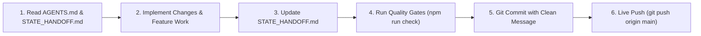
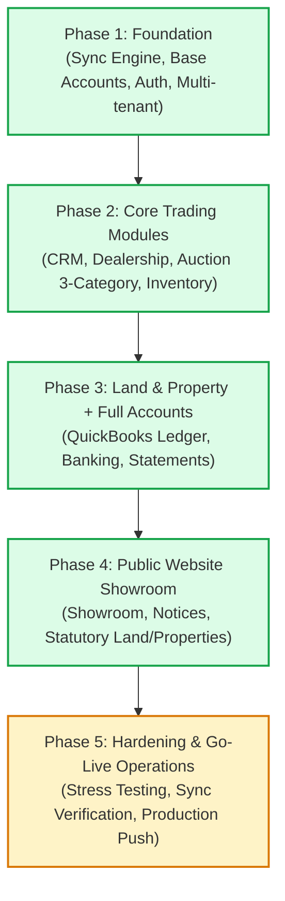

# AmenDesk — State Handoff & Project Continuity

> **MANDATORY FOR ALL AGENTS & DEVELOPERS:**  
> Before writing code, executing commands, or planning modifications, you **MUST** read this file along with [`AGENTS.md`](file:///d:/amendesk/AGENTS.md) and [`amen-mart-erp-website-plan.md`](file:///d:/amendesk/amen-mart-erp-website-plan.md).  
> At the end of every execution, you **MUST** update this file to reflect current phase progress, session changes, and pending tasks before committing and pushing live to GitHub.

---

## 1. Document Overview & Agent Protocol

This file serves as the **living state ledger** and **primary continuity bridge** between agent sessions for AmenDesk. It ensures zero context loss, prevents regression, and enforces adherence to architectural standards.

### Mandatory Agent Workflow


1. **Pre-Execution Check**: Verify current git branch, review recent commit history, and read the latest session log in this document.
2. **Implementation Integrity**: Adhere to Next.js 16 App Router rules, strict TypeScript (`tsconfig.json`), and Tailwind CSS v4 styling standards.
3. **Post-Execution Update**: Update this document with any status changes, newly built features, database schema adjustments, or identified blockers.
4. **Mandatory Quality Gates**:
   ```powershell
   npm run check
   # or equivalently:
   npx tsc --noEmit
   npx eslint "src/**/*.{ts,tsx}" --max-warnings 0
   ```
5. **Mandatory Live Push**: Commit changes using company credentials and push immediately:
   ```powershell
   git push origin main
   ```

---

## 2. Current Environment & Project Snapshot

| Parameter | Current Value | Notes |
|---|---|---|
| **Project Name** | AmenDesk (Amen Mart Auctioning Services) | Offline-First ERP & Website Showroom |
| **Client** | Amen Mart | Ministry of the Interior & Auctioneers Registration Board Authorized |
| **Vendor** | Dev Surge Infotech Ltd. | `devsurgeinfotech@gmail.com` / Martin Cofie |
| **Framework** | Next.js 16.4.1 (App Router) + React 19.3.0 | TurboPack enabled, TypeScript strict mode |
| **Local Database** | Dexie.js 4.4.6 (IndexedDB) | Schema version 2, multi-tenant DB segregation |
| **Styling** | Tailwind CSS v4 | LandingGo slate canvas (`#e9eff5`), solid semantic color cards |
| **Default Port** | `3001` (`package.json` configured) | Avoids conflicts with standard port 3000 |
| **Primary Branch** | `main` | Synchronized with `origin/main` |
| **Current Quality Gate Status** | **100% PASS** (0 TSC errors, 0 ESLint warnings) | Verified via `npm run check` |

### Multi-Tenant Architecture & Database Separation
AmenDesk implements an **Encore SMS-style multi-tenant architecture**:
- **Live Production Tenant (`amen-mart-live`)**: Database `AmenDeskDB_live`. Isolated live records for production yard and cash office.
- **Sandbox Demo Tenant (`amen-mart-sandbox`)**: Database `AmenDeskDB_sandbox`. Cloaked sandbox environment for staging, testing, and staff training with rich seed data.
- **Platform Console (`/platform`)**: Fleet management console for Dev Surge Infotech administrators to provision workspaces, review deployment builds, manage releases, and toggle client tenant accounts.

---

## 3. Phased Implementation Roadmap & Status

Based on the master implementation plan ([`amen-mart-erp-website-plan.md`](file:///d:/amendesk/amen-mart-erp-website-plan.md)), the project roadmap is structured into 5 foundational phases plus auxiliary enterprise modules:



### Phase Breakdown

#### Phase 1: Foundation & Infrastructure — **COMPLETED (100%)**
- [x] Next.js 16 App Router foundation with strict TypeScript compiler options (`noImplicitAny`, `strict`, `noUnusedLocals`).
- [x] Offline-first IndexedDB storage via Dexie.js with typed schema (`src/lib/db/index.ts`).
- [x] Background sync outbox pattern (`src/lib/sync/syncEngine.ts`) with tactile manual cloud sync triggers and status toasts.
- [x] Multi-tenant segregation (`src/lib/types/tenant.ts`, `src/lib/db/env.ts`) separating `AmenDeskDB_live` and `AmenDeskDB_sandbox`.
- [x] Multi-tenant authentication service (`src/lib/auth/authService.ts`) with role-based access control (RBAC) and Google Sign-In enterprise whitelist protection.
- [x] Base Accounts module: Chart of Accounts, seed accounts, journal entry primitives, and multi-mode receipting foundations.

#### Phase 2: Core Trading Modules — **COMPLETED (100%)**
- [x] **Auction Module (`/desk/auctions` & `/desk/auctions/intake`)**:
  - Full support for **3 distinct auction categories**: **Private**, **Government**, and **Judicial**.
  - Dual asset categorization: **Movable** (Vehicles, Machinery, Equipment) and **Immovable** (Land, Buildings).
  - Judicial auction compliance capture: Court case number, Sheriff instruction reference, and court order document attachments.
  - 14-day instalment settlement engine: Deposit calculation, balance due date tracking, extension handling, and overdue flagging.
  - Asset-specific disposal generation: **Waybills** for Movable assets, **Sale/Transfer Documents** for Immovable assets.
- [x] **Car Dealership Module (`/desk/dealership`)**:
  - Direct vehicle sales inventory with VIN/Chassis tracking, landed cost, asking price, and stock status.
  - Multi-photo galleries and offline photo uploads with canvas-based client compression.
- [x] **Inventory Module (`/desk/inventory`)**:
  - Centralized stock view across physical locations (Yard, Showroom, Land/Property Offices).
  - Cross-location stock movement ledger with timestamping, personnel attribution, and transfer notes.
  - Asset stock ledger linking auction lots and dealership vehicles.
- [x] **CRM Module (`/desk/crm`)**:
  - Unified customer profiles across all trading lines (Auction, Dealership, Land, Property).
  - KYC document verification and Ghana Card validation.
  - Lead pipeline, interaction tracking, and balance-due reminder workflows.

#### Phase 3: Land & Property + Full Accounts — **COMPLETED (100%)**
- [x] **Land Module (`/desk/land`)**: Parcel management, site reference, size, location, site plan / indenture attachments, reservation/sales tracking.
- [x] **Property Module (`/desk/property`)**: Unit listings, property types, pricing, sale/lease status, document uploads.
- [x] **Advanced QuickBooks-style Accounting (`/desk/accounts`)**:
  - Standard Chart of Accounts (Assets, Liabilities, Equity, Revenue, Cost of Goods Sold, Operating Expenses).
  - General Journal Entries, automated debits/credits on sales and payments.
  - Expense tracking with classification tags (Accounting Classes & Locations).
  - Cash Shifts & Till Management: Opening float, cash-in/out logging, cash drops, and end-of-shift reconciliation.
  - Bank Deposits: Batching undeposited funds (Cash, MoMo, Bank Transfers) into reconciled bank accounts.
  - Financial Statements: Profit & Loss Statement, Balance Sheet, Trial Balance, and Streamlined 4-Card KPI Overview.
- [x] **Payment Plans & Multi-Mode Receipting (`/desk/payment-plans`, `/desk/payments`)**:
  - Receivables dashboard tracking 14-day balance deadlines, active payment plans, and overdue receivables.
  - 80mm Thermal Receipt Generator with browser print styling for front-desk receipt printers.
  - Formal A4 invoice and A5 waybill print layouts.

#### Phase 4: Public Website Showroom — **COMPLETED (100%)**
- [x] **Public Portal (`/`)**:
  - Premium light-theme layout with architectural hairline-divided trust strip for hero KPIs.
  - Statutory compliance badges (Ministry of the Interior, Auctioneers Registration Board, Ghana Auctioneers Association).
  - Ghana flag top announcement strip and navigation header.
- [x] **Vehicle Showroom (`/showroom`)**:
  - Direct live sync with ERP Dealership inventory.
  - Filterable by make, price range, fuel type, transmission, and availability status.
  - Vehicle modal with interactive photo gallery and direct inquiry lead capture.
- [x] **Auction Notices (`/auctions`)**:
  - Public auction calendar pulling active notices from the ERP Auction module.
  - Filterable by category (Private, Government, Judicial) and asset scope (Movable, Immovable).
  - Judicial court order notices, asset specifications, and lot inspection details.
- [x] **Land & Property Showcases (`/land`, `/properties`)**:
  - Parcel listings with site plan documentation and inquiry forms.
  - Property unit showcases with specifications and direct inquiry integration.
- [x] **About & Contact (`/about`, `/contact`)**:
  - Official Amen Mart leadership, licensing, Accra head office physical location, postal address, and GAA affiliation.

#### Phase 5: Hardening, Verification & Go-Live Operations — **IN PROGRESS**
- [x] Husky pre-commit hooks and lint-staged pipeline active (`.husky/pre-commit`).
- [x] Multi-tenant isolation verified with zero bleed between Sandbox and Live databases.
- [x] Data portability hub (`/desk/migration`) supporting JSON/CSV backup exports and bulk data ingestion.
- [ ] Multi-device concurrent sync stress testing across simulated low-bandwidth Ghana cellular connections (Hubtel/MTN).
- [ ] End-to-end Paystack card deposit subaccount integration testing in live environment.
- [ ] Final yard staff acceptance testing and thermal printer hardware pairing checks.

---

## 4. Module & Route Navigation Index

| Route | Module | Purpose | Status |
|---|---|---|---|
| `/` | Public Home | Brand showcase, hero trust metrics, corporate credibility | ✅ Active |
| `/showroom` | Public Showroom | Dealership vehicle inventory for public buyers | ✅ Active |
| `/auctions` | Public Auctions | Public notices for Private, Government, Judicial auctions | ✅ Active |
| `/land` | Public Land | Land parcels, site plans, inquiry forms | ✅ Active |
| `/properties` | Public Property | Residential & commercial property units | ✅ Active |
| `/news` | Public News | Statutory notices, press releases, GAA updates | ✅ Active |
| `/blog` | Public Blog | Buyer guides, judicial auction rules, auto advice | ✅ Active |
| `/about` | Public About | Licensing, statutory authorizations, company background | ✅ Active |
| `/contact` | Public Contact | Office location, phone, email, direct inquiry lead generation | ✅ Active |
| `/login` | Auth Portal | Light-themed Google sign-in & tenant account selection | ✅ Active |
| `/platform` | Dev Surge Console | Fleet operations, tenant provisioning, system releases | ✅ Active |
| `/desk` | ERP Dashboard | Operations matrix, collections velocity, aging charts | ✅ Active |
| `/desk/auctions` | Auction Management | Event planning, lot intake, bidding, waybills | ✅ Active |
| `/desk/auctions/intake` | Auction Intake | Lot intake wizard (3 categories, movable/immovable) | ✅ Active |
| `/desk/dealership` | Dealership Stock | Direct vehicle sales, specs, photo galleries | ✅ Active |
| `/desk/inventory` | Inventory Ledger | Multi-location stock tracking, transfers, auditing | ✅ Active |
| `/desk/land` | Land Desk | Parcel records, site plans, buyer checklists | ✅ Active |
| `/desk/property` | Property Desk | Unit listings, sales/leases, document attachments | ✅ Active |
| `/desk/crm` | Customer Relations | Unified profiles, KYC Ghana Card verification, reminders | ✅ Active |
| `/desk/accounts` | Accounts & Finance | QuickBooks ledger, P&L, balance sheet, cash shifts | ✅ Active |
| `/desk/payment-plans` | Payment Plans | 14-day instalment engine, balance due dates, extensions | ✅ Active |
| `/desk/payments` | Cash Office | Multi-mode receipting (Cash, MoMo, Bank, Card), thermal receipts | ✅ Active |
| `/desk/settings` | Workspace Settings | Margin defaults, deposit %, staff invitations, permissions | ✅ Active |
| `/desk/migration` | Data Hub | CSV data ingestion, backup export/import portability | ✅ Active |

---

## 5. Architectural & Technical Conventions

### 1. Offline-First Principles
- All ERP read/write operations execute against local Dexie IndexedDB first.
- Primary keys are generated deterministically or via unique client identifiers (e.g., `AM-RCP-2026-XXXX`, `AM-WAY-2026-XXXX`).
- Transactions write to `syncOutbox` table with pending status, ensuring zero data loss during network dropouts.
- Thermal receipt and waybill printing MUST never depend on active network connectivity.

### 2. Strict UI & Styling Guidelines
- **Canvas**: LandingGo slate `#e9eff5` for root backgrounds; pure white `#ffffff` cards for content surfaces.
- **Card Styling**: Thin subtle border (`border-slate-200/80` or `hover:border-indigo-500/40`), subtle shadows, rounded-xl/2xl geometry.
- **KPI Metrics**: Pure solid soft-tinted backgrounds for metric badges (e.g., emerald, amber, rose, sky).
- **Public Showroom Theme**: Light theme is mandatory by default across public pages.

### 3. Quality & Git Protocols
- Pre-commit Husky hook runs `lint-staged` with `--max-warnings 0`.
- All agents must execute `npm run check` before committing.
- Live Git Push is strictly mandatory at the end of every agent task:
  - Commit identity: `Martin Cofie` <`devsurgeinfotech@gmail.com`>
  - Remote: `git push origin main`

---

## 6. Execution History & Session Changelog

### Session: 2026-10-24 (World-Standard Light-Theme Login Pedestal Overhaul)
- **Goal**: Enhance `/login` ([`src/app/login/page.tsx`](file:///d:/amendesk/src/app/login/page.tsx)) to enforce a dedicated, world-standard light theme without any demo or showroom links.
- **Accomplishments**:
  - Enforced strict light-theme rendering (`light` root scope with zero `dark:` overrides) so `/login` always renders in a luminous, high-contrast light palette regardless of previous browser `localStorage` dark-mode state, ensuring the official Amen Mart navy & gold logo (`/amenmart-logo.svg`) is always razor-sharp.
  - Engineered a double-bezel pedestal card architecture (`rounded-[28px] bg-white/65 p-2 backdrop-blur-xl` outer frame wrapping a crisp `rounded-[22px] bg-white` inner surface card) over a radial-masked architectural grid and porcelain-slate canvas (`#eef2f6`).
  - Refined form ergonomics with leading `Mail` and `Lock` input icons, executive Amen Mart Navy (`#0B1F3A`) focus rings and primary CTA button, and replaced the legacy `pastor@graceacc.org` placeholder with `name@amenmart.com`.
  - Removed all demo/test account shortcuts and ensured zero links to Demo or Showroom exist on the login page or within the Google SSO modal.
  - Ran mandatory quality gates: `npm run check` passing 100% (0 TSC errors, 0 ESLint warnings).
- **Changed Files**:
  - `src/app/login/page.tsx` (Redesigned into a world-standard light-theme pedestal login experience)
  - `STATE_HANDOFF.md` (Updated session changelog)

### Session: 2026-10-24 (Homepage & About Us Deduplication and Cognitive Load Reduction)
- **Goal**: Eliminate duplicate "About Us" copy from the Homepage ([`src/app/(site)/page.tsx`](file:///d:/amendesk/src/app/%28site%29/page.tsx)) and streamline both the Homepage and About Us page ([`src/app/(site)/about/page.tsx`](file:///d:/amendesk/src/app/%28site%29/about/page.tsx)) to reduce cognitive overload.
- **Accomplishments**:
  - Removed duplicated "About Us" sections from [`src/app/(site)/page.tsx`](file:///d:/amendesk/src/app/%28site%29/page.tsx), including the 3-card narrative block (*"Looking for Auctions Near Me?"*, *"Ghana's Auction Market Is Booming"*, *"Bid From Anywhere Online"*) and the 5-card *"Why Thousands Trust Amen Mart Auctioning Services"* block.
  - Replaced the duplicated About Us narrative paragraph in the Homepage Hero with a concise, action-oriented single-sentence subtitle and streamlined the Hero CTAs to focus on `View Upcoming Auctions` and `Explore Car Showroom`.
  - Tightened the 4 Core Business Lines cards on the Homepage for immediate scanability before live Showroom Stock and Upcoming Auction Notices.
  - Streamlined [`src/app/(site)/about/page.tsx`](file:///d:/amendesk/src/app/%28site%29/about/page.tsx) by removing internal repetition across multiple prose sections, consolidating into a clean statutory hero, Dr. Francis Kwaku Yeboah's leadership profile, and 4 concise core strength cards.
  - Ran mandatory quality gates: `npm run check` passing 100% (0 TSC errors, 0 ESLint warnings).
- **Changed Files**:
  - `src/app/(site)/page.tsx` (Removed duplicated About Us notes, simplified Hero and Core Business Lines)
  - `src/app/(site)/about/page.tsx` (Streamlined About Us content to eliminate internal redundancy and text walls)
  - `STATE_HANDOFF.md` (Updated session changelog)

### Session: 2026-10-24 (Homepage KPI Overhaul & Standard Enterprise KPI Re-Enhancement)
- **Goal**: Overhaul and re-enhance the homepage KPI section ([`HeroKpis.tsx`](file:///d:/amendesk/src/components/site/HeroKpis.tsx)) from non-standard pastel feature boxes into standard enterprise KPI cards.
- **Accomplishments**:
  - Removed the redundant outer box-in-box wrapper and stripped the non-standard full-card pastel yellow/blue/green/purple backgrounds (`from-amber-50/60`, `from-indigo-50/60`, `from-emerald-50/60`, `from-violet-50/60`).
  - Established pure white `#ffffff` (`bg-white dark:bg-slate-900`) `.surface-card` KPI cards with crisp slate border definition and physical elevation shadow (`shadow-[0_4px_20px_-4px_rgba(15,23,42,0.07),0_2px_6px_-1px_rgba(15,23,42,0.04)]`).
  - Re-architected each card into a disciplined 3-zone standard KPI layout:
    1. **Row 1 (KPI Header)**: Uppercase eyebrow metric category (`Industry Track Record`, `Statutory Mandate`, `Bidding Infrastructure`, `Title & Deed Assurance`) + subtitle on top-left, paired with a soft-tinted semantic icon badge (`h-10 w-10 rounded-xl`) on top-right.
    2. **Row 2 (Primary KPI Metric Figure & Verification Pill)**: Unified, high-contrast `text-slate-900 dark:text-white` tabular metric figures (`10+ Years`, `GAA Licensed`, `Accra & Online`, `100% Clear`) with smooth `AnimatedCounter` on `10+` and `100%`, eliminating split multi-colored words, paired with compact inline verification pills (`Decade+`, `Accredited`, `Live Active`, `Verified`).
    3. **Row 3 (KPI Benchmark Bar & Metadata Footer)**: Replaced bloated multi-line prose paragraphs and redundant footer links with a sleek semantic KPI progress/compliance bar (`h-1.5 rounded-full`) and a structured single-line key-value metadata row.
  - Refined the Hero section backdrop gradient in [`src/app/(site)/page.tsx`](file:///d:/amendesk/src/app/(site)/page.tsx) (`to-[#e9eff5]/80`) to ensure crisp contrast behind the pure white KPI cards.
  - Ran mandatory quality gates: `npm run check` passing 100% (0 TSC errors, 0 ESLint warnings).
- **Changed Files**:
  - `src/components/site/HeroKpis.tsx` (Complete overhaul and re-enhancement to standard enterprise KPI card architecture)
  - `src/app/(site)/page.tsx` (Aligned hero bottom canvas gradient for pure white KPI card contrast)
  - `STATE_HANDOFF.md` (Updated session changelog)

### Session: 2026-10-24 (Platform Console Decoupling & Recoverable Error Fix)
- **Goal**: Resolve recoverable error in `/platform` route where Turbopack encountered an invalid module factory for `Car` required by `SiteHeader.tsx`.
- **Root Cause Analysis**:
  - The fleet management console at [`/platform`](file:///d:/amendesk/src/app/platform/page.tsx) imported `{ GhanaFlag }` from [`SiteHeader.tsx`](file:///d:/amendesk/src/components/site/SiteHeader.tsx).
  - An earlier navigation refinement removed the unused `Car` icon from `SiteHeader.tsx`.
  - When the client browser visited `/platform`, Next.js Turbopack had a stale module graph cache linking `SiteHeader.tsx`'s evaluation to `car.mjs`.
  - Importing the public site header into an administrative console created an architectural code smell and cross-module entanglement.
- **Accomplishments**:
  - Extracted the national flag SVG into a dedicated, self-contained component [`GhanaFlag.tsx`](file:///d:/amendesk/src/components/ui/GhanaFlag.tsx).
  - Decoupled [`/platform/page.tsx`](file:///d:/amendesk/src/app/platform/page.tsx) from `SiteHeader.tsx`, importing directly from `@/components/ui/GhanaFlag`.
  - Maintained backwards compatibility by re-exporting `GhanaFlag` from `SiteHeader.tsx`.
  - Ran mandatory quality gates: `tsc --noEmit` and strict `eslint` passed with 0 errors and 0 warnings.
- **Changed Files**:
  - `src/components/ui/GhanaFlag.tsx` (Created dedicated GhanaFlag component)
  - `src/components/site/SiteHeader.tsx` (Re-exported GhanaFlag from ui directory)
  - `src/app/platform/page.tsx` (Decoupled from SiteHeader, imported from ui/GhanaFlag)
  - `STATE_HANDOFF.md` (Updated session changelog)

### Session: 2026-10-24 (Login Surface Contrast & Streamlined Clean UI)
- **Goal**: Remediate login surface card blending into surrounding slate canvas and strip non-instructed auxiliary elements (Quick Test Access drawer, footer badges row, and extra top chrome) per user directive.
- **Accomplishments**:
  - Replaced washed-out `#F4F7FB` background with LandingGo architectural slate gradient (`from-[#edf2f7] via-[#e4ebf3] to-[#d8e2ec]` in light mode, `dark:from-slate-950 dark:via-slate-900 dark:to-slate-950`).
  - Added subtle architectural dot-matrix canvas texture and atmospheric lighting highlights to provide physical depth and clear contrast behind the card.
  - Enhanced the login card with multi-layered physical elevation shadow (`shadow-[0_22px_60px_-15px_rgba(15,23,42,0.18),0_10px_25px_-5px_rgba(15,23,42,0.08),0_0_0_1px_rgba(15,23,42,0.06)]`), razor-sharp border definition, and top brand gradient accent ribbon (`from-amber-500 via-[#4A154B] to-indigo-600`).
  - Removed all non-instructed widgets: Quick Test Access drawer, footer trust badges line, top utility bar, and card badge, restoring pristine minimalist focus.
  - Retained clean statutory copyright footer and standard login form ergonomics.
  - Ran mandatory quality gates: `npm run check` passing 100% (0 TSC errors, 0 ESLint warnings).
- **Changed Files**:
  - `src/app/login/page.tsx` (Remediated card surface contrast and elevation, removed Quick Test Access and footer badges, kept clean minimalist interface)
  - `STATE_HANDOFF.md` (Updated session changelog)

### Session: 2026-10-24 (Quick Action Command Hub Floating Tooltips)
- **Goal**: Add accessible, responsive floating tooltips to all 6 command buttons in the Speed Operations Quick Action Command Hub to bring out hidden/truncated words.
- **Accomplishments**:
  - Enhanced [`src/components/erp/dashboard/QuickActionBar.tsx`](file:///d:/amendesk/src/components/erp/dashboard/QuickActionBar.tsx) with a data-driven configuration model (`QuickActionConfig`).
  - Added high-contrast, backdrop-blurred floating tooltips (`role="tooltip"`) displaying the complete untruncated command titles and operational subtitles on hover and keyboard focus (`group-focus-visible`).
  - Implemented responsive edge-aware positioning (`tooltipPos` and `arrowPos`) preventing viewport clipping on mobile 2-column, tablet 3-column, and desktop 6-column layouts.
  - Added explicit screen-reader accessibility via descriptive `aria-label` attributes on both buttons and navigation links.
  - Passed all strict quality gates: `npm run check` (TypeScript typecheck + ESLint strict) with 0 errors and 0 warnings.
- **Changed Files**:
  - `src/components/erp/dashboard/QuickActionBar.tsx` (Added accessible floating tooltips and data-driven command actions)
  - `STATE_HANDOFF.md` (Updated continuity ledger with session changelog)
- **Commit Reference**: Pending live git commit & push.

### Session: 2026-10-24 (Earlier Session — Megamenu, Navigation & Content Cleanup)
- **Goal**: Realign site navigation megamenu, remove redundant links, strip duplicate top flag badge, and add dedicated News & Blog modules.
- **Accomplishments**:
  - Removed "Staff Login" from [`SiteHeader.tsx`](file:///d:/amendesk/src/components/site/SiteHeader.tsx) and "Staff ERP Terminal Login" from [`SiteFooter.tsx`](file:///d:/amendesk/src/components/site/SiteFooter.tsx) per isolated DNS routing policy.
  - Aligned all navigation links and the "Explore Showroom" button on a clean single line with `whitespace-nowrap shrink-0`, preventing text wrapping and misaligned multi-line tabs.
  - Removed duplicate center `GH` badge from top announcement strip while retaining the statutory `GHANA` national flag badge on the far right.
  - Removed redundant "Car Showroom" link from desktop and mobile navigation menus (nav points directly via the dedicated "Explore Showroom" CTA).
  - Added "News" and "Blog" navigation entries and built dedicated production-ready public pages at [`/news`](file:///d:/amendesk/src/app/(site)/news/page.tsx) and [`/blog`](file:///d:/amendesk/src/app/(site)/blog/page.tsx) with category filtering, modal viewers, and Ghana auction industry insights.
  - Updated [`SiteFooter.tsx`](file:///d:/amendesk/src/components/site/SiteFooter.tsx) Quick Links to reference News and Blog pages.
  - Ran mandatory quality gates: `npm run check` passing with 0 TypeScript compiler errors and 0 ESLint warnings.
- **Changed Files**:
  - `src/components/site/SiteHeader.tsx` (Realigned single-line navigation, removed staff login and car showroom, removed center GH badge, added News and Blog)
  - `src/components/site/SiteFooter.tsx` (Removed staff login, linked News and Blog guides)
  - `src/app/(site)/news/page.tsx` (Created official news, statutory gazettes, and press releases portal)
  - `src/app/(site)/blog/page.tsx` (Created auction and vehicle buying guides blog portal)
  - `STATE_HANDOFF.md` (Updated route index and session history)

### Session: 2026-10-24 (Earlier Session)
- **Goal**: Implement project-wide state handoff governance and continuity protocol.
- **Accomplishments**:
  - Created root [`STATE_HANDOFF.md`](file:///d:/amendesk/STATE_HANDOFF.md) establishing comprehensive project status, module index, architecture conventions, and roadmap tracking.
  - Updated [`AGENTS.md`](file:///d:/amendesk/AGENTS.md) with mandatory `<!-- BEGIN:state-handoff-rules -->` protocol requiring pre-execution reading and post-execution updates by all agents.
  - Cross-referenced phase execution states against master plan [`amen-mart-erp-website-plan.md`](file:///d:/amendesk/amen-mart-erp-website-plan.md).
  - Verified all quality gates pass: `npm run check` (TypeScript typecheck + ESLint strict) with 0 errors and 0 warnings.
- **Changed Files**:
  - `STATE_HANDOFF.md` (Created living state ledger)
  - `AGENTS.md` (Added mandatory state handoff protocol)
  - `README.md` (Added project overview, agent rules, and documentation links)
  - `NEW-PROJECT-AGENT-SETUP.md` (Updated agent setup checklist)
- **Commit Reference**: `228a9b5` (docs(handoff): establish STATE_HANDOFF.md protocol and align AGENTS.md continuity governance)

### Previous Notable Milestones
- `de6a2f8`: Added workspace settings, staff invitations, and platform console for fleet management.
- `44569d0`: Fixed auth session caching in `useSyncExternalStore` to eliminate render loops.
- `5fa2d5d`: Redesigned platform console and provisioned Amen Mart live and demo sandbox accounts.
- `675d60a`: Integrated Google Sign-In with enterprise domain whitelist verification.
- `8e47cf7`: Enforced complete isolation of production (`amen-mart-live`) from sandbox (`amen-mart-sandbox`).
- `7f0570b`: Completed 12 audit remediations for accounting, mock data, and workflow compliance.
- `2ae0612`: Implemented QuickBooks accounting dimensions, banking, cash shifts, and financial reports.
- `2151dfc`: Integrated interactive SVG dashboard charts, quick action hub, and A5 waybill print layouts.
- `d4031e9`: Completed core AmenDesk offline ERP modules and public showroom website.

---

## 7. Immediate Next Steps & Priority Backlog

For the next incoming agent, prioritize the following tasks in Phase 5:

1. **Paystack Direct Subaccount Webhook Verification**:
   - Verify server-side payment callback handler for Paystack card deposits on website showroom inquiries.
   - Ensure transaction settlement records write to undeposited funds in the Accounts ledger.

2. **Network Resilience & Outbox Stress Testing**:
   - Run simulated offline scenarios where multiple transactions (Receipts, Waybills, Invoices) are created in disconnected mode.
   - Verify smooth batch reconciliation when manual or automatic cloud sync is triggered.

3. **Multi-location Stock Count Reconciliation Tool**:
   - In `/desk/inventory`, enhance physical stock audit workflow to calculate physical vs system count variances and generate journal adjustment entries.

4. **Continuous Quality Gate Maintenance**:
   - Always run `npm run check` before any commit and push changes live to `origin main`.

---

## 8. Agent Instructions for Updating This File

When completing your session:
1. Append your session summary to **Section 6: Execution History & Session Changelog**.
2. If any roadmap item or phase transitioned in status, update **Section 3: Phased Implementation Roadmap & Status**.
3. If new routes, tables, or architecture patterns were added, update **Section 2, 4, or 5**.
4. Update **Section 7: Immediate Next Steps & Priority Backlog** with refreshed priorities.
5. Save this file, run `npm run check`, commit, and push live to GitHub.
