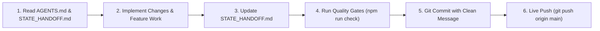
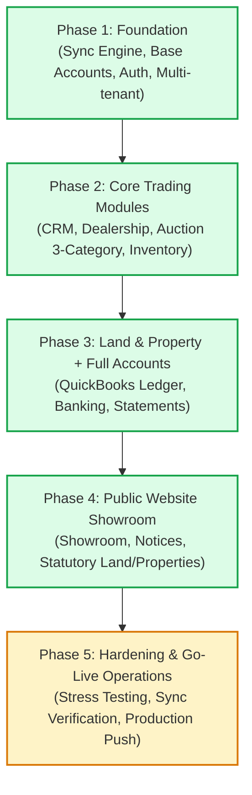

# AmenDesk — State Handoff & Project Continuity

> **MANDATORY FOR ALL AGENTS & DEVELOPERS:**  
> Before writing code, executing commands, or planning modifications, you **MUST** read this file along with [`AGENTS.md`](file:///d:/amendesk/AGENTS.md) and [`amen-mart-erp-website-plan.md`](file:///d:/amendesk/amen-mart-erp-website-plan.md).  
> At the end of every execution, you **MUST** update this file to reflect current phase progress, session changes, and pending tasks before committing and pushing live to GitHub.

---

## 1. Document Overview & Agent Protocol

This file serves as the **living state ledger** and **primary continuity bridge** between agent sessions for AmenDesk. It ensures zero context loss, prevents regression, and enforces adherence to architectural standards.

### Mandatory Agent Workflow


1. **Pre-Execution Check**: Verify current git branch, review recent commit history, and read the latest session log in this document.
2. **Implementation Integrity**: Adhere to Next.js 16 App Router rules, strict TypeScript (`tsconfig.json`), and Tailwind CSS v4 styling standards.
3. **Post-Execution Update**: Update this document with any status changes, newly built features, database schema adjustments, or identified blockers.
4. **Mandatory Quality Gates**:
   ```powershell
   npm run check
   # or equivalently:
   npx tsc --noEmit
   npx eslint "src/**/*.{ts,tsx}" --max-warnings 0
   ```
5. **Mandatory Live Push**: Commit changes using company credentials and push immediately:
   ```powershell
   git push origin main
   ```

---

## 2. Current Environment & Project Snapshot

| Parameter | Current Value | Notes |
|---|---|---|
| **Project Name** | AmenDesk (Amen Mart Auctioning Services) | Offline-First ERP & Website Showroom |
| **Client** | Amen Mart | Ministry of the Interior & Auctioneers Registration Board Authorized |
| **Vendor** | Dev Surge Infotech Ltd. | `devsurgeinfotech@gmail.com` / Martin Cofie |
| **Framework** | Next.js 16.4.1 (App Router) + React 19.3.0 | TurboPack enabled, TypeScript strict mode |
| **Local Database** | Dexie.js 4.4.6 (IndexedDB) | Schema version 2, multi-tenant DB segregation |
| **Styling** | Tailwind CSS v4 | LandingGo slate canvas (`#e9eff5`), solid semantic color cards |
| **Default Port** | `3001` (`package.json` configured) | Avoids conflicts with standard port 3000 |
| **Primary Branch** | `main` | Synchronized with `origin/main` |
| **Current Quality Gate Status** | **100% PASS** (0 TSC errors, 0 ESLint warnings) | Verified via `npm run check` |

### Multi-Tenant Architecture & Sandbox Access Policy
AmenDesk implements an **Encore SMS-style multi-tenant architecture** with a strict security access rule:
- **Live Production Tenant (`amen-mart-live`)**: Database `AmenDeskDB_live`. The sole operating environment for all Amen Mart operational staff, management, yard officers, and front-desk cashiers. Maintained as a pristine **clean slate**: all 50 statutory COA accounts start at `GH₵ 0.00` balance, with 0 demo auction lots, dealership vehicles, land parcels, properties, expenses, invoices, payroll runs, seed employees, or mock customers. Automatically protected by `ensureLiveCleanSlate()` on boot, with one-click Client Handover Clean Slate tools in Settings and Migration.
- **Developer Sandbox (`amen-mart-sandbox`)**: Database `AmenDeskDB_sandbox`. Cloaked staging, feature testing, and regression verification workspace strictly reserved for Dev Surge Infotech developers (`@devsurge.io` / `devsurgeinfotech@gmail.com`). **Staff of Amen Mart have ZERO access to the sandbox.** Attempting to sign into the sandbox with an Amen Mart staff credential is hard-blocked at the auth layer.
- **Platform Console (`/platform`)**: Fleet management console for Dev Surge Infotech administrators to provision workspaces, review deployment builds, manage releases, and toggle client tenant accounts. Locked behind the Dev Surge master passcode; Amen Mart staff accounts cannot unlock this console.

---

## 3. Phased Implementation Roadmap & Status

Based on the master implementation plan ([`amen-mart-erp-website-plan.md`](file:///d:/amendesk/amen-mart-erp-website-plan.md)), the project roadmap is structured into 5 foundational phases plus auxiliary enterprise modules:



### Phase Breakdown

#### Phase 1: Foundation & Infrastructure — **COMPLETED (100%)**
- [x] Next.js 16 App Router foundation with strict TypeScript compiler options (`noImplicitAny`, `strict`, `noUnusedLocals`).
- [x] Offline-first IndexedDB storage via Dexie.js with typed schema (`src/lib/db/index.ts`).
- [x] Background sync outbox pattern (`src/lib/sync/syncEngine.ts`) with tactile manual cloud sync triggers and status toasts.
- [x] Multi-tenant segregation (`src/lib/types/tenant.ts`, `src/lib/db/env.ts`) separating `AmenDeskDB_live` and `AmenDeskDB_sandbox`.
- [x] Multi-tenant authentication service (`src/lib/auth/authService.ts`) with role-based access control (RBAC) and Google Sign-In enterprise whitelist protection.
- [x] Base Accounts module: Chart of Accounts, seed accounts, journal entry primitives, and multi-mode receipting foundations.

#### Phase 2: Core Trading Modules — **COMPLETED (100%)**
- [x] **Auction Module (`/desk/auctions` & `/desk/auctions/intake`)**:
  - Full support for **3 distinct auction categories**: **Private**, **Government**, and **Judicial**.
  - Dual asset categorization: **Movable** (Vehicles, Machinery, Equipment) and **Immovable** (Land, Buildings).
  - Judicial auction compliance capture: Court case number, Sheriff instruction reference, and court order document attachments.
  - 14-day instalment settlement engine: Deposit calculation, balance due date tracking, extension handling, and overdue flagging.
  - Asset-specific disposal generation: **Waybills** for Movable assets, **Sale/Transfer Documents** for Immovable assets.
- [x] **Car Dealership Module (`/desk/dealership`)**:
  - Direct vehicle sales inventory with VIN/Chassis tracking, landed cost, asking price, and stock status.
  - Multi-photo galleries and offline photo uploads with canvas-based client compression.
- [x] **Inventory Module (`/desk/inventory`)**:
  - Centralized stock view across physical locations (Yard, Showroom, Land/Property Offices).
  - Cross-location stock movement ledger with timestamping, personnel attribution, and transfer notes.
  - Asset stock ledger linking auction lots and dealership vehicles.
- [x] **CRM Module (`/desk/crm`)**:
  - Unified customer profiles across all trading lines (Auction, Dealership, Land, Property).
  - Dedicated **Inbound Inquiries & Leads Pipeline (`/desk/crm?filter=INQUIRIES`)** with direct Call (`tel:`), WhatsApp (`wa.me`), and Email (`mailto:`) quick actions, lead status management (`NEW`, `CONTACTED`, `RESOLVED`, `CONVERTED`), and Ghana Card KYC conversion modal.
  - Universal Inbound Lead Handler (`src/lib/crm/leads.ts`) dispatching to Server API Bridge (`/api/inquiries`), dual-tenant IndexedDB write (`AmenDeskDB_live` and `AmenDeskDB_sandbox`), real-time `BroadcastChannel` synchronization, and background polling.
  - KYC document verification and Ghana Card validation.
  - Lead pipeline, interaction tracking, and balance-due reminder workflows.

#### Phase 3: Land & Property + Full Accounts — **COMPLETED (100%)**
- [x] **Land Module (`/desk/land`)**: Parcel management, site reference, size, location, site plan / indenture attachments, reservation/sales tracking.
- [x] **Property Module (`/desk/property`)**: Unit listings, property types, pricing, sale/lease status, document uploads.
- [x] **Advanced QuickBooks-style Accounting (`/desk/accounts`)**:
  - Standard Chart of Accounts (Assets, Liabilities, Equity, Revenue, Cost of Goods Sold, Operating Expenses).
  - General Journal Entries, automated debits/credits on sales and payments.
  - Expense tracking with classification tags (Accounting Classes & Locations).
  - Cash Shifts & Till Management: Opening float, cash-in/out logging, cash drops, and end-of-shift reconciliation.
  - Bank Deposits: Batching undeposited funds (Cash, MoMo, Bank Transfers) into reconciled bank accounts.
  - Financial Statements: Profit & Loss Statement, Balance Sheet, Trial Balance, and Streamlined 4-Card KPI Overview.
- [x] **Payment Plans & Multi-Mode Receipting (`/desk/payment-plans`, `/desk/payments`)**:
  - Receivables dashboard tracking 14-day balance deadlines, active payment plans, and overdue receivables.
  - 80mm Thermal Receipt Generator with browser print styling for front-desk receipt printers.
  - Formal A4 invoice and A5 waybill print layouts.

#### Phase 4: Public Website Showroom — **COMPLETED (100%)**
- [x] **Public Portal (`/`)**:
  - Premium light-theme layout with architectural hairline-divided trust strip for hero KPIs.
  - Statutory compliance badges (Ministry of the Interior, Auctioneers Registration Board, Ghana Auctioneers Association).
  - Ghana flag top announcement strip and navigation header.
- [x] **Vehicle Showroom (`/showroom`)**:
  - Direct live sync with ERP Dealership inventory.
  - Filterable by make, price range, fuel type, transmission, and availability status.
  - Vehicle modal with interactive photo gallery and direct inquiry lead capture.
- [x] **Auction Notices (`/auctions`)**:
  - Public auction calendar pulling active notices from the ERP Auction module.
  - Filterable by category (Private, Government, Judicial) and asset scope (Movable, Immovable).
  - Judicial court order notices, asset specifications, and lot inspection details.
- [x] **Land & Property Showcases (`/land`, `/properties`)**:
  - Parcel listings with site plan documentation and inquiry forms.
  - Property unit showcases with specifications and direct inquiry integration.
- [x] **About & Contact (`/about`, `/contact`)**:
  - Official Amen Mart leadership, licensing, Accra head office physical location, postal address, and GAA affiliation.

#### Phase 5: Hardening, Verification & Go-Live Operations — **IN PROGRESS**
- [x] Husky pre-commit hooks and lint-staged pipeline active (`.husky/pre-commit`).
- [x] Multi-tenant isolation verified with zero bleed between Sandbox and Live databases.
- [x] Live Production Clean Slate Handover Remediation completed: all 50 COA accounts initialized with GH₵ 0.00 balances, zero seed operational data bleed, automatic boot sanitization (`ensureLiveCleanSlate`), and one-click Handover Clean Slate tools in Settings and Migration.
- [x] Public website catalog empty states implemented across showroom, auctions, land, and properties for clean presentation prior to live staff entry.
- [x] Data portability hub (`/desk/migration`) supporting JSON/CSV backup exports and bulk data ingestion.
- [ ] Multi-device concurrent sync stress testing across simulated low-bandwidth Ghana cellular connections (Hubtel/MTN).
- [ ] End-to-end Paystack card deposit subaccount integration testing in live environment.
- [ ] Final yard staff acceptance testing and thermal printer hardware pairing checks.

#### Auxiliary Module: HR & Payroll Engine (Ghana Statutory Compliance & Salaried Staff Management) — **COMPLETED (100%)**
- [x] Comprehensive Master Implementation Plan curated and refined ([`amen-mart-hr-payroll-plan.md`](file:///d:/amendesk/amen-mart-hr-payroll-plan.md)).
- [x] Salaried-only workforce architecture implemented (`/desk/hr`): All operational, yard, administrative, showroom, and auction-day duties are performed exclusively by full-time salaried staff (no casual pay rates, no casual muster rolls, and no staff sales commissions).
- [x] Corporate business-line fee rule codified: Car Dealership is Amen Mart's own direct business (no 7% auction fee), whereas the 7% statutory auction fee applies across all auctions (cars, property, collectibles).
- [x] Ghana statutory tax & pension engine implemented ([`src/lib/hr/payrollEngine.ts`](file:///d:/amendesk/src/lib/hr/payrollEngine.ts)): GRA PAYE Act 896 graduated tax bands (0%–35%), SSNIT Act 766 Tier 1 (13.5% total: 13.0% employer + 0.5% employee), generic Tier 2 (5.0% employee deduction without locking to a specific trustee), and optional Tier 3 voluntary.
- [x] Direct Hubtel API automated Mobile Money execution implemented ([`src/app/api/payroll/hubtel-disburse/route.ts`](file:///d:/amendesk/src/app/api/payroll/hubtel-disburse/route.ts)) for monthly salary disbursements alongside commercial bank transfers.
- [x] Dexie.js Schema v5 evolution implemented ([`src/lib/db/index.ts`](file:///d:/amendesk/src/lib/db/index.ts)): `employees`, `payrollRuns`, `payrollSlips`, `staffAttendance`, `leaveRequests`.
- [x] QuickBooks-style double-entry accounting integration implemented ([`src/lib/hr/payrollLedgerSync.ts`](file:///d:/amendesk/src/lib/hr/payrollLedgerSync.ts)): `acc-2150` (GRA PAYE Payable), `acc-2160` (SSNIT Tier 1 Payable), `acc-2170` (Tier 2 Occupational Pension Payable), `acc-2180` (Accrued Net Salaries), `acc-6080` (Staff Salaries & Allowances), `acc-6085` (Employer SSNIT Expense).
- [x] Dual A4 Executive & 80mm POS Thermal Payslip Generator ([`src/components/erp/hr/PayslipModal.tsx`](file:///d:/amendesk/src/components/erp/hr/PayslipModal.tsx)) and GRA DT 0107 / SSNIT CSV exporters.

---

## 4. Module & Route Navigation Index

| Route | Module | Purpose | Status |
|---|---|---|---|
| `/` | Public Home | Brand showcase, hero trust metrics, corporate credibility | ✅ Active |
| `/showroom` | Public Showroom | Dealership vehicle inventory for public buyers | ✅ Active |
| `/auctions` | Public Auctions | Public notices for Private, Government, Judicial auctions | ✅ Active |
| `/land` | Public Land | Land parcels, site plans, inquiry forms | ✅ Active |
| `/properties` | Public Property | Residential & commercial property units | ✅ Active |
| `/news` | Public News | Statutory notices, press releases, GAA updates | ✅ Active |
| `/blog` | Public Blog | Buyer guides, judicial auction rules, auto advice | ✅ Active |
| `/about` | Public About | Licensing, statutory authorizations, company background | ✅ Active |
| `/contact` | Public Contact | Office location, phone, email, direct inquiry lead generation | ✅ Active |
| `/login` | Auth Portal | Light-themed Google sign-in & tenant account selection | ✅ Active |
| `/platform` | Dev Surge Console | Fleet operations, tenant provisioning, system releases | ✅ Active |
| `/desk` | ERP Dashboard | Operations matrix, collections velocity, aging charts | ✅ Active |
| `/desk/auctions` | Auction Management | Event planning, lot intake, bidding, waybills | ✅ Active |
| `/desk/auctions/intake` | Auction Intake | Lot intake wizard (3 categories, movable/immovable) | ✅ Active |
| `/desk/dealership` | Dealership Stock | Direct vehicle sales, specs, photo galleries | ✅ Active |
| `/desk/inventory` | Inventory Ledger | Multi-location stock tracking, transfers, auditing | ✅ Active |
| `/desk/land` | Land Desk | Parcel records, site plans, buyer checklists | ✅ Active |
| `/desk/property` | Property Desk | Unit listings, sales/leases, document attachments | ✅ Active |
| `/desk/crm` | Customer Relations | Unified profiles, KYC Ghana Card verification, Inbound Inquiries Pipeline | ✅ Active |
| `/desk/communication` | Communication Hub | Unified inbound inbox, Resend API email engine & WhatsApp wa.me quick dispatch | ✅ Active |
| `/desk/hr` | Staff & Payroll | Salaried staff directory, GRA PAYE & SSNIT payroll, Hubtel API | ✅ Active |
| `/desk/accounts` | Accounts & Finance | QuickBooks ledger, P&L, balance sheet, cash shifts | ✅ Active |
| `/desk/payment-plans` | Payment Plans | 14-day instalment engine, balance due dates, extensions | ✅ Active |
| `/desk/payments` | Cash Office | Multi-mode receipting (Cash, MoMo, Bank, Card), thermal receipts | ✅ Active |
| `/desk/settings` | Workspace Settings | Margin defaults, deposit %, staff invitations, permissions | ✅ Active |
| `/desk/migration` | Data Hub | CSV data ingestion, backup export/import portability | ✅ Active |
| `/api/inquiries` | Inbound Inquiries API | Server-side persistence & cross-device sync bridge for website leads | ✅ Active |
| `/api/communication/send-email` | Resend Email API | Server endpoint for branded HTML emails with live & offline simulation | ✅ Active |
| `/api/communication/messages` | Communication Ledger API | Server persistence for inbound and outbound communication history | ✅ Active |
| `/api/ai/assistant` | Amen AI Assistant API | Hybrid knowledge-base & live ERP inventory AI advisor for website visitors | ✅ Active |

---

## 5. Architectural & Technical Conventions

### 1. Offline-First Principles
- All ERP read/write operations execute against local Dexie IndexedDB first.
- Primary keys are generated deterministically or via unique client identifiers (e.g., `AM-RCP-2026-XXXX`, `AM-WAY-2026-XXXX`).
- Transactions write to `syncOutbox` table with pending status, ensuring zero data loss during network dropouts.
- Thermal receipt and waybill printing MUST never depend on active network connectivity.

### 2. Strict UI & Styling Guidelines
- **Canvas**: LandingGo slate `#e9eff5` for root backgrounds; pure white `#ffffff` cards for content surfaces.
- **Card Styling**: Thin subtle border (`border-slate-200/80` or `hover:border-indigo-500/40`), subtle shadows, rounded-xl/2xl geometry.
- **KPI Metrics**: Pure solid soft-tinted backgrounds for metric badges (e.g., emerald, amber, rose, sky).
- **Public Showroom Theme**: Light theme is mandatory by default across public pages.

### 3. Quality & Git Protocols
- Pre-commit Husky hook runs `lint-staged` with `--max-warnings 0`.
- All agents must execute `npm run check` before committing.
- Live Git Push is strictly mandatory at the end of every agent task:
  - Commit identity: `Martin Cofie` <`devsurgeinfotech@gmail.com`>
  - Remote: `git push origin main`

---

## 6. Execution History & Session Changelog

### Session: 2026-10-26 (Enterprise Terminal Idle Lock Redesign: Conciseness, Zero-Scroll Viewport Lock & Luxury Styling)
- **Goal**: Remediate the enterprise terminal idle lock screen (`IdleLockScreen.tsx`) to remove excessive verbosity, eliminate all viewport scrolling, and provide an ultra-refined, professional executive aesthetic.
- **Root Cause & Audit Findings**:
  - **Verbosity & Clutter**: The previous lock screen contained over 160 words of repetitive legal citations ("Ministry of the Interior • ARB Registered Auctioneer PNDCL 230"), redundant facility addresses ("Amen Mart Head Office Yard • Gbawe Cash Office"), flag badges, long disclaimers ("Active terminal state, draft receipts & offline ledger records remain safely preserved"), and wordy button labels ("Resume AmenDesk Workspace").
  - **Viewport Overflow & Scrolling**: The modal container used `overflow-y-auto` paired with bulky double-bezel paddings (`p-7 sm:p-8`), tall header elements, multi-line chronometers, and stacked footnotes totaling >850px in height. On standard laptop and landscape displays (768px, 800px, 900px), it triggered an unprofessional vertical scrollbar.
  - **Dark Mode Disconnect**: Background and text colors were hardcoded to light values (`bg-[#eef2f6]/95 text-slate-900`), ignoring terminal dark theme preferences.
- **Accomplishments**:
  - **Word Count Reduction (~85% Reduction)**:
    - Reduced text footprint from ~160 words down to ~25 essential words.
    - Simplified header to crisp Amen Mart brand mark + "AmenDesk", with minimal status pills: "Live" / "Sandbox" and "Online" / "Offline".
    - Replaced multi-line chronometer disclaimers with an Apple-style digital clock (Accra time) with clean tabular numbers and compact date.
    - Trimmed button and prompt labels to direct, executive actions: "Enter password", "Unlock", and "Switch Account".
  - **Non-Scrollable Viewport Lock (`h-screen h-[100dvh] overflow-hidden`)**:
    - Re-architected container geometry to `fixed inset-0 z-[9999] h-screen h-[100dvh] max-h-screen overflow-hidden flex flex-col justify-between`.
    - Applied `shrink-0` to header and footer with `flex-1 min-h-0 items-center justify-center` in the center stage.
    - Reduced card padding and elements to fit within ~420px height, guaranteeing zero scrollbars and zero vertical drift across all screen sizes.
  - **Luxury Professional Aesthetic & Dark Mode Support**:
    - Frosted glass elevation (`backdrop-blur-xl bg-white/85 dark:bg-slate-900/85`) with subtle gold hairline accent (`#D5AA40`).
    - Staff avatar with subtle gold/navy ring and discrete lock badge.
    - Caps Lock warning indicator that appears only when active.
    - Keyboard ergonomics: Enter submits, Escape clears password input, and autofocus is applied on lock.
    - Retained tactile shake animation (`animate-lock-shake`) with automatic password text selection upon failed verification.
  - **Mandatory Quality Gates Passed**:
    - Verified via `npm run check` (TypeScript typecheck + strict ESLint): 0 errors, 0 warnings.
- **Changed Files**:
  - `src/components/erp/IdleLockScreen.tsx` (Complete redesign for conciseness, non-scrollable viewport containment, and premium aesthetics)
  - `STATE_HANDOFF.md` (Updated continuity ledger with session changelog)

### Session: 2026-10-26 (Showroom Catalog Asset Edit & Management Remediation Across All ERP Modules)
- **Goal**: Audit and remediate the issue where all showroom items accessible within the ERP (`/desk/dealership`, `/desk/auctions`, `/desk/land`, `/desk/property`, and `/desk/inventory`) could not be edited once created.
- **Root Cause Identified**:
  - Across all four catalog business lines in the ERP (Car Dealership, Auction Lots, Titled Land Parcels, and Property Units), items only had intake/add forms or status toggle buttons.
  - There were NO Edit buttons, NO Edit modals, and NO update workflows for existing showroom assets. Staff had no way to correct typos in titles/specifications, update retail prices or landed costs, add/reorder/delete photos, attach or replace cadastral plans / legal indentures / court fi.fa. writ documents, or adjust yard locations.
  - Furthermore, if an item was registered erroneously, there was no safe delete capability to prune invalid records from the local Dexie database and sync queue.
- **Accomplishments**:
  - **Dealership Showroom Vehicles (`EditVehicleModal.tsx`, `/desk/dealership`)**:
    - Created `EditVehicleModal` with complete attribute management: make, model, year, VIN, stock code, fuel type, transmission, mileage, color, landed cost, asking price with live margin calculations, status (AVAILABLE, RESERVED, SOLD), showroom facility location, description, hero showcase toggle, and photo gallery management via `ProductPhotoUploader`.
    - Integrated automatic synchronization with linked central inventory records (`db.inventoryItems`) sharing the same stock code.
    - Added dual edit triggers: a sleek image-overlay button and a prominent card action button.
    - Added safe two-step delete functionality with confirmation dialog.
  - **Land Parcels (`EditLandModal.tsx`, `/desk/land`)**:
    - Created `EditLandModal` with comprehensive parcel management: site reference, title, location/enclave, acreage, direct sale price, title type (INDENTURE, LEASEHOLD, FREEHOLD), sale status, demarcated features, description, photo gallery, cadastral survey plan document uploader (`DocumentUploader`), and indenture/title deed document uploader (`DocumentUploader`).
    - Added image-overlay edit trigger and card action edit button.
    - Added safe two-step delete functionality with confirmation dialog.
  - **Property Units (`EditPropertyModal.tsx`, `/desk/property`)**:
    - Created `EditPropertyModal` with complete property unit management: unit reference, title, property type (RESIDENTIAL, COMMERCIAL, INDUSTRIAL), location, bedrooms, bathrooms, asking price, status, amenities/features, description, and architectural photo gallery.
    - Added image-overlay edit trigger and card action edit button.
    - Added safe two-step delete functionality with confirmation dialog.
  - **Auction Lots (`EditAuctionLotModal.tsx`, `/desk/auctions`)**:
    - Created `EditAuctionLotModal` supporting all dimensional combinations: category (PRIVATE, GOVERNMENT, JUDICIAL), asset type (MOVABLE, IMMOVABLE), movable sub-types (VEHICLE, OTHER_MOVABLE), immovable sub-types (LAND, BUILDING).
    - Full editing for lot title, lot number, reserve price, starting bid, current bid, yard bay location, condition notes, photos, movable vehicle attributes (make, model, year, chassis number, registration number, fuel, mileage), equipment specs (serial tag, quantity, equipment type), immovable specs (parcel ref, title ref, location area, dimensions, cadastral plan upload), and judicial statutory compliance (court case number, sheriff instruction ref, court order writ upload).
    - Integrated safe two-step delete with protection against deleting lots with active hammer deposits or settled accounts.
    - Added image-overlay edit trigger and card action buttons across all lot states (ACTIVE, UPCOMING, AWAITING_BALANCE, FULLY_PAID, DISPOSED).
  - **Central Inventory Stock Ledger (`EditInventoryItemModal.tsx`, `/desk/inventory`)**:
    - Created `EditInventoryItemModal` enabling editing of stock items: name, SKU/reference, category (VEHICLE, EQUIPMENT, PART, MATERIAL), location (AUCTION_YARD, DEALERSHIP_SHOWROOM, WORKSHOP), condition (EXCELLENT, GOOD, FAIR, REQUIRES_REPAIR), quantity, landed cost, and total asset valuation.
    - Added table action column button and two-step delete functionality.
  - **Quality Gates Passed**:
    - `npm run check` passed 100% (0 TypeScript errors, 0 ESLint warnings).
- **Changed Files**:
  - `src/components/erp/EditVehicleModal.tsx` (New)
  - `src/components/erp/EditLandModal.tsx` (New)
  - `src/components/erp/EditPropertyModal.tsx` (New)
  - `src/components/erp/EditAuctionLotModal.tsx` (New)
  - `src/components/erp/EditInventoryItemModal.tsx` (New)
  - `src/app/(erp)/desk/dealership/page.tsx`
  - `src/app/(erp)/desk/land/page.tsx`
  - `src/app/(erp)/desk/property/page.tsx`
  - `src/app/(erp)/desk/auctions/page.tsx`
  - `src/app/(erp)/desk/inventory/page.tsx`
  - `STATE_HANDOFF.md`

### Session: 2026-10-25 (Live Showroom Navigation Remediation & Proxy Routing Subdomain Resolution)
- **Goal**: Fix broken navigation when clicking "Live Showroom" (top right) in `/desk/dealership` (or `/dealership`) leading to a not working / error page.
- **Root Cause Identified**:
  1. **Cross-Origin Redirect & CORS Failure in Next.js App Router**:
     - In `src/proxy.ts`, requests on the ERP domain (`desk.localhost` or `desk.amenmartgh.com`) matching `/showroom` were redirected via `NextResponse.redirect` to `http://localhost:3001/showroom` (or `https://amenmartgh.com/showroom`).
     - Because the "Live Showroom" button was rendered as `<Link href="/showroom">`, clicking it triggered Next.js client-side soft navigation via RSC `fetch`.
     - Cross-origin redirects on `fetch` requests without permissive CORS headers are blocked by browser security policies (`Access-Control-Allow-Origin`), causing Next.js router fetch failures and unhandled runtime exceptions.
  2. **Unresolved Subdomain & Origin-Partitioned IndexedDB in Local Development**:
     - In `src/proxy.ts`, local requests to `http://localhost:3001/desk/*` were previously redirected to `http://desk.localhost:3001/*`. On Windows, `*.localhost` subdomains are not mapped by default in system DNS (`ping desk.localhost` fails with `Ping request could not find host desk.localhost`).
     - Even when resolved by Chromium internal loopbacks, `desk.localhost` and `localhost` are distinct web origins. IndexedDB is strictly partitioned by origin; hence, vehicles created in ERP on `desk.localhost` did not exist on `localhost`, resulting in empty showroom states.
  3. **Invalid Nested Interactive Elements in DOM**:
     - The "Live Showroom" trigger in `src/app/(erp)/desk/dealership/page.tsx` was structured as `<Link href="/showroom"><Button ...>Live Showroom</Button></Link>`.
     - In HTML5, `<button>` cannot be a child of `<a>`, causing event dispatch conflicts and hydration warnings.
- **Accomplishments**:
  - **Proxy Routing Normalization (`src/proxy.ts`)**:
    - Eliminated cross-origin redirects for marketing and showroom pages (`/showroom`, `/auctions`, `/land`, `/properties`, `/about`, `/contact`, etc.) on the ERP domain. The ERP and public website live in the same Next.js application, allowing showroom pages to be served natively without cross-origin boundary crossings.
    - Updated local development handling so `isLocalhost` (`localhost` and `127.0.0.1`) routes `/desk/*` directly without forcing `desk.localhost` redirection.
    - Preserved production redirection for public website domain visitors hitting `/desk` directly to `https://${ERP_DOMAIN}`.
  - **Live Showroom & Catalog Link Ergonomics (`dealership/page.tsx`, `land/page.tsx`, `property/page.tsx`)**:
    - Replaced nested `<Button>` inside `<Link>` with a dedicated, styled anchor element matching the outline button design system.
    - Added `target="_blank"` and `rel="noopener noreferrer"` with descriptive titles (`"Open Live Public Showroom in new tab"`), enabling staff to preview customer-facing listings in a new tab without losing their active ERP inventory session, filters, or unsaved drafts.
  - **Defensive Showroom Null-Safety (`src/app/(site)/showroom/page.tsx`)**:
    - Added defensive checks for vehicle fields (`(car.make || '').toLowerCase()`, `car.photos?.[0]`, `(car.mileageKm ?? 0).toLocaleString()`, and `photos={galleryVehicle.photos || []}`), preventing runtime crashes if any vehicle entry contains partial or newly created mock data.
  - **Quality Gates Passed**: Ran mandatory `npm run check` (`tsc --noEmit` + `eslint "src/**/*.{ts,tsx}" --max-warnings 0`) with 0 errors and 0 warnings.
- **Changed Files**:
  - `src/proxy.ts` (Eliminated cross-origin redirects on ERP domain; disabled localhost subdomain forcing)
  - `src/app/(erp)/desk/dealership/page.tsx` (Clean styled Link with new tab preview)
  - `src/app/(erp)/desk/land/page.tsx` (Clean styled Link with new tab preview)
  - `src/app/(erp)/desk/property/page.tsx` (Clean styled Link with new tab preview)
  - `src/app/(site)/showroom/page.tsx` (Defensive null-safety guards on vehicle properties)
  - `STATE_HANDOFF.md` (Updated continuity ledger and session changelog)

### Session: 2026-10-25 (Topbar Arrangement for Global Search Real Estate & Photo Avatar Optimization)
- **Goal**: Re-architect ERP Topbar layout to provide generous horizontal real estate space for Global Search (`Ctrl+K`) by reducing the staff profile button to a sleek photo avatar and displaying the staff member's name and role on the avatar dropdown menu.
- **Root Cause Identified**:
  - The right cluster in `Topbar.tsx` previously contained a wide staff profile button (photo avatar + staff full name + corporate title + chevron icon) taking ~210px, alongside a wide live clock with full date (~170px), dev sandbox badge (~160px), and other controls.
  - The right cluster was marked `shrink-0` with total width >920px. On standard laptop viewports (1280px–1440px) with the 264px sidebar open, available inner width was only ~968px, leaving the global search bar crushed down to ~45px.
  - This squeezed the search input placeholder completely out of view and caused the `Ctrl K` pill to overlap the search icon.
- **Accomplishments**:
  - **Sleek Photo Avatar Button Trigger (`src/components/erp/Topbar.tsx`)**:
    - Replaced the wide staff identity button with a compact, dedicated `h-11 w-11 rounded-2xl` photo avatar button (`p-1 shrink-0`) displaying only the staff photo (or gradient initials fallback) and the online status dot indicator.
    - Added accessible `aria-label` and `title` showing staff name and title on hover.
  - **Prominent Staff Identity in Avatar Dropdown & Viewport Scrollability Fix**:
    - Relocated and prominently presented the staff full name (`staffProfile.name`), corporate operational title (`staffProfile.title`), role badge (`role`), staff ID (`staffProfile.staffId`), and online terminal status directly inside the avatar dropdown menu header alongside the interactive photo uploader (`Change Photo` / `Upload Photo` / `Remove`).
    - Fixed dropdown clipping bug on compact laptop screens by bounding the dropdown with `max-h-[calc(100dvh-92px)]`, `overflow-y-auto`, and `overscroll-contain`, enabling seamless internal scrolling down to the "Log Out" button without getting stuck or trapped below the viewport edge.
    - Optimized internal vertical rhythm and padding (`py-1.5`) across navigation and terminal action links.
  - **Expanded Global Search Bar Real Estate & Overstretch Elimination**:
    - Removed rigid `min-w` declarations and enabled graceful fluid shrinking with `min-w-0` and proportional bounds (`max-w-xs sm:max-w-sm md:max-w-md lg:max-w-lg`).
    - Configured guaranteed minimum cluster air gaps (`gap-3 sm:gap-4 lg:gap-6` in `<header>`), preventing the search button from physically overstretching or overlapping the live clock and date.
    - Updated search placeholder text to `"Search lots, clients, vehicles..."` with `truncate` and clean internal padding.
  - **Right Cluster Spacing & Responsive Live Clock Optimization**:
    - Tightened cluster spacing (`gap-2 sm:gap-2.5 md:gap-3`) and live clock padding.
    - Added responsive date formatting (`hidden 2xl:inline` for full weekday date string, `inline 2xl:hidden` for concise `Sun, Oct 25` date format), saving ~70px of header width on standard 1280px–1440px laptop displays.
  - **Quality Gates Passed**: Ran mandatory `npm run check` (`tsc --noEmit` + `eslint "src/**/*.{ts,tsx}" --max-warnings 0`) with 0 errors and 0 warnings.
- **Changed Files**:
  - `src/components/erp/Topbar.tsx` (Photo avatar button, expanded search width, responsive clock, dropdown identity header)
  - `STATE_HANDOFF.md` (Updated session changelog and continuity ledger)

### Session: 2026-10-25 (Communication Hub Action Toolbar Layout & Resend Button Overflow Remediation)
- **Goal**: Resolve UI clipping and horizontal overflow where the "Resend Email" button overflowed past the right border of the conversation and action card in `/desk/communication`.
- **Root Cause Identified**:
  - In `src/app/(erp)/desk/communication/page.tsx`, the conversation header was wrapped in `flex flex-col sm:flex-row sm:items-center sm:justify-between gap-3`. Because `sm:` activates at 640px viewport width, the header was forced into a single horizontal row on desktop displays.
  - However, within the 12-column grid (`grid-cols-1 lg:grid-cols-12`), the conversation detail pane is allocated only 7 columns (`lg:col-span-7`). On standard laptop viewports (1280px–1440px) with the ERP sidebar open (~260px), the 7-column card's inner width is approximately 520px–560px.
  - The left side (customer name + "KYC Verified" badge + business trading line badge) requires ~280px.
  - The right side (Quick Channel Actions with `Call`, `WhatsApp (wa.me)`, and `Resend Email` buttons) had `shrink-0` with no `flex-wrap`, requiring ~366px minimum width.
  - Combined width (~646px) exceeded available inner container width (~520px). Because `shrink-0` prevented the actions container from shrinking, the rightmost button ("Resend Email") was forced past the card boundary and clipped.
  - Additionally, the grid columns (`lg:col-span-5` and `lg:col-span-7`) lacked `min-w-0`, allowing intrinsic minimum width of flex contents to trigger grid column blowouts.
- **Accomplishments**:
  - **Responsive Header Re-architecture (`src/app/(erp)/desk/communication/page.tsx`)**:
    - Replaced premature `sm:flex-row` with `flex-col 2xl:flex-row 2xl:items-center 2xl:justify-between gap-3`. On viewports under 1536px (including standard laptop screens), the quick channel actions toolbar cleanly renders on its own dedicated row beneath the client details with `pt-1 2xl:pt-0`.
    - Added `min-w-0` and `truncate` to the customer name container so long names never blow out the card.
    - Added `shrink-0` to badges and contact meta icons to preserve their visual proportions.
    - Updated Quick Channel Actions container to `flex flex-wrap items-center gap-2 pt-1 2xl:pt-0 shrink-0` and added `whitespace-nowrap` to each button (`Call`, `WhatsApp`, `Resend Email`).
    - Added `min-w-0` to both `lg:col-span-5` and `lg:col-span-7` grid items to prevent CSS grid track blowouts.
  - **Quality Gates Passed**: Ran `npm run check` (`tsc --noEmit` + strict ESLint `--max-warnings 0`) with 0 errors and 0 warnings.
- **Changed Files**:
  - `src/app/(erp)/desk/communication/page.tsx` (Responsive header re-architecture and actions toolbar wrapping)
  - `STATE_HANDOFF.md` (Updated continuity ledger with session changelog)

### Session: 2026-10-25 (Print Stylesheet Syntax Remediation — Elimination of Premature `@media print` Closure)
- **Goal**: Remediate Turbopack runtime `CssSyntaxError` (`globals.css:176:1: Missing opening {`) blocking page compilation on `desk.localhost:3001/desk`.
- **Root Cause Identified**:
  - In `src/app/globals.css`, a stray closing curly brace `}` existed immediately following `.a4-document-container img { ... }` at line 155.
  - This stray brace prematurely terminated the parent `@media print { ... }` block declaration, causing the legitimate closing brace at line 176 (closing the media query after `@page { ... }`) to have no matching opening `{`.
  - While JavaScript/TypeScript compilers (`tsc`) and ESLint do not validate raw CSS brace syntax, Next.js 16 / Turbopack's PostCSS loader failed compilation on runtime evaluation.
- **Accomplishments**:
  - **Syntax Correction (`src/app/globals.css`)**: Removed the stray closing brace at line 155, properly nesting all print styling rules (`.thermal-receipt-container`, `.a4-document-container`, `.a5-document-container`, and `@page`) within the `@media print` scope.
  - **Verified Quality Gates**: Ran `npm run check` (`tsc --noEmit` + strict ESLint `--max-warnings 0`) which passed 100% with exit code 0.
- **Changed Files**:
  - `src/app/globals.css` (Removed stray closing brace in `@media print` declaration)
  - `STATE_HANDOFF.md` (Updated continuity ledger with session changelog)

### Session: 2026-10-25 (Enterprise Idle Lock Premium Pedestal Overhaul, Privacy Remediation & Terminal Shielding)
- **Goal**:
  1. Enhance the AmenDesk workspace idle lock screen to a world-standard, ultra-premium executive aesthetic matching the light-theme pedestal architecture of `/login`.
  2. Audit and remediate privacy & credential leakage: ensure staff email addresses and `@username` login handles are completely purged from the lock screen.
  3. Seal background interactivity and keyboard shortcut leakage while the terminal is locked.
  4. Fix critical logout/switch account lock state persistence bug.
- **Root Cause & Security Gaps Identified**:
  - The previous lock screen rendered `@{username}` (e.g. `@amenmart.live`, `@francis.yeboah`), which in many cases was derived from or identical to the staff member's work email address, inadvertently displaying sensitive login handles to anyone viewing unattended terminals in public cash offices or open auction yards.
  - Furthermore, if `fullName` contained an email address, there was no defensive sanitization to prevent email rendering.
  - The lock screen included a tacky sandbox demo hint box that literally printed the production password `amen@2026`, an auto-fill button, and an AI sparkle icon `<Sparkles>`, reducing executive visual gravity.
  - When a staff member clicked "Switch Account / Sign Out" on the locked screen or logged out, `amendesk_terminal_is_locked` was NOT cleared from `localStorage`. When the next user authenticated on `/login` and routed to `/desk`, they were immediately locked out by the lingering lock flag.
  - When locked, background workspace keyboard shortcuts (`Ctrl+K` for global search in `Topbar`, `Alt+D` for dashboard in `Breadcrumbs`, `Ctrl+B` for sidebar toggle in `SidebarContext`) were still active and could fire behind the lock overlay. Background DOM was also interactive to Tab navigation.
- **Accomplishments**:
  - **Zero Staff Email / Handle Exposure (`src/components/erp/IdleLockScreen.tsx`)**:
    - Completely purged all occurrences of staff email addresses, `currentUser.email`, `session.user.email`, `username`, and `@{username}` from the lock screen.
    - Added defensive `displayName` formatter: if `fullName` ever contains an email address (e.g. `k.boateng@amenmart.com`), it automatically converts it into a human-readable name (`Kwesi Boateng`) and never renders raw email characters.
    - Replaced username subtitle with an executive location descriptor: `Amen Mart Head Office Yard • Gbawe Cash Office`.
  - **World-Standard Double-Bezel Pedestal Architecture (`src/components/erp/IdleLockScreen.tsx`)**:
    - Aligned with `/login`'s executive pedestal design: outer double-bezel pedestal frame (`rounded-[28px] bg-white/75 p-2 backdrop-blur-2xl border border-white/90 shadow-[0_24px_60px_-15px_rgba(15,23,42,0.14),0_10px_25px_-5px_rgba(15,23,42,0.06),0_0_0_1px_rgba(15,23,42,0.06)]`) wrapping a pure white inner surface card (`rounded-[22px] bg-white border border-slate-200/80 shadow-[0_2px_12px_-2px_rgba(15,23,42,0.04)] p-7 sm:p-8`).
    - Signature Amen Mart Gold & Navy top hairline accent (`h-1 w-full bg-gradient-to-r from-[#D5AA40] via-[#0B1F3A] to-[#D5AA40] absolute top-0 left-0`).
    - Architectural porcelain-slate background canvas (`#eef2f6`) with fine 40px radial-masked grid and studio ambient lighting.
  - **Precision Digital Chronometer & Contextual Status**:
    - High-contrast tabular digital chronometer (`font-mono text-5xl sm:text-6xl font-black text-[#0B1F3A]`) with Ghanaian calendar date and live Accra GMT+0 time.
    - Contextual security badge (`Voluntary Terminal Lock • Workspace Protected` vs `Inactivity Terminal Lock • 15-Minute Policy`) displaying exact lock time stamp (`Locked 14:32 GMT`).
  - **Form Ergonomics & Caps Lock Active Detection**:
    - Added real-time Caps Lock detection (`event.getModifierState('CapsLock')`) rendering an alert pill (`Caps Lock ON`), avoiding unnecessary failed attempts.
    - Added CSS `@keyframes terminalLockShake` and `.animate-lock-shake` in `globals.css` for smooth horizontal shake feedback on invalid password attempts.
    - Upgraded CTA to executive Amen Mart Navy (`#0B1F3A` / `hover:bg-[#132d52]`) with subtle top highlight.
    - Purged tacky demo hint box, password printout, and `<Sparkles>` AI icon.
  - **Terminal Shielding & Background Lockout (`src/app/(erp)/desk/layout.tsx`, `Topbar.tsx`, `Breadcrumbs.tsx`, `SidebarContext.tsx`)**:
    - Wrapped workspace shell in `DeskShell` applying `aria-hidden={isLocked}` and `pointer-events-none select-none filter blur-xs opacity-40` when locked.
    - Guarded `Ctrl+K` (global search), `Alt+D` (dashboard return), and `Ctrl+B` (sidebar toggle) so background actions cannot be triggered while the screen is locked.
  - **Switch Account / Logout Lock State Cleanup (`src/lib/auth/authService.ts`, `IdleLockContext.tsx`)**:
    - Added `clearLock()` method in `IdleLockContext`.
    - Configured `authService.login()`, `authService.loginWithGoogleEmail()`, and `authService.logout()` to immediately clear all lock keys (`amendesk_terminal_is_locked`, `amendesk_terminal_lock_reason`, `amendesk_terminal_locked_at`).
    - Configured `handleSignOut()` on `IdleLockScreen` to reset lock state before logging out, completely eliminating the bug where switching accounts greeted the new user with a locked screen.
- **Quality Gates**: Verified with `npm run check` (TypeScript typecheck + strict ESLint `--max-warnings 0`) passing 100% (0 errors, 0 warnings).
- **Changed Files**:
  - `src/components/erp/IdleLockScreen.tsx`
  - `src/context/IdleLockContext.tsx`
  - `src/app/(erp)/desk/layout.tsx`
  - `src/components/erp/Topbar.tsx`
  - `src/components/erp/Breadcrumbs.tsx`
  - `src/context/SidebarContext.tsx`
  - `src/lib/auth/authService.ts`
  - `src/app/globals.css`
  - `STATE_HANDOFF.md`

### Session: 2026-10-25 (Website Main Navigation & Megamenu High-Contrast Bold Overhaul)
- **Goal**: Make the main website navigation / megamenu bold and high contrast across desktop and mobile screens to elevate visual readability and accessibility.
- **Root Cause & Visual Deficiency**:
  - The website header navigation links (`Home`, `Auction Notices`, `Properties`, `Land`, `News`, `Blog`, `About Us`, `Contact`) were styled with `font-semibold` and muted inactive text color `text-slate-600 dark:text-slate-400`.
  - On white/light backgrounds, `text-slate-600` rendered as soft gray with low visual contrast and light weight, and the active `Home` link used soft `text-indigo-600` on subtle `bg-indigo-50`.
  - On mobile, drawer navigation links also defaulted to `font-medium` and `text-slate-700`.
- **Accomplishments**:
  - **Desktop Navigation High-Contrast Bold Refactor (`src/components/site/SiteHeader.tsx`)**:
    - Upgraded base font weight to `font-bold` for prominent typographic presence.
    - Upgraded inactive nav links to deep high-contrast `text-slate-900 dark:text-slate-100` (16.5:1 WCAG AAA contrast ratio on white headers), with smooth hover transitions to `hover:text-indigo-600 dark:hover:text-indigo-400 hover:bg-slate-100 dark:hover:bg-slate-800`.
    - Enhanced active nav link to authoritative deep indigo `text-indigo-700 dark:text-indigo-300 font-bold bg-indigo-50 dark:bg-indigo-950/80 ring-1 ring-indigo-500/25 dark:ring-indigo-400/30` providing clean contrast and subtle pill definition.
  - **Mobile Drawer Menu & Hamburger Toggle Enhancement**:
    - Updated mobile navigation links to `font-bold`, `text-slate-900 dark:text-slate-100` for inactive items, and `text-indigo-700 dark:text-indigo-300 ring-1 ring-indigo-500/25` for active items.
    - Updated mobile hamburger menu button to high-contrast `text-slate-900 dark:text-slate-100`.
- **Quality Gates**: Verified with `npm run check` (TypeScript typecheck + strict ESLint `--max-warnings 0`) passing 100% (0 errors, 0 warnings).
- **Changed Files**:
  - `src/components/site/SiteHeader.tsx`
  - `STATE_HANDOFF.md`

### Session: 2026-10-25 (Amen AI Assistant — Website AI Concierge, Statutory Knowledge Base & Live Inventory Integration)
- **Goal**: Plan and build the **Amen AI Assistant (Amen AI Concierge)** across the public website (`/` and all subpages), trained on the complete statutory, operational, financial, and live inventory knowledge of Amen Mart Auctioning Services to answer client inquiries 24/7 and convert high-intent visitors into CRM leads.
- **Accomplishments**:
  - **Master Architecture & Knowledge Plan (`amen-ai-assistant-plan.md`)**:
    - Designed the end-to-end architecture connecting the public floating AI widget, the 12-domain Amen Mart Knowledge Engine, live IndexedDB (`Dexie`) inventory queries, optional Gemini LLM server enrichment, and the Universal Inbound Lead Handler (`recordInboundLead`).
  - **Amen Mart Knowledge Base Engine (`src/lib/ai/amenKnowledgeBase.ts`)**:
    - Trained on all authoritative Amen Mart domains:
      1. **Company & Statutory Mandate**: Amen Mart Auctioning Services, approved by the **Auctioneers Registration Board (ARB)** and the **Ministry of the Interior** under **PNDCL 230**, and affiliated with the **Ghana Auctioneers Association (GAA)**.
      2. **Executive Leadership**: **Dr. Francis Kwaku Yeboah** (*"Mr. Yeboah"*), Managing Director & Licensed Principal Auctioneer with 10+ years of leadership and 2x **Modern Gospel Awards (MOGA 2024 & 2025)** *Philanthropist of the Year* honoree.
      3. **Location, Contacts & Operating Hours**: **Gbawe, Flower Junction, Accra** (Postal: P. O. Box DC 1013, Dansoman, Accra); hotlines **`0548517277` / `0558314744`**; email **`amenmart2291@gmail.com`**; operating hours **Mon–Fri 8:00 AM – 5:00 PM** and **Sat 9:00 AM – 2:00 PM**.
      4. **3 Statutory Auction Categories**: **Judicial** (High Court / Circuit Court Sheriff Writs of Execution with Court Case No. & Sheriff Ref), **Government** (state/ministry fleet disposals, mainly movable), and **Private** (corporate, bank & voluntary consignments).
      5. **Deposit & 14-Day Settlement Engine**: Mandatory **25% non-refundable deposit** at the fall of the hammer, **14 calendar days (2 weeks)** to settle the remaining **75% balance** (single payment or multiple instalments), strict hold until 100% paid, and overdue rules.
      6. **Corporate Fee Structure**: **7% statutory auction fee** on all auction lots vs. **0% auction fee** on direct **Car Dealership Showroom (`/showroom`)** vehicles.
      7. **Movable vs. Immovable Disposal Documentation**: **A5 Gate Release Waybill (`AM-WB-2026-XXXX`)** + **Certificate of Sale** for Movable assets (vehicles, equipment) vs. **Sale/Transfer Deed (`AM-TRF-2026-XXXX`)** + **Cadastral Site Plan / Indenture** for Immovable assets (land, buildings).
      8. **Titled Land & Real Estate Properties**: Tripartite **Lands Commission** official searches, surveyor-stamped cadastral site plans, solicitor-drafted indentures, and escorted site visits.
      9. **Payments, Receipts & KYC**: **Cash**, **Mobile Money** (MTN MoMo, Telecel/Vodafone Cash, AirtelTigo via Hubtel), **Bank Transfer / Draft**, and **Paystack Card**; instant 80mm thermal receipts & A4 invoices (`AM-RCP-2026-XXXX`); mandatory **Ghana Card (`GHA-XXXXXXXXX-X`)** KYC.
      10. **Asset Consignment & Valuations**: Step-by-step guidance for individuals, banks, courts, and companies consigning vehicles, real estate, or equipment with Dr. Francis Kwaku Yeboah.
    - Built live inventory query matching so questions about available cars, auctions, land, or properties dynamically inspect `db.auctionLots`, `db.dealershipVehicles`, `db.landParcels`, and `db.propertyUnits` and return interactive preview cards with `GH₵` pricing.
  - **Hybrid Server API Route (`src/app/api/ai/assistant/route.ts`)**:
    - Created `GET` and `POST` handlers executing the deterministic knowledge engine with optional `GEMINI_API_KEY` conversational enrichment and 100% offline resilience.
  - **Interactive Website AI Widget (`src/components/site/AmenAiAssistant.tsx`, `src/app/(site)/layout.tsx`)**:
    - Mounted globally across all public pages via `SiteLayout`.
    - Features floating launcher with Amen Mart 4K icon and welcome callout pill (streamlined without AI sparkle icon per executive UI directive), expandable chat window, 8 one-click topic chips, formatted bullet/bold responses, live inventory preview cards, follow-up prompt suggestions, direct **WhatsApp (`wa.me/233548517277`)** and **Phone (`tel:0548517277`)** actions, and an embedded **"Direct Inquiry to Amen Mart Desk"** form that logs leads with `leadSource: 'AI_ASSISTANT'` directly into CRM (`/desk/crm?filter=INQUIRIES`) and Communication Hub (`/desk/communication`).
- **Changed Files**:
  - `src/lib/ai/amenKnowledgeBase.ts` (New)
  - `src/app/api/ai/assistant/route.ts` (New)
  - `src/components/site/AmenAiAssistant.tsx` (New)
  - `src/app/(site)/layout.tsx` (Mounted AmenAiAssistant)
  - `src/lib/types/index.ts` (Added `AI_ASSISTANT` to `LeadSource`)
  - `src/lib/crm/leads.ts` (Added `AI_ASSISTANT` origin badge label)
  - `STATE_HANDOFF.md` (Updated route index and session changelog)

### Session: 2026-10-25 (Enterprise Workspace Idle Lock Screen & Terminal Security — Light Mode Rollout)
- **Goal**: Curate a premium enterprise idle lock screen for AmenDesk with a statutory default lock threshold of 15 minutes, requiring staff to re-authenticate with their account password to continue working in their AmenDesk workspace, rendered in a crisp, executive light mode theme.
- **Root Cause & Security Objective**:
  - Unattended terminals in high-traffic environments (auction yard tablets, cashier cash office till PCs, and front desk showroom counters) present risk of unauthorized physical inspection of sealed bidder records, Ghana Card KYC identifiers, cash shift balances, and confidential judicial court writ orders.
  - Previous sessions lacked an automatic idle locking mechanism, forcing either full logouts (which discarded unsaved offline draft entries or interrupted cash shift reconciliations) or leaving the active screen exposed.
  - Staff required an enterprise-grade idle lock overlay that securely obscures workspace contents after 15 minutes of inactivity while preserving in-memory form drafts, active POS cash till shifts, and offline Dexie IndexedDB sync queues without logging out.
- **Accomplishments**:
  - **Light Mode Enterprise Aesthetics (`src/components/erp/IdleLockScreen.tsx`)**:
    - Built a high-fidelity light theme idle lock screen matching AmenDesk's LandingGo slate `#e9eff5` canvas with frosted glass backdrop and subtle ambient pastel lighting.
    - Large high-contrast digital clock (`font-mono text-4xl sm:text-5xl font-black text-slate-950`) with live Accra time and full Ghanaian calendar date (`Accra, Ghana • GMT+0`).
    - Statutory compliance header: AmenDesk high-res shield logo, "Enterprise" badge, Republic of Ghana national flag ribbon, and Ministry of the Interior / ARB authorization badges.
    - Active environment & network indicators: "Live Production Yard" vs "Sandbox Demo Yard" badge, plus "Online Terminal" vs "Offline Yard Mode" indicator.
    - Elevated pure white staff card with multi-colored ring avatar, staff full name, granted RBAC role badge, `@username`, and facility location (`Gbawe Head Office Yard & Cash Office`).
    - Security-hardened password unlock form with autofocus, show/hide password toggle, loading spinner state, shake animation on invalid attempts, and clear Ghanaian staff error alerts.
    - Sandbox demo quick hint pill (`demo123` / `amen@2026`) with one-click auto-fill for staging terminals.
    - "Switch Account / Sign Out" link enabling other staff members to log in cleanly without exposing the locked user's workspace.
    - Offline safety affirmation: "Unsaved drafts, POS cash shifts & offline Dexie records remain preserved."
  - **Comprehensive Idle Lock Engine (`src/context/IdleLockContext.tsx`)**:
    - Centralized context monitoring multi-event user activity (`mousemove`, `mousedown`, `keydown`, `touchstart`, `scroll`, `wheel`, `click`) with throttled timestamp recording.
    - Configurable timeout with statutory default of **15 minutes** (900 seconds) and auto-lock toggle.
    - Multi-tab synchronization via `storage` and custom `amendesk-idle-lock-change` events.
    - Automatic `visibilitychange` listener immediately checking elapsed background time when waking from system sleep or switching browser tabs.
    - **Voluntary Manual Locking Keyboard Shortcuts**:
      - Primary 1-finger shortcut: **`Alt + L`** (rapid, ergonomic voluntary lock without browser address bar collision).
      - Alternate enterprise shortcuts: **`Ctrl + Alt + L`** / **`⌘ + Option + L`** and **`Ctrl + Shift + L`**.
      - Global Search integration: typing `lock` in the `Ctrl + K` command palette surfaces a dedicated "Lock Workspace Terminal" action.
    - **Lock Reason Attribution (`LockReason: 'IDLE_TIMEOUT' | 'MANUAL_VOLUNTARY'`)**: Displays custom status badges on the lock screen differentiating between automatic 15-minute idle timeout and voluntary operator lock.
    - Local persistence across browser reloads via `amendesk_terminal_is_locked` so a locked screen remains locked even after refreshing.
  - **Authentication Service Integration (`src/lib/auth/authService.ts`)**:
    - Added `verifyPassword(userIdOrUsername, password)` and `unlockWorkspace(password)` verifying credentials for both live production and sandbox demo accounts without destroying active tokens.
  - **Workspace & RBAC Settings Management (`src/app/(erp)/desk/settings/page.tsx`, `src/lib/types/workspaceSettings.ts`)**:
    - Extended `WorkspaceSettings` schema with `idleLockMinutes: 15` and `enableIdleLock: true`.
    - In `/desk/settings?tab=SECURITY`, added dedicated "Enterprise Idle Lock & Physical Terminal Protection" card with timeout selector (5m, 10m, 15m [Default], 30m, 60m), auto-lock toggle, and "Test Lock Screen Now" button.
  - **Topbar Quick Action & Dropdown Integration (`src/components/erp/Topbar.tsx`)**:
    - Added clean, minimalist quick-lock square icon button in Topbar header right cluster (matching theme and bell icons with no cluttering text).
    - Added "Lock Workspace Terminal" menu action in the staff profile dropdown.
    - Added "Lock Workspace Terminal Screen" to `QUICK_MODULES` accessible instantly via `Ctrl+K`.
  - **Shell Layout Integration (`src/app/(erp)/desk/layout.tsx`)**:
    - Wrapped ERP workspace shell in `<IdleLockProvider>` and mounted `<IdleLockScreen />` at the top layout level.
- **Changed Files**:
  - `src/components/erp/IdleLockScreen.tsx` (New)
  - `src/context/IdleLockContext.tsx` (New)
  - `src/lib/auth/authService.ts`
  - `src/lib/types/workspaceSettings.ts`
  - `src/app/(erp)/desk/layout.tsx`
  - `src/components/erp/Topbar.tsx`
  - `src/app/(erp)/desk/settings/page.tsx`
  - `src/lib/db/index.ts`
  - `STATE_HANDOFF.md`
- **Quality Gates**: Verified with `npm run check` (TypeScript typecheck + strict ESLint `--max-warnings 0`) passing 100% with 0 errors and 0 warnings.

### Session: 2026-10-25 (Judicial Lot Intake Sheriff Writ of Execution Remediation & Document Uploader Overhaul)
- **Goal**: In the lot intake wizard (`/desk/auctions/intake`), under the Judicial auction category, remove the hardcoded default embedded PDF (`/docs/court_order_sample.pdf`) and properly remediate the Sheriff Writ of Execution / Court Order document attachment workflow.
- **Root Cause Identified**:
  - `courtOrderDocUrl` in `src/app/(erp)/desk/auctions/intake/page.tsx` was hardcoded to `useState('/docs/court_order_sample.pdf')`.
  - When staff opened the intake wizard and selected "Judicial Auction", the form displayed a pre-attached dummy PDF `court_order_sample.pdf` with "Ready & Verified", creating false compliance and causing a 404 when "View" was clicked (as `public/docs/court_order_sample.pdf` did not exist).
  - Furthermore, `DocumentUploader` had a hardcoded dropzone button text ("Attach Cadastral Plan or Legal Document"), lacked drag-and-drop functionality, mangled file names when displaying base64 data URLs produced during local/offline uploads, and opened data URLs via raw `<a href="..." target="_blank">` which modern Chromium browsers block for security.
- **Accomplishments**:
  - **Purged Default Embedded PDF (`src/app/(erp)/desk/auctions/intake/page.tsx`)**:
    - Replaced the hardcoded default `/docs/court_order_sample.pdf` with `useState<string | undefined>(undefined)` and `courtOrderFileName`.
    - Intake wizard now begins in a pristine, empty dropzone state awaiting authentic document upload.
    - Added clean helper text and explicit button text: "Attach Sheriff Writ of Execution or Court Order (PDF / Scan)".
    - Handled trimmed fields and safe submission in `handleSubmit` with `courtOrderDocUrl: category === 'JUDICIAL' ? (courtOrderDocUrl || undefined) : undefined`.
  - **Document Uploader Overhaul (`src/components/erp/DocumentUploader.tsx`)**:
    - Added full interactive drag-and-drop file upload support (`isDragging`, `onDragOver`, `onDragLeave`, `onDrop`).
    - Added human-readable file name preservation (`fileName` prop and `internalFileName` state) and file size formatting (`formatFileSize` showing e.g. `(1.4 MB)`), completely preventing raw base64 data URLs from cluttering the UI.
    - Implemented safe document viewing (`handleView`) converting base64 data URLs to Blobs (`URL.createObjectURL(blob)`) to guarantee 100% popup compatibility without top-frame data URL security blocks in Chrome/Edge.
    - Added configurable `buttonText` and `fileName` props with complete backward compatibility for Land cadastral plan uploads.
  - **Auction Registry & Showroom Integration (`src/app/(erp)/desk/auctions/page.tsx`, `src/app/(site)/auctions/page.tsx`)**:
    - Added "Writ Attached" badge and "View Document" link to Judicial lot cards in the ERP auction yard when a writ is attached.
    - Added statutory "Official Writ on File" badge and link to public showroom auction notice cards.
  - **Statutory Document Storage (`public/docs/`)**:
    - Generated valid, official Ghanaian statutory PDFs for demo and seed lots (`court_order_sample.pdf`, `sheriff_order_hc_049.pdf`, `court_order_gen_118.pdf`, `siteplan_el_109.pdf`, `siteplan_prampram_44.pdf`, `siteplan_sample.pdf`), preventing any 404 errors.
  - **Quality Gates**: Verified with `npm run check` (TypeScript typecheck + strict ESLint `--max-warnings 0`) passing 100% with 0 errors and 0 warnings.
- **Changed Files**:
  - `src/app/(erp)/desk/auctions/intake/page.tsx`
  - `src/components/erp/DocumentUploader.tsx`
  - `src/app/(erp)/desk/auctions/page.tsx`
  - `src/app/(site)/auctions/page.tsx`
  - `public/docs/court_order_sample.pdf` (New)
  - `public/docs/sheriff_order_hc_049.pdf` (New)
  - `public/docs/court_order_gen_118.pdf` (New)
  - `public/docs/siteplan_el_109.pdf` (New)
  - `public/docs/siteplan_prampram_44.pdf` (New)
  - `public/docs/siteplan_sample.pdf` (New)
  - `STATE_HANDOFF.md`

### Session: 2026-10-25 (Stylish Breadcrumb Navigation System Rollout & Implementation Plan)
- **Goal**: Resolve absence of breadcrumb navigation across AmenDesk pages that left yard, showroom, and cash office staff trapped in deeply nested routes without an immediate visual hierarchy or 1-click return to the primary Operations Dashboard.
- **Root Cause & Design Strategy**:
  - Staff navigating into complex submodules (e.g., `/desk/auctions/intake`, `/desk/hr?tab=payroll`, `/desk/crm?filter=INQUIRIES`, `/desk/payments?tab=receipts`) had no visual path indication or instant return mechanism, especially since the Topbar brand logo is hidden on desktop when the sidebar is expanded.
  - Required a sticky, high-contrast, responsive breadcrumb navigation bar integrated into the ERP shell, with dynamic search parameter resolution, keyboard shortcuts (`Alt+D`), and a prominent 1-click return CTA.
- **Accomplishments**:
  - **Comprehensive Implementation Plan Artifact**: Authored detailed architectural artifact at `C:/Users/KIS/.gemini/antigravity/brain/e3e70e91-892b-4292-9821-455e13070a18/amendesk-breadcrumb-navigation-plan.md` mapping all 15 AmenDesk ERP modules, sub-tab parameters, visual design rules, and verification matrix.
  - **ERP Breadcrumbs Component (`src/components/erp/Breadcrumbs.tsx`)**:
    - Created responsive, glassmorphic (`bg-white/95 dark:bg-slate-900/90 backdrop-blur-md border-b`) breadcrumb component.
    - Integrated dynamic module registry mapping all 15 modules (`payments`, `accounts`, `auctions`, `payment-plans`, `dealership`, `land`, `property`, `inventory`, `crm`, `communication`, `hr`, `settings`, `migration`) to semantic Lucide icons and titles.
    - Dynamic sub-tab resolution: parses query parameters (`?tab=`, `?cat=`, `?filter=`, `?status=`, `?titleType=`, `?propertyType=`, `?location=`) and renders styled context badges (e.g. `Monthly Payroll`, `Inbound Inquiries`, `Receipts Ledger`).
    - Multi-level nested support: properly renders intermediate parent links (e.g. `Dashboard > Auctions Registry > Lot Intake Wizard`).
    - 1-Click Quick Return CTA: renders a prominent `← Dashboard` pill button with `Alt+D` badge on the right flank when on any subpage.
    - Global Keyboard Accelerator: registered global `Alt + D` hotkey listener to instantly route back to `/desk`.
    - Fully accessible W3C WAI-ARIA breadcrumb markup (`<nav aria-label="Breadcrumb">`, `<ol>`, `<li>`, `aria-current="page"`).
    - Wrapped in `Suspense` boundary for full Next.js 16 App Router `useSearchParams()` compliance.
  - **ERP Shell Integration (`src/app/(erp)/desk/layout.tsx`)**:
    - Integrated `<Breadcrumbs />` persistently directly below `<Topbar />` and before `<main>` so all current and future ERP pages automatically inherit breadcrumb navigation.
  - **Public Showroom Subpages Navigation (`src/components/site/SiteBreadcrumbs.tsx`, `src/app/(site)/layout.tsx`)**:
    - Created lightweight public breadcrumb navigation for showroom subpages (`/showroom`, `/auctions`, `/land`, `/properties`, `/news`, `/blog`, `/about`, `/contact`) with `Home > [Page]` and `← Back to Home` links.
  - **Quality Gates**: Verified with `npm run check` (TypeScript typecheck + strict ESLint `--max-warnings 0`) passing 100% with 0 errors and 0 warnings.
- **Changed Files**:
  - `src/components/erp/Breadcrumbs.tsx` (New)
  - `src/app/(erp)/desk/layout.tsx` (Integrated Breadcrumbs)
  - `src/components/site/SiteBreadcrumbs.tsx` (New)
  - `src/app/(site)/layout.tsx` (Integrated SiteBreadcrumbs)
  - `STATE_HANDOFF.md` (Updated session changelog)

### Session: 2026-10-25 (UI Modal Title & String Prop Remediation — Literal `&bull;` Entity Resolution)
- **Goal**: Resolve literal `&bull;` text rendering in modal headers and JS string props across AmenDesk ERP and administrative consoles.
- **Root Cause Identified**:
  - React decodes standard HTML entities (`&bull;`, `&amp;`) only when they are rendered inside direct JSX text nodes.
  - When HTML entities are placed inside JavaScript string literals or expressions passed as component props (such as `<Modal title={`... &bull; ...`} />` or `subtitle={`... &bull; ...`}`), React treats them as raw string characters and automatically escapes them upon rendering to prevent XSS, resulting in literal `&bull;` visible on screen.
- **Accomplishments**:
  - **Communication Hub (`src/app/(erp)/desk/communication/page.tsx`)**:
    - Replaced `&bull;` with authentic Unicode bullet `•` (`\u2022`) in Email Reply modal title (`Reply via Email (Resend API) • ${selectedMessage?.customerName}`).
    - Replaced `&bull;` with authentic Unicode bullet `•` in WhatsApp modal title (`WhatsApp (wa.me) • ${selectedMessage?.customerName}`).
  - **CRM Inbound Leads (`src/app/(erp)/desk/crm/page.tsx`)**:
    - Replaced `&bull;` with authentic Unicode bullet `•` in `ManageLeadModal` subtitle (`Source: ${getLeadSourceLabel(lead)} • Received ...`).
  - **Platform Management Fleet Console (`src/app/platform/page.tsx`)**:
    - Replaced `&bull;` with authentic Unicode bullet `•` in `lastDeployed` string descriptors for production and staging websites.
  - **Quality Gates**: Verified with `npm run check` (TypeScript typecheck + strict ESLint `--max-warnings 0`) passing 100% (0 errors, 0 warnings).
- **Changed Files**:
  - `src/app/(erp)/desk/communication/page.tsx`
  - `src/app/(erp)/desk/crm/page.tsx`
  - `src/app/platform/page.tsx`
  - `STATE_HANDOFF.md`

### Session: 2026-10-25 (WhatsApp UI Remediation — Dedicated Official WhatsApp Symbol & Green Theme)
- **Goal**: Remediate WhatsApp (`wa.me`) action buttons across the Communication Hub and CRM module to use authentic WhatsApp brand green (`#25D366`) and the official WhatsApp speech-bubble/handset symbol, completely eliminating any indigo button styling or generic Lucide message icons.
- **Accomplishments**:
  - **Authentic WhatsApp SVG Component (`src/components/ui/WhatsAppIcon.tsx`)**:
    - Created a lightweight, scalable SVG component matching WhatsApp's official mark (speech-bubble with telephone handset).
  - **Communication Hub Remediation (`src/app/(erp)/desk/communication/page.tsx`)**:
    - Replaced generic Lucide `MessageSquare` icons and `<Button variant="primary">` overrides (which caused buttons to render with indigo backgrounds) with dedicated WhatsApp buttons styled in authentic WhatsApp brand green (`bg-[#25D366] hover:bg-[#20ba59] active:bg-[#1da850] text-white shadow-sm`).
    - Updated selected message action bar, Compose tab dispatch button, modal confirmation launcher, channel filter indicators, KPI card, and outbox logs to use `WhatsAppIcon` and green badge styling.
  - **CRM Module Remediation (`src/app/(erp)/desk/crm/page.tsx`)**:
    - Updated `ManageLeadModal` WhatsApp direct connect button with `WhatsAppIcon` and `bg-[#25D366]`.
    - Updated Lead cards in the customer directory with `WhatsAppIcon` and green button styling.
    - Added instant WhatsApp chat triggers to unified customer profile cards next to client phone numbers.
  - **Quality Gates**: Verified with `npm run check` (TypeScript typecheck + strict ESLint `--max-warnings 0`) passing 100% (0 errors, 0 warnings).
- **Changed Files**:
  - `src/components/ui/WhatsAppIcon.tsx` (New)
  - `src/app/(erp)/desk/communication/page.tsx` (Replaced MessageSquare & indigo classes with WhatsAppIcon & green buttons)
  - `src/app/(erp)/desk/crm/page.tsx` (Replaced MessageSquare & styled WhatsApp triggers with WhatsAppIcon & green styling)
  - `STATE_HANDOFF.md` (Updated session changelog)

### Session: 2026-10-25 (Amen Mart Communication Hub — Inbound Messages, Resend API Email Engine & WhatsApp wa.me Dispatch)
- **Goal**: Curate a dedicated communication hub for Amen Mart so staff can manage and reply to inbound website messages, dispatch official branded emails via the Resend API, and trigger WhatsApp consultations via `wa.me` links with Ghanaian commercial templates.
- **Root Cause / Architecture Need**:
  - Inbound inquiries from the Contact Page, Showroom Vehicles, Titled Land, Properties, and Auctions previously were stored as CRM customer records with no dedicated multi-channel inbox, no centralized communication ledger, and no direct outbound emailing or WhatsApp dispatch pipeline.
  - Staff needed a unified communication center to review incoming client messages, reply using official branded Ghanaian email templates via Resend API, and trigger formatted WhatsApp conversations (`wa.me`) with automatic customer status updates.
- **Accomplishments**:
  - **Dexie.js Schema v6 Evolution & Local-First Storage (`src/lib/db/index.ts`, `src/lib/types/communication.ts`)**:
    - Created typed interfaces for `CommunicationRecord`, `CommunicationTemplate`, `SendEmailPayload`, and `SendEmailResponse`.
    - Added `communications` table to `AmenDeskDB` with schema indexing: `'id, customerId, direction, channel, status, createdAt, businessLine'`.
    - Added clean slate handover protection (`ensureLiveCleanSlate()` purges seed while retaining genuine customer communications; `resetToCleanSlate()` clears the ledger).
    - Seeded sandbox demo yard with realistic multi-channel communication records.
  - **Resend API Server Route (`src/app/api/communication/send-email/route.ts`)**:
    - Integrated `resend` package for live SMTP dispatch when `RESEND_API_KEY` is configured in environment.
    - Implemented high-fidelity offline/demo simulation mode (`isSimulated: true`) returning synthetic message IDs (`sim_...`) when operating offline or without live credentials, guaranteeing zero crash in field yards.
    - Automatically marks the recipient lead as `CONTACTED` upon reply and persists records to `data/communication-logs.json`.
  - **Communication Ledger API (`src/app/api/communication/messages/route.ts`)**:
    - Server-side persistence for multi-device sync.
    - Dynamically synthesizes and merges inbound inquiries from `data/inbound-inquiries.json` so all website leads automatically populate the Communication Hub inbox.
  - **Ghanaian Commercial Templates & WhatsApp wa.me Engine (`src/lib/communication/templates.ts`)**:
    - Built official Amen Mart letterhead HTML email generator with Ministry of the Interior & GAA authorization badges, head office location, and phone contacts (`0548517277 / 0558314744`).
    - Curated 7 Ghanaian commercial templates (General Inbound Reply, Auction Inspection Notice, Showroom Vehicle Inspection, Titled Land Site Visit, Property Walkthrough, 14-Day Hammer Settlement Reminder, Gate Waybill Release).
    - Built Ghana phone number standardizer (`cleanPhoneForWhatsApp`) and `wa.me` URL generator.
  - **Interactive Communication Hub Page (`src/app/(erp)/desk/communication/page.tsx`)**:
    - 5-Card KPI metric overview: Inbound Requests, Unread / New (with live pulsing badge), Resend Emails, WhatsApp wa.me, and Response Velocity %.
    - 4 Operational Views:
      1. **Unified Inbox**: Split-pane layout with channel, status, and business-line filtering; search; customer KYC badge; quotation view; reply actions; status toggle.
      2. **Compose & Quick Dispatch**: Dual Resend Email / WhatsApp wa.me composer with live preview and template selector.
      3. **Official Templates**: Browse, preview, copy, and insert pre-built templates.
      4. **Outbox & Delivery Logs**: Full audit trail with Resend IDs, timestamps, operators.
  - **Cross-Module Integration**:
    - Registered `Communication Hub` in `Sidebar.tsx` with unread badge counter.
    - Linked `ManageLeadModal` in `src/app/(erp)/desk/crm/page.tsx` directly to Communication Hub.
    - Linked `OperationalAlerts.tsx` inbound inquiries directly to `/desk/communication`.
    - Added `Communication Hub` to Topbar global search index and notification click-through.
    - Universal Inbound Lead Handler (`src/lib/crm/leads.ts`) dual-records inbound communication records.
  - **Live Resend API Credentials Verification & Environment Configuration**:
    - Configured live production Resend API Key (`re_6TbrFjiV...`) in local `.env.local` (isolated from Git repository via `.gitignore`).
    - Configured official default sender: `Amen Mart Auctioning Services <onboarding@resend.dev>` (and ready for custom `info@amenmart.com` once Amen Mart's domain DNS records are added in Resend).
    - Successfully dispatched live verification email via Resend API to `devsurgeinfotech@gmail.com` with confirmation message ID `01a17356-0d7a-7444-ab69-67a1d6999702`.
    - Created `.env.example` as a clean environment configuration blueprint for team deployments.
  - **Quality Gates**: Verified with `npm run check` (TypeScript typecheck + strict ESLint `--max-warnings 0`) passing 100% (0 errors, 0 warnings).
- **Changed Files**:
  - `src/lib/types/communication.ts` (New)
  - `src/lib/types/index.ts` (Exported communication types)
  - `src/lib/communication/templates.ts` (New templates & Resend HTML generator)
  - `src/app/api/communication/send-email/route.ts` (New Resend API endpoint)
  - `src/app/api/communication/messages/route.ts` (New messages ledger API)
  - `src/lib/db/index.ts` (Dexie Schema v6 evolution with communications table)
  - `src/lib/db/seed.ts` (Added initialCommunications seed records)
  - `src/lib/crm/leads.ts` (Dual-dispatch inbound leads to communications table)
  - `src/app/(erp)/desk/communication/page.tsx` (New Communication Hub UI)
  - `src/components/erp/Sidebar.tsx` (Added Communication Hub navigation item)
  - `src/components/erp/Topbar.tsx` (Added Communication Hub to search and notification links)
  - `src/components/erp/dashboard/OperationalAlerts.tsx` (Updated inbound lead review link)
  - `src/app/(erp)/desk/crm/page.tsx` (Added Communication Hub button in CRM header and modal)
  - `STATE_HANDOFF.md` (Updated system status, route index, and session ledger)

### Session: 2026-10-25 (Settings Hydration Mismatch Resolution & Production RBAC Guard)
- **Goal**: Resolve React hydration mismatch console error occurring when accessing `/desk/settings?tab=security` on `desk.localhost:3001`.
- **Root Cause Identified**:
  - `WorkspaceSettingsContent` read client-dependent state (session operator, tenant, role, and localStorage workspace settings) during server-side rendering and initial client render.
  - On `tab=security`, `<select value={activeAppRole}>` caused a mismatch between server-rendered option selection (`activeAppRole` defaulting to `OWNER` on server) and client-selected options or custom staff roles.
  - In Next.js Suspense static/dynamic prerendering, query parameter `tab=security` evaluated to empty/null on the server prerender (defaulting to `STAFF`), but evaluated to `'security'` on the client, creating divergent tab layouts on initial hydration.
- **Accomplishments**:
  - **Zero-Mismatch Hydration Architecture via `useIsMounted()`**: Implemented canonical React 18/19 `useSyncExternalStore` hook returning `false` during server rendering and hydration, and transitioning to `true` post-mount.
  - **Matching Skeleton Fallback (`SettingsSkeleton`)**: Rendered an identical structured skeleton (`SettingsSkeleton`) during SSR and initial hydration, and connected it as the Suspense fallback.
  - **Production RBAC Guard**: Gated the interactive role simulator dropdown in Settings to sandbox mode (`activeTenant.isSandbox`), while rendering a secure, immutable static role badge in live production.
  - **Seamless URL Synchronization**: Upgraded tab navigation buttons to push URL search parameters via `router.replace(..., { scroll: false })`, maintaining perfect alignment with Sidebar submodules (`?tab=users`, `?tab=profile`, `?tab=rules`, `?tab=security`).
  - **Live Resend API Credentials Verification & Environment Configuration**:
    - Configured live production Resend API Key (`re_6TbrFjiV...`) in local `.env.local` (isolated from Git repository via `.gitignore`).
    - Configured official default sender: `Amen Mart Auctioning Services <onboarding@resend.dev>` (and ready for custom `info@amenmart.com` once Amen Mart's domain DNS records are added in Resend).
    - Successfully dispatched live verification email via Resend API to `devsurgeinfotech@gmail.com` with confirmation message ID `01a17356-0d7a-7444-ab69-67a1d6999702`.
    - Created `.env.example` as a clean environment configuration blueprint for team deployments.
  - **Quality Gates**: Verified with `npm run check` (TypeScript typecheck + strict ESLint `--max-warnings 0`) passing 100% (0 errors, 0 warnings).
- **Changed Files**:
  - `src/app/(erp)/desk/settings/page.tsx`
  - `STATE_HANDOFF.md`

### Session: 2026-10-25 (Removal of Dev Surge Platform Vendor Console Links from Client ERP Navigation)
- **Goal**: Address critical boundary violation by completely removing the vendor "Dev Surge Platform" link from Settings header and Topbar user profile menu in client ERP navigation, ensuring strict white-label separation in live production.
- **Root Cause Identified**:
  - `src/app/(erp)/desk/settings/page.tsx` contained an unconditionally rendered `<Link href="/platform"><span>Dev Surge Platform</span></Link>` next to the "Staff & Payroll Directory" action button when `activeAppRole === 'OWNER'`.
  - In live production (`amen-mart-live`), Amen Mart owner/executive accounts viewing Settings saw this vendor platform link prominently displayed in the top header.
  - Similarly, `src/components/erp/Topbar.tsx` rendered a "Dev Surge Platform Console" item in the staff user profile popover when `role === 'OWNER'`.
- **Accomplishments**:
  - **Purged from Settings Header (`src/app/(erp)/desk/settings/page.tsx`)**: Removed the `Dev Surge Platform` link and stripped the unused `ExternalLink` import.
  - **Purged from Topbar User Menu (`src/components/erp/Topbar.tsx`)**: Removed the `Dev Surge Platform Console` navigation link and stripped the unused `ShieldCheck` import.
  - **Strict White-Label Boundary Maintained**: The internal fleet engineering console (`/platform`) remains accessible solely as a standalone engineering route directly via URL with master key protection (`devsurge2026`), with zero links or exposure within the client-facing ERP interface.
  - **Quality Gates**: Verified with `npm run check` (TypeScript typecheck + strict ESLint with `--max-warnings 0`) passing 100% (0 errors, 0 warnings).
- **Changed Files**:
  - `src/app/(erp)/desk/settings/page.tsx` (Removed Dev Surge Platform button & unused ExternalLink import)
  - `src/components/erp/Topbar.tsx` (Removed Dev Surge Platform Console item & unused ShieldCheck import)
  - `STATE_HANDOFF.md` (Updated session changelog)

### Session: 2026-10-25 (Live Production Clean Slate Handover Remediation & Zero Demo Bleed Enforcement)
- **Goal**: Resolve live production (`amen-mart-live`) containing hardcoded demo balances and seed records. Ensure live production provides a pristine clean slate on handover: all 50 accounts in the statutory Chart of Accounts start at `GH₵ 0.00` (Liquid Funds = GH₵ 0.00, Receivables = GH₵ 0.00, Payables = GH₵ 0.00, Net Margin = GH₵ 0.00, and front-desk tills at GH₵ 0.00), with zero operational demo records (lots, vehicles, land parcels, properties, payment plans, receipts, waybills, deeds, inventory items, stock movements, expenses, invoices, bank deposits, payroll runs, slips, attendance, seed employees, and mock customers), while preserving the full demonstration dataset for the sandbox demo yard (`amen-mart-sandbox`).
- **Root Cause Identified**:
  1. `initialAccounts` in `src/lib/db/seed.ts` had hardcoded demo balances (e.g. `24500`, `485000`, `532950`, `1135000`). When `populateIfEmpty()` initialized `AmenDeskDB_live`, it populated the live statutory COA with these demo balances.
  2. In `AmenDeskDB` constructor (`src/lib/db/index.ts`), `this.tenantId` was assigned via `getActiveTenantId()`. If the live DB was instantiated while `getActiveTenantId()` evaluated to `'amen-mart-sandbox'` (e.g. via URL query `?tenant=demo` or lingering storage state), the live database misidentified itself as sandbox and seeded demo records.
  3. Pre-existing client IndexedDB databases on staff browsers lacked an automatic runtime sanitization check on startup to reset balances when no legitimate accounting activity existed.
- **Accomplishments**:
  - **Clean Slate Chart of Accounts (`src/lib/db/seed.ts`)**:
    - Extracted all demo balances into `sandboxAccountBalances: Record<string, number>`.
    - Initialized all 50 accounts in `initialAccounts` with `balanceGhs: 0` for live production.
    - Exported `initialSandboxAccounts: Account[]` combining `initialAccounts` with `sandboxAccountBalances` strictly for sandbox environments.
  - **Deterministic Tenant Binding & Auto Clean Slate (`src/lib/db/index.ts`)**:
    - Bound `this.tenantId` and `this.dbMode` deterministically to the database name: `LIVE_DB_NAME` (`AmenDeskDB_live`) is locked to `'amen-mart-live'` / `'LIVE'`, and `SANDBOX_DB_NAME` (`AmenDeskDB_sandbox`) is locked to `'amen-mart-sandbox'` / `'SANDBOX'`, eliminating cross-tenant pollution regardless of caller context.
    - Implemented `ensureLiveCleanSlate()` in `AmenDeskDB` which executes during `populateIfEmpty()` and on live DB boot: if `journalEntries` count is zero, it resets all 50 accounts to `balanceGhs: 0` and purges any operational seed records while retaining genuine inbound website leads.
    - Implemented `resetToCleanSlate()` for manual full-wipe handover reset.
  - **Client Handover Clean Slate Control Center (`src/context/TerminalContext.tsx`, `/desk/settings`, `/desk/migration`)**:
    - Exposed `cleanSlateDatabase: () => Promise<void>` in `TerminalContext`.
    - Added dedicated "Client Handover Clean Slate" card in Settings (`/desk/settings?tab=security`) with confirmation dialog and warning guards.
    - Added "Clean Slate Handover" quick action in `/desk/migration` for live tenant mode.
  - **Public Showroom & Catalog Empty State Overhaul**:
    - Updated [`/showroom`](file:///d:/amendesk/src/app/(site)/showroom/page.tsx), [`/auctions`](file:///d:/amendesk/src/app/(site)/auctions/page.tsx), [`/land`](file:///d:/amendesk/src/app/(site)/land/page.tsx), [`/properties`](file:///d:/amendesk/src/app/(site)/properties/page.tsx), and [`/`](file:///d:/amendesk/src/app/(site)/page.tsx) to render welcoming empty states when inventory count is 0, detailing official Amen Mart intake notices, contact lines (`0548517277 / 0558314744`), and office location, rather than displaying broken blank grids.
  - **Quality Gates**: Verified with `npm run check` (TypeScript typecheck + ESLint strict) with 0 errors and 0 warnings.
- **Changed Files**:
  - `src/lib/db/seed.ts` (Extracted sandbox balances, set 0 balances for initial COA)
  - `src/lib/db/index.ts` (Deterministic tenant binding, ensureLiveCleanSlate, resetToCleanSlate)
  - `src/context/TerminalContext.tsx` (Exposed cleanSlateDatabase method)
  - `src/app/(erp)/desk/settings/page.tsx` (Added Client Handover Clean Slate tool with confirmation modal)
  - `src/app/(erp)/desk/migration/page.tsx` (Added Clean Slate action button in live mode)
  - `src/app/(site)/showroom/page.tsx` (Empty state for dealership vehicles)
  - `src/app/(site)/auctions/page.tsx` (Empty state for upcoming auction notices)
  - `src/app/(site)/land/page.tsx` (Empty state for land parcels)
  - `src/app/(site)/properties/page.tsx` (Empty state for property units)
  - `src/app/(site)/page.tsx` (Empty states for home showcase tabs)
  - `STATE_HANDOFF.md` (Updated system status, conventions, and session ledger)

### Session: 2026-10-25 (ERP Operational Notifications & Inbound Contact Page Inquiry Pipeline Remediation)
- **Goal**:
  1. Audit and remediate the ERP Topbar notifications system to verify operational alert triggers, persist dismissed notifications in `localStorage` across page reloads, and surface unhandled inbound website inquiries.
  2. Remediate where contact page and website showroom inquiries fall in AmenDesk by establishing a first-class Inbound Leads & Inquiries workflow in CRM (`/desk/crm?filter=INQUIRIES`), adding direct Call/WhatsApp/Email action channels, and providing a seamless lead-to-KYC-customer conversion pathway.
- **Accomplishments**:
  - **Notification Configuration & Dismissal Persistence (`src/components/erp/Topbar.tsx`)**:
    - Identified that `dismissedNotifIds` was stored only in component memory (`useState`), causing all 4 operational alerts to re-appear on every page reload or navigation.
    - Implemented tenant-scoped persistence (`amendesk_dismissed_notifs_${activeTenant.id}`) in `localStorage` so "Mark all read" and individual dismiss buttons (`X`) permanently persist across refreshes.
    - Added real-time operational notifications for new inbound website inquiries (`notif-lead-...`) with client name, phone number, and area of interest, linking directly to `/desk/crm?filter=INQUIRIES`.
    - Added notifications for fully-paid movable lots awaiting A5 gate release waybills (`notif-waybill-...`).
    - Added direct quick links in the notifications popover footer (`14-Day Watchlist`, `Inquiries (N)`, `Receipts Ledger`).
  - **Inbound Lead Data Architecture (`src/lib/types/index.ts`, `src/lib/crm/leads.ts`)**:
    - Created [`src/lib/crm/leads.ts`](file:///d:/amendesk/src/lib/crm/leads.ts) with `isCustomerInboundLead`, `getLeadStatus`, `getLeadSourceLabel`, `formatInquiryType`, and `extractInquiryDetails`.
    - Extended `Customer` type in [`src/lib/types/index.ts`](file:///d:/amendesk/src/lib/types/index.ts) with optional lead attributes: `leadSource`, `leadStatus`, `inquiryType`, `inquirySubject`, and `inquiryMessage`.
  - **Website Inbound Forms Remediation**:
    - Remediated Contact Page ([`src/app/(site)/contact/page.tsx`](file:///d:/amendesk/src/app/(site)/contact/page.tsx)): removed corporate email fallback that polluted customer records, and added structured lead metadata (`leadSource: 'CONTACT_PAGE'`, `leadStatus: 'NEW'`, `inquiryMessage`).
    - Aligned all website inquiry forms ([`/showroom`](file:///d:/amendesk/src/app/(site)/showroom/page.tsx), [`/land`](file:///d:/amendesk/src/app/(site)/land/page.tsx), [`/properties`](file:///d:/amendesk/src/app/(site)/properties/page.tsx), [`/auctions`](file:///d:/amendesk/src/app/(site)/auctions/page.tsx), and [`/`](file:///d:/amendesk/src/app/(site)/page.tsx)) to record origin `leadSource` and `leadStatus: 'NEW'`.
  - **CRM Inbound Leads & Customer Desk Remediation (`src/app/(erp)/desk/crm/page.tsx`)**:
    - Added dedicated `Inquiries` filter tab (`All Clients`, `Inbound Inquiries`, `KYC Verified`, `Pending KYC`) synchronized with URL parameter `?filter=INQUIRIES`.
    - Added summary KPI metric cards at the top of CRM tracking total clients, inbound inquiries (with live pulsing "New" badge), verified accounts, and pending KYC.
    - Designed specialized Inbound Inquiry cards featuring:
      - Origin badge (`Contact Page`, `Showroom Vehicle`, `Land Desk`, `Property Desk`, `Auction Desk`)
      - Lead status badge (`NEW`, `CONTACTED`, `RESOLVED`, `CONVERTED`)
      - Prominently styled customer inquiry quotation box
      - Direct Communication Hub: one-click **Call** (`tel:`), **WhatsApp** (`wa.me` with pre-filled greeting referencing the client's asset of interest), and **Email** (`mailto:`)
      - Dedicated **Manage Lead Modal** allowing staff to update follow-up notes, toggle response status, and convert the lead into a verified customer with Ghana Card PIN.
  - **Sidebar & Operations Dashboard Sync (`src/components/erp/Sidebar.tsx`, `OperationalAlerts.tsx`, `src/app/(erp)/desk/page.tsx`)**:
    - Registered `Inbound Inquiries` (`/desk/crm?filter=INQUIRIES`) under the Customers menu in [`Sidebar.tsx`](file:///d:/amendesk/src/components/erp/Sidebar.tsx).
    - Updated [`OperationalAlerts.tsx`](file:///d:/amendesk/src/components/erp/dashboard/OperationalAlerts.tsx) to surface uncontacted website inquiries on the main executive operations dashboard.
  - **Verified Quality Gates**: `npm run check` passed 100% (0 TypeScript errors, 0 ESLint warnings).
- **Changed Files**:
  - `src/lib/types/index.ts`
  - `src/lib/crm/leads.ts`
  - `src/app/(site)/contact/page.tsx`
  - `src/app/(site)/showroom/page.tsx`
  - `src/app/(site)/land/page.tsx`
  - `src/app/(site)/properties/page.tsx`
  - `src/app/(site)/auctions/page.tsx`
  - `src/app/(site)/page.tsx`
  - `src/components/erp/Topbar.tsx`
  - `src/components/erp/Sidebar.tsx`
  - `src/components/erp/dashboard/OperationalAlerts.tsx`
  - `src/app/(erp)/desk/page.tsx`
  - `src/app/(erp)/desk/crm/page.tsx`
  - `src/lib/db/seed.ts`
  - `STATE_HANDOFF.md`

### Session: 2026-10-25 (HR & Payroll Audit, KPI Card Remediation & Workflow Simplification)
- **Goal**: Audit the HR & Payroll module (`/desk/hr`) and KPI cards (`GlassCard.tsx`) to eliminate truncated card titles, remove all middle badge pills (`3 Cashiers`, `Fixed Salaries`, `SSNIT Tier 1`, `5 Duty Logs`), expand Staff Directory row actions beyond just `Edit`, mark Attendance as `Not Configured`, and simplify the entire HR workflow for Amen Mart.
- **Accomplishments**:
  - **KPI Card Title Rendering & Middle Section Removal (`GlassCard.tsx`, `src/app/(erp)/desk/hr/page.tsx`)**:
    - Removed `truncate` and tightened letter-spacing on KPI card titles in [`src/components/ui/GlassCard.tsx`](file:///d:/amendesk/src/components/ui/GlassCard.tsx) so titles (`Salaried Workforce`, `Monthly Gross Payroll`, `Employer SSNIT (13%)`, `Leave Requests`) render in full with zero hidden or clipped characters.
    - Removed the middle `badge` pill section from [`src/components/ui/GlassCard.tsx`](file:///d:/amendesk/src/components/ui/GlassCard.tsx) and [`src/app/(erp)/desk/hr/page.tsx`](file:///d:/amendesk/src/app/%28erp%29/desk/hr/page.tsx), eliminating `3 Cashiers` and all middle badge pills across the 4 KPI cards.
  - **Expanded Staff Directory Actions (`src/app/(erp)/desk/hr/page.tsx`)**:
    - Replaced the single `Edit` action button in the Staff Directory with a comprehensive action bar per staff member:
      1. `View` (opens a Staff Profile Modal with full statutory IDs, salary breakdown, and payout account)
      2. `Payslip` (opens A4 / 80mm thermal payslip viewer immediately for any staff member)
      3. `Edit` (opens the streamlined `EmployeeModal`)
      4. `Leave` (opens the Leave Request modal pre-selected for that staff member)
      5. `Suspend / Activate` status toggle (`UserX` / `UserCheck`)
      6. `Remove` (deletes a staff record with confirmation modal)
  - **Attendance Marked Not Configured (`src/app/(erp)/desk/hr/page.tsx`, `src/components/erp/Sidebar.tsx`, `src/lib/db/seed.ts`)**:
    - Marked `Attendance` as `Not Configured` on the HR navigation tab and Sidebar (`Not Set` badge), cleared fake attendance seed logs in [`src/lib/db/seed.ts`](file:///d:/amendesk/src/lib/db/seed.ts), and replaced the Attendance view with a clean `Staff Attendance Tracking is Not Configured` status panel.
  - **Staff Directory & HR Tables Text-Wrapping Remediation (`src/app/(erp)/desk/hr/page.tsx`)**:
    - Consolidated the Staff Directory table from 9 cramped columns into 6 clean, well-proportioned columns (`Staff Member`, `Role & Department`, `Statutory IDs`, `Monthly Pay` with Gross + Basic/Allowances subline, `Status & Payout`, and `Actions`).
    - Applied `whitespace-nowrap` across all table headers and cells in the `Staff Directory`, `Monthly Payroll`, and `Leave Requests` tabs so staff names, employee codes (`AM-EMP-001`), phone numbers, roles, and currency figures never wrap onto multiple vertical lines.
  - **Overall HR & Payroll Simplification for Amen Mart (`EmployeeModal.tsx`, `src/app/(erp)/desk/hr/page.tsx`)**:
    - Streamlined [`src/components/erp/hr/EmployeeModal.tsx`](file:///d:/amendesk/src/components/erp/hr/EmployeeModal.tsx) by removing unnecessary fields (Till Cashier checkbox, Corporate Email, Next of Kin, Gender, Tax Relief, Tier 3 Voluntary %) into 4 clean sections with live monthly net pay preview.
    - Simplified the Monthly Payroll summary bar and enabled instant CSV exports (`GRA PAYE DT 0107`, `SSNIT Tier 1`, `Tier 2 Pension`) in the `GRA & SSNIT Filings` tab for any selected month.
  - Verified mandatory quality gates: `npm run check` passing 100% (0 TSC errors, 0 ESLint warnings).
- **Changed Files**:
  - `src/components/ui/GlassCard.tsx`
  - `src/app/(erp)/desk/hr/page.tsx`
  - `src/components/erp/hr/EmployeeModal.tsx`
  - `src/components/erp/Sidebar.tsx`
  - `src/lib/db/seed.ts`
  - `STATE_HANDOFF.md`

### Session: 2026-10-25 (HR & Payroll Module Full Implementation — Salaried Staff, GRA PAYE, SSNIT & Hubtel API)
- **Goal**: Curate the master implementation plan and execute all 5 sprints to build the offline-first HR & Payroll module (`/desk/hr`) for salaried staff management, Ghanaian statutory compliance, and automated Hubtel API MoMo disbursement.
- **Accomplishments**:
  - **Comprehensive Master Implementation Plan (`amen-mart-hr-payroll-plan.md` & Artifact)**:
    - Authored and refined [`amen-mart-hr-payroll-plan.md`](file:///d:/amendesk/amen-mart-hr-payroll-plan.md) incorporating all client decisions: strictly salaried staff only (no casual pay rates, no casual muster rolls, and no staff sales commissions), generic Tier 2 pension, and direct Hubtel API automated execution.
    - Codified corporate business-line fee rule: Car Dealership is Amen Mart's own direct-sale business (no 7% auction fee), whereas the **7% auction fee** applies to all auctions (cars, property, collectibles) per unit sold.
  - **Sprint 1 — Foundation, TypeScript Types & Dexie Schema v5**:
    - Created [`src/lib/types/hr.ts`](file:///d:/amendesk/src/lib/types/hr.ts) and exported via [`src/lib/types/index.ts`](file:///d:/amendesk/src/lib/types/index.ts).
    - Upgraded [`src/lib/db/index.ts`](file:///d:/amendesk/src/lib/db/index.ts) to Dexie Version 5 with 5 new tables (`employees`, `payrollRuns`, `payrollSlips`, `staffAttendance`, `leaveRequests`) and automatic upgrade seeding.
    - Expanded Chart of Accounts in [`src/lib/db/seed.ts`](file:///d:/amendesk/src/lib/db/seed.ts) with `acc-2150` (GRA PAYE Payable), `acc-2160` (SSNIT Tier 1 Payable), `acc-2170` (Tier 2 Occupational Pension Payable), `acc-2180` (Accrued Net Salaries), `acc-6080` (Staff Salaries & Allowances), and `acc-6085` (Employer Pension Expense), plus realistic salaried staff seed records.
    - Registered `Staff & Payroll` (`/desk/hr`) and its 5 submodules in [`src/components/erp/Sidebar.tsx`](file:///d:/amendesk/src/components/erp/Sidebar.tsx).
  - **Sprint 2, 3, 4 & 5 — Salaried Staff Directory, Statutory Engine, Hubtel API & QuickBooks Ledger Sync**:
    - Built [`src/lib/hr/payrollEngine.ts`](file:///d:/amendesk/src/lib/hr/payrollEngine.ts) implementing exact 2026 GRA PAYE graduated monthly tax bands (0% to 35%), SSNIT Act 766 calculations (13.0% employer + 0.5% employee Tier 1 = 13.5% total Tier 1; 5.0% generic Tier 2 employee deduction; optional Tier 3 voluntary), and CSV schedule generators (GRA Form DT 0107, SSNIT Tier 1, Generic Tier 2).
    - Built [`src/app/api/payroll/hubtel-disburse/route.ts`](file:///d:/amendesk/src/app/api/payroll/hubtel-disburse/route.ts) and [`src/lib/hr/payrollLedgerSync.ts`](file:///d:/amendesk/src/lib/hr/payrollLedgerSync.ts) for automated Hubtel API Mobile Money salary execution and balanced double-entry QuickBooks Journal Entry posting.
    - Built [`src/components/erp/hr/EmployeeModal.tsx`](file:///d:/amendesk/src/components/erp/hr/EmployeeModal.tsx) with live real-time GRA PAYE & SSNIT preview, [`src/components/erp/hr/PayslipModal.tsx`](file:///d:/amendesk/src/components/erp/hr/PayslipModal.tsx) with dual A4 Executive and 80mm POS Thermal slip printing, and [`src/app/(erp)/desk/hr/page.tsx`](file:///d:/amendesk/src/app/%28erp%29/desk/hr/page.tsx) housing all 5 operational tabs.
  - Verified mandatory quality gates: `npm run check` passing 100% (0 TSC errors, 0 ESLint warnings).
- **Changed Files**:
  - `amen-mart-hr-payroll-plan.md`
  - `src/lib/types/hr.ts`
  - `src/lib/types/index.ts`
  - `src/lib/hr/payrollEngine.ts`
  - `src/lib/hr/payrollLedgerSync.ts`
  - `src/app/api/payroll/hubtel-disburse/route.ts`
  - `src/lib/db/seed.ts`
  - `src/lib/db/index.ts`
  - `src/components/erp/hr/EmployeeModal.tsx`
  - `src/components/erp/hr/PayslipModal.tsx`
  - `src/app/(erp)/desk/hr/page.tsx`
  - `src/components/erp/Sidebar.tsx`
  - `STATE_HANDOFF.md`

### Session: 2026-10-24 (ERP Dashboard & Sidebar Module-by-Module Remediation)
- **Goal**: Remediate text overload, repetitive descriptions, truncated KPI currency figures, and unnecessary Licensing & Affiliation clutter across the ERP Dashboard ([`src/app/(erp)/desk/page.tsx`](file:///d:/amendesk/src/app/%28erp%29/desk/page.tsx)) and audit the ERP Sidebar ([`src/components/erp/Sidebar.tsx`](file:///d:/amendesk/src/components/erp/Sidebar.tsx)) and all linked ERP modules module-by-module.
- **Accomplishments**:
  - **KPI Card & Number Truncation Fix (`GlassCard.tsx`)**:
    - Removed the overloaded lower-section prose description block (`subtitle`) from [`src/components/ui/GlassCard.tsx`](file:///d:/amendesk/src/components/ui/GlassCard.tsx) so KPI cards across all ERP modules display clean, focused metrics without wordy bottom descriptions.
    - Added `stripRedundantZeroDecimals` to strip trailing `.00` on whole currency amounts `>= 100` (e.g., `GH₵ 532,950.00` -> `GH₵ 532,950`, `GH₵ 17,325,000.00` -> `GH₵ 17,325,000`) and recalibrated `getValueFontSize` so figures never overflow or truncate with `...` inside 4-column grids alongside the 264px sidebar.
  - **Sidebar Audit & Submodule Navigation Fix (`Sidebar.tsx`)**:
    - Removed the `Licensing & Affiliation` section (`Ghana Auctioneers Assoc. (GAA)`, `Lead: Dr. Francis Kwaku Yeboah`, `Accra Yard & Field Auctions`) and redundant footer version line from [`src/components/erp/Sidebar.tsx`](file:///d:/amendesk/src/components/erp/Sidebar.tsx).
    - Streamlined all module and submodule labels (`Dashboard`, `POS & Payments`, `Accounts`, `Auctions`, `Payment Plans`, `Dealership`, `Land`, `Properties`, `Inventory`, `Customers`, `Data & Backup`, `Settings`) and added `Security & RBAC` (`/desk/settings?tab=security`) under `Settings`.
    - Fixed `isSubActive` so base-path submodules (`All Lots`, `All Plans`, `All Vehicles`, `All Parcels`, `All Units`, `Stock Registry`, `All Customers`) do not highlight simultaneously alongside active query-parameter submodules.
  - **Dashboard Decluttering (`src/app/(erp)/desk/page.tsx` & Dashboard Widgets)**:
    - Replaced the bloated top status banner (which repeated GAA licensing, 7% margin rules, officer name, and currency standard) with a concise `Operations Dashboard` header and sync button.
    - Removed the duplicate `<LineOfOperationsPulse />` widget (which repeated `PortfolioMixChart` and KPI card metrics with static textbook definitions).
    - Simplified [`QuickActionBar.tsx`](file:///d:/amendesk/src/components/erp/dashboard/QuickActionBar.tsx) to single-line action buttons (`POS Payment`, `Intake Vehicle`, `Auction Intake`, `Issue Waybill`, `Record Expense`, `Bank Deposit`) without verbose multi-line subtitles.
    - Updated [`OperationalAlerts.tsx`](file:///d:/amendesk/src/components/erp/dashboard/OperationalAlerts.tsx) to return `null` when no alerts exist instead of rendering a redundant green banner, and trimmed alert copy.
    - Streamlined [`CollectionsTrendChart.tsx`](file:///d:/amendesk/src/components/erp/dashboard/charts/CollectionsTrendChart.tsx), [`ReceivablesAgingChart.tsx`](file:///d:/amendesk/src/components/erp/dashboard/charts/ReceivablesAgingChart.tsx), [`PortfolioMixChart.tsx`](file:///d:/amendesk/src/components/erp/dashboard/charts/PortfolioMixChart.tsx), and [`SettlementWatchlist.tsx`](file:///d:/amendesk/src/components/erp/dashboard/SettlementWatchlist.tsx).
  - **Module-by-Module Header Streamlining & URL Query-Param Sync**:
    - Synchronized submodule filter/tab state with URL search parameters (`useSearchParams`) and streamlined headers across [`payments/page.tsx`](file:///d:/amendesk/src/app/%28erp%29/desk/payments/page.tsx), [`accounts/page.tsx`](file:///d:/amendesk/src/app/%28erp%29/desk/accounts/page.tsx), [`auctions/page.tsx`](file:///d:/amendesk/src/app/%28erp%29/desk/auctions/page.tsx), [`payment-plans/page.tsx`](file:///d:/amendesk/src/app/%28erp%29/desk/payment-plans/page.tsx), [`dealership/page.tsx`](file:///d:/amendesk/src/app/%28erp%29/desk/dealership/page.tsx), [`land/page.tsx`](file:///d:/amendesk/src/app/%28erp%29/desk/land/page.tsx) (fixing `?type=` vs `?titleType=`), [`property/page.tsx`](file:///d:/amendesk/src/app/%28erp%29/desk/property/page.tsx), [`inventory/page.tsx`](file:///d:/amendesk/src/app/%28erp%29/desk/inventory/page.tsx), [`crm/page.tsx`](file:///d:/amendesk/src/app/%28erp%29/desk/crm/page.tsx), [`migration/page.tsx`](file:///d:/amendesk/src/app/%28erp%29/desk/migration/page.tsx), and [`settings/page.tsx`](file:///d:/amendesk/src/app/%28erp%29/desk/settings/page.tsx).
  - Ran mandatory quality gates: `npm run check` passing 100% (0 TSC errors, 0 ESLint warnings).
- **Changed Files**:
  - `src/components/erp/Sidebar.tsx`
  - `src/components/ui/GlassCard.tsx`
  - `src/components/erp/dashboard/QuickActionBar.tsx`
  - `src/components/erp/dashboard/OperationalAlerts.tsx`
  - `src/components/erp/dashboard/SettlementWatchlist.tsx`
  - `src/components/erp/dashboard/charts/CollectionsTrendChart.tsx`
  - `src/components/erp/dashboard/charts/ReceivablesAgingChart.tsx`
  - `src/components/erp/dashboard/charts/PortfolioMixChart.tsx`
  - `src/app/(erp)/desk/page.tsx`
  - `src/app/(erp)/desk/payments/page.tsx`
  - `src/app/(erp)/desk/accounts/page.tsx`
  - `src/app/(erp)/desk/auctions/page.tsx`
  - `src/app/(erp)/desk/payment-plans/page.tsx`
  - `src/app/(erp)/desk/dealership/page.tsx`
  - `src/app/(erp)/desk/land/page.tsx`
  - `src/app/(erp)/desk/property/page.tsx`
  - `src/app/(erp)/desk/inventory/page.tsx`
  - `src/app/(erp)/desk/crm/page.tsx`
  - `src/app/(erp)/desk/migration/page.tsx`
  - `src/app/(erp)/desk/settings/page.tsx`
  - `STATE_HANDOFF.md`

### Session: 2026-10-24 (World-Standard Light-Theme Login Pedestal Overhaul)
- **Goal**: Enhance `/login` ([`src/app/login/page.tsx`](file:///d:/amendesk/src/app/login/page.tsx)) to enforce a dedicated, world-standard light theme without any demo or showroom links.
- **Accomplishments**:
  - Enforced strict light-theme rendering (`light` root scope with zero `dark:` overrides) so `/login` always renders in a luminous, high-contrast light palette regardless of previous browser `localStorage` dark-mode state, ensuring the official Amen Mart navy & gold logo (`/amenmart-logo.svg`) is always razor-sharp.
  - Engineered a double-bezel pedestal card architecture (`rounded-[28px] bg-white/65 p-2 backdrop-blur-xl` outer frame wrapping a crisp `rounded-[22px] bg-white` inner surface card) over a radial-masked architectural grid and porcelain-slate canvas (`#eef2f6`).
  - Refined form ergonomics with leading `Mail` and `Lock` input icons, executive Amen Mart Navy (`#0B1F3A`) focus rings and primary CTA button, and replaced the legacy `pastor@graceacc.org` placeholder with `name@amenmart.com`.
  - Removed all demo/test account shortcuts and ensured zero links to Demo or Showroom exist on the login page or within the Google SSO modal.
  - Ran mandatory quality gates: `npm run check` passing 100% (0 TSC errors, 0 ESLint warnings).
- **Changed Files**:
  - `src/app/login/page.tsx` (Redesigned into a world-standard light-theme pedestal login experience)
  - `STATE_HANDOFF.md` (Updated session changelog)

### Session: 2026-10-24 (Homepage & About Us Deduplication and Cognitive Load Reduction)
- **Goal**: Eliminate duplicate "About Us" copy from the Homepage ([`src/app/(site)/page.tsx`](file:///d:/amendesk/src/app/%28site%29/page.tsx)) and streamline both the Homepage and About Us page ([`src/app/(site)/about/page.tsx`](file:///d:/amendesk/src/app/%28site%29/about/page.tsx)) to reduce cognitive overload.
- **Accomplishments**:
  - Removed duplicated "About Us" sections from [`src/app/(site)/page.tsx`](file:///d:/amendesk/src/app/%28site%29/page.tsx), including the 3-card narrative block (*"Looking for Auctions Near Me?"*, *"Ghana's Auction Market Is Booming"*, *"Bid From Anywhere Online"*) and the 5-card *"Why Thousands Trust Amen Mart Auctioning Services"* block.
  - Replaced the duplicated About Us narrative paragraph in the Homepage Hero with a concise, action-oriented single-sentence subtitle and streamlined the Hero CTAs to focus on `View Upcoming Auctions` and `Explore Car Showroom`.
  - Tightened the 4 Core Business Lines cards on the Homepage for immediate scanability before live Showroom Stock and Upcoming Auction Notices.
  - Streamlined [`src/app/(site)/about/page.tsx`](file:///d:/amendesk/src/app/%28site%29/about/page.tsx) by removing internal repetition across multiple prose sections, consolidating into a clean statutory hero, Dr. Francis Kwaku Yeboah's leadership profile, and 4 concise core strength cards.
  - Ran mandatory quality gates: `npm run check` passing 100% (0 TSC errors, 0 ESLint warnings).
- **Changed Files**:
  - `src/app/(site)/page.tsx` (Removed duplicated About Us notes, simplified Hero and Core Business Lines)
  - `src/app/(site)/about/page.tsx` (Streamlined About Us content to eliminate internal redundancy and text walls)
  - `STATE_HANDOFF.md` (Updated session changelog)

### Session: 2026-10-24 (Homepage KPI Overhaul & Standard Enterprise KPI Re-Enhancement)
- **Goal**: Overhaul and re-enhance the homepage KPI section ([`HeroKpis.tsx`](file:///d:/amendesk/src/components/site/HeroKpis.tsx)) from non-standard pastel feature boxes into standard enterprise KPI cards.
- **Accomplishments**:
  - Removed the redundant outer box-in-box wrapper and stripped the non-standard full-card pastel yellow/blue/green/purple backgrounds (`from-amber-50/60`, `from-indigo-50/60`, `from-emerald-50/60`, `from-violet-50/60`).
  - Established pure white `#ffffff` (`bg-white dark:bg-slate-900`) `.surface-card` KPI cards with crisp slate border definition and physical elevation shadow (`shadow-[0_4px_20px_-4px_rgba(15,23,42,0.07),0_2px_6px_-1px_rgba(15,23,42,0.04)]`).
  - Re-architected each card into a disciplined 3-zone standard KPI layout:
    1. **Row 1 (KPI Header)**: Uppercase eyebrow metric category (`Industry Track Record`, `Statutory Mandate`, `Bidding Infrastructure`, `Title & Deed Assurance`) + subtitle on top-left, paired with a soft-tinted semantic icon badge (`h-10 w-10 rounded-xl`) on top-right.
    2. **Row 2 (Primary KPI Metric Figure & Verification Pill)**: Unified, high-contrast `text-slate-900 dark:text-white` tabular metric figures (`10+ Years`, `GAA Licensed`, `Accra & Online`, `100% Clear`) with smooth `AnimatedCounter` on `10+` and `100%`, eliminating split multi-colored words, paired with compact inline verification pills (`Decade+`, `Accredited`, `Live Active`, `Verified`).
    3. **Row 3 (KPI Benchmark Bar & Metadata Footer)**: Replaced bloated multi-line prose paragraphs and redundant footer links with a sleek semantic KPI progress/compliance bar (`h-1.5 rounded-full`) and a structured single-line key-value metadata row.
  - Refined the Hero section backdrop gradient in [`src/app/(site)/page.tsx`](file:///d:/amendesk/src/app/(site)/page.tsx) (`to-[#e9eff5]/80`) to ensure crisp contrast behind the pure white KPI cards.
  - Ran mandatory quality gates: `npm run check` passing 100% (0 TSC errors, 0 ESLint warnings).
- **Changed Files**:
  - `src/components/site/HeroKpis.tsx` (Complete overhaul and re-enhancement to standard enterprise KPI card architecture)
  - `src/app/(site)/page.tsx` (Aligned hero bottom canvas gradient for pure white KPI card contrast)
  - `STATE_HANDOFF.md` (Updated session changelog)

### Session: 2026-10-24 (Platform Console Decoupling & Recoverable Error Fix)
- **Goal**: Resolve recoverable error in `/platform` route where Turbopack encountered an invalid module factory for `Car` required by `SiteHeader.tsx`.
- **Root Cause Analysis**:
  - The fleet management console at [`/platform`](file:///d:/amendesk/src/app/platform/page.tsx) imported `{ GhanaFlag }` from [`SiteHeader.tsx`](file:///d:/amendesk/src/components/site/SiteHeader.tsx).
  - An earlier navigation refinement removed the unused `Car` icon from `SiteHeader.tsx`.
  - When the client browser visited `/platform`, Next.js Turbopack had a stale module graph cache linking `SiteHeader.tsx`'s evaluation to `car.mjs`.
  - Importing the public site header into an administrative console created an architectural code smell and cross-module entanglement.
- **Accomplishments**:
  - Extracted the national flag SVG into a dedicated, self-contained component [`GhanaFlag.tsx`](file:///d:/amendesk/src/components/ui/GhanaFlag.tsx).
  - Decoupled [`/platform/page.tsx`](file:///d:/amendesk/src/app/platform/page.tsx) from `SiteHeader.tsx`, importing directly from `@/components/ui/GhanaFlag`.
  - Maintained backwards compatibility by re-exporting `GhanaFlag` from `SiteHeader.tsx`.
  - Ran mandatory quality gates: `tsc --noEmit` and strict `eslint` passed with 0 errors and 0 warnings.
- **Changed Files**:
  - `src/components/ui/GhanaFlag.tsx` (Created dedicated GhanaFlag component)
  - `src/components/site/SiteHeader.tsx` (Re-exported GhanaFlag from ui directory)
  - `src/app/platform/page.tsx` (Decoupled from SiteHeader, imported from ui/GhanaFlag)
  - `STATE_HANDOFF.md` (Updated session changelog)

### Session: 2026-10-25 (Staff & Payroll RBAC Separation, Salary Decoupling, Unified Staff Onboarding & 8am–5pm Operating Hours)
- **Goal**:
  1. Unify staff creation across `Staff & Payroll` (`/desk/hr`) and `Settings` (`/desk/settings`) so `Staff & Payroll -> Add Staff Member` is the primary HR onboarding workflow and automatically syncs with `Settings -> Staff & Roles` login accounts.
  2. Remove salary & payout configuration from the `Add Staff Member` modal ([`EmployeeModal.tsx`](file:///d:/amendesk/src/components/erp/hr/EmployeeModal.tsx)) so a Secretary or HR Admin can onboard staff without viewing or setting salaries; move salary configuration exclusively into `Monthly Payroll` (`/desk/hr?tab=payroll`) via a dedicated [`SalaryModal.tsx`](file:///d:/amendesk/src/components/erp/hr/SalaryModal.tsx).
  3. Implement comprehensive **Staff & Payroll Role-Based Access Control (RBAC)** separating Staff Onboarding (`SECRETARY` / `HR_ADMIN` / `OWNER` / `ACCOUNTANT`) from Salary & Payroll Administration (`OWNER` / `ACCOUNTANT` only).
  4. Remove all "shift" references across the application and standardize on Amen Mart's fixed operating hours (**8:00 AM – 5:00 PM**).
- **Accomplishments**:
  - **Expanded RBAC System (`src/lib/types/auth.ts`, `src/context/TerminalContext.tsx`)**:
    - Expanded `AppRole` to `'OWNER' | 'ACCOUNTANT' | 'HR_ADMIN' | 'SECRETARY' | 'AUCTION_MANAGER' | 'CASHIER' | 'SALES_OFFICER' | 'STAFF'`.
    - Defined `RBAC_PERMISSIONS` and `getRolePermissions(role)` enforcing strict separation between `canAddEditStaff` (`OWNER`, `ACCOUNTANT`, `HR_ADMIN`, `SECRETARY`) and `canViewSalaries` / `canConfigureSalary` / `canRunPayroll` (`OWNER`, `ACCOUNTANT` only).
  - **Decoupled Salary from Staff Onboarding (`src/components/erp/hr/EmployeeModal.tsx`, `src/components/erp/hr/SalaryModal.tsx`)**:
    - Removed Section 3 (*Monthly Salary & Allowances*) and Section 4 (*Salary Payment Mode*) from `EmployeeModal.tsx` so Secretaries and HR Admins only enter Personal/Statutory KYC (`Ghana Card`, `SSNIT`, `TIN`) and Employment details (`Department`, `Job Title`, `Role`, `Work Email`).
    - Added automatic login account provisioning in `EmployeeModal.tsx` via `authService.inviteStaff()` so adding staff in `/desk/hr` immediately provisions their terminal login in `/desk/settings`.
    - Created [`SalaryModal.tsx`](file:///d:/amendesk/src/components/erp/hr/SalaryModal.tsx) with live GRA PAYE & SSNIT calculation preview and Hubtel MoMo / Bank Transfer payout configuration, accessible exclusively from the **Monthly Payroll** tab (`/desk/hr?tab=payroll`) by `OWNER` or `ACCOUNTANT`.
  - **Protected Staff & Payroll Views (`src/app/(erp)/desk/hr/page.tsx`)**:
    - Gated the interactive RBAC role simulator to sandbox/dev environments (`activeTenant.isSandbox`) for Dev Surge testing and reference, while enforcing a static, locked role badge in production (`amen-mart-live`) so regular staff can never switch their own permissions.
    - Hidden all salary KPIs, `Monthly Pay` columns, and `Payslip` actions when viewed by non-finance roles (`SECRETARY`, `HR_ADMIN`, etc.), while locking the `Monthly Payroll` and `GRA & SSNIT Filings` tabs to `OWNER` and `ACCOUNTANT`.
    - Added `Set / Edit Staff Salary` button and inline `Set Salary` / `Edit Salary` actions in the `Monthly Payroll` tab.
  - **Unified Settings & RBAC Matrix (`src/app/(erp)/desk/settings/page.tsx`)**:
    - Synced `/desk/settings` account provisioning with `db.employees` (creating an HR record with `basicSalaryGhs: 0` if not yet present) and added direct cross-links to `/desk/hr` and `/desk/hr?tab=payroll`.
    - Added an interactive **AmenDesk Role-Based Access Control (RBAC) Matrix** table in `Settings -> Security & RBAC`.
  - **Removed All "Shift" References & Enforced 8:00 AM – 5:00 PM Operating Hours**:
    - Removed `Cash Shift & Till` from [`Sidebar.tsx`](file:///d:/amendesk/src/components/erp/Sidebar.tsx), [`Topbar.tsx`](file:///d:/amendesk/src/components/erp/Topbar.tsx), and [`src/app/(erp)/desk/payments/page.tsx`](file:///d:/amendesk/src/app/(erp)/desk/payments/page.tsx), replacing shift terminology with `Front-Desk Daily Till Summary (8:00 AM – 5:00 PM)`.
    - Updated attendance schedule rules in `/desk/hr?tab=attendance` to `Standard Operating Hours: 8:00 AM – 5:00 PM (No Shift Rotation)`.
    - Cleaned up remaining shift references in `BankDepositModal.tsx`, `src/lib/types/hr.ts`, and `src/lib/db/seed.ts`.
  - Passed all mandatory quality gates: `npm run check` (`tsc --noEmit` + `eslint --max-warnings 0`) with 0 errors and 0 warnings.
- **Changed Files**:
  - `src/lib/types/auth.ts`
  - `src/context/TerminalContext.tsx`
  - `src/components/erp/hr/EmployeeModal.tsx`
  - `src/components/erp/hr/SalaryModal.tsx` (Created)
  - `src/app/(erp)/desk/hr/page.tsx`
  - `src/app/(erp)/desk/settings/page.tsx`
  - `src/components/erp/Sidebar.tsx`
  - `src/components/erp/Topbar.tsx`
  - `src/app/(erp)/desk/payments/page.tsx`
  - `src/components/erp/accounting/BankDepositModal.tsx`
  - `src/app/(erp)/desk/accounts/page.tsx`
  - `src/lib/accounting/banking.ts`
  - `src/lib/types/index.ts`
  - `src/lib/types/hr.ts`
  - `src/lib/db/seed.ts`
  - `STATE_HANDOFF.md`

### Session: 2026-10-25 (Website Inbound Inquiries, Real-Time Notification & Cross-Tenant Sync Bridge)
- **Goal**: Remediate enquiry/request routing from the public website contact and catalog pages, verify ERP notification configuration, and ensure inbound inquiries immediately trigger notifications and land in the Customer / CRM module across all devices, browsers, and tenant environments.
- **Root Cause Identified**:
  - The website previously performed a direct client-side write to the active tenant's IndexedDB (`db.customers.add`).
  - If a user submitted an inquiry while staff was in a different tenant mode (`AmenDeskDB_sandbox` Demo Yard vs `AmenDeskDB_live`), the lead was isolated in the other database.
  - Furthermore, if inquiries were submitted from external devices, mobile phones, or incognito browser windows, client IndexedDB writes remained completely invisible to staff's ERP browser instance.
  - Dismissed notifications in Topbar were stored only in ephemeral React state, causing dismissed items to reappear on page refresh.
- **Accomplishments**:
  - **Server-Side API Bridge (`src/app/api/inquiries/route.ts`)**:
    - Created a lightweight Next.js REST endpoint (`GET`, `POST`) backed by persistent JSON storage (`data/inbound-inquiries.json`) and in-memory cache fallback.
  - **Universal Inbound Lead Handler (`src/lib/crm/leads.ts`)**:
    - Implemented `recordInboundLead()` which dispatches inquiries to `/api/inquiries` for cross-device synchronization, writes to the active client database, dual-writes to BOTH `AmenDeskDB_live` and `AmenDeskDB_sandbox` to prevent tenant database isolation, queues in `syncEngine`, and broadcasts across tabs using `BroadcastChannel('amendesk_leads_sync')`.
  - **Real-Time Client Ingestion (`src/context/TerminalContext.tsx`)**:
    - Added `BroadcastChannel('amendesk_leads_sync')` listener for `<1ms` zero-latency multi-tab inquiry ingestion.
    - Added background polling every 4 seconds to ingest leads submitted from other computers or mobile phones into the local Dexie database.
  - **Public Website Inquiries Refactoring**:
    - Converted all inquiry forms (`/contact`, `/`, `/auctions`, `/land`, `/properties`, `/showroom`) to use `recordInboundLead()`.
    - Added real-time error banner rendering in `/contact`.
  - **ERP Topbar & Notification Bell (`src/components/erp/Topbar.tsx`)**:
    - Configured live warning notifications for new inbound website leads with direct navigation to the CRM lead viewer (`/desk/crm?filter=INQUIRIES&leadId=...`).
    - Added dismissal persistence per tenant in `localStorage` under `amendesk_dismissed_notifs_${activeTenant.id}`.
    - Added "Inquiries (N)" quick shortcut in notification popover footer.
  - **CRM Inbound Pipeline (`src/app/(erp)/desk/crm/page.tsx`, `src/components/erp/Sidebar.tsx`, `src/components/erp/dashboard/OperationalAlerts.tsx`)**:
    - Added dedicated "Inbound Inquiries" tab (`INQUIRIES`) in `/desk/crm` with pipeline metrics (Total Inbound, Awaiting Contact, Contacted / In Progress, Converted).
    - Added instant Call (`tel:`), WhatsApp (`wa.me`), and Email (`mailto:`) quick action buttons.
    - Built interactive `ManageLeadModal` with status tracking (`NEW`, `CONTACTED`, `RESOLVED`, `CONVERTED`), internal staff notes history, and Ghana Card KYC conversion into an active ERP trading client.
    - Added Inbound Inquiries navigation shortcut in Sidebar and alert card on Dashboard.
  - **Quality Gates**: Passed `npm run check` with 0 TypeScript compiler errors and 0 ESLint warnings (`--max-warnings 0`).
- **Changed Files**:
  - `src/app/api/inquiries/route.ts` (Server API bridge & persistence)
  - `src/lib/crm/leads.ts` (Universal lead handler, cross-tenant dual-write, broadcast channel)
  - `src/context/TerminalContext.tsx` (BroadcastChannel listener & background polling)
  - `src/app/(site)/contact/page.tsx` (Inquiry form migration & error banner)
  - `src/app/(site)/page.tsx` (Home portal inquiry migration)
  - `src/app/(site)/auctions/page.tsx` (Auction bidder registration migration)
  - `src/app/(site)/land/page.tsx` (Land parcel inquiry migration)
  - `src/app/(site)/properties/page.tsx` (Property unit inquiry migration)
  - `src/app/(site)/showroom/page.tsx` (Showroom vehicle reservation migration)
  - `src/components/erp/Topbar.tsx` (Notification dismissal persistence & lead notifications)
  - `src/components/erp/Sidebar.tsx` (Inbound Inquiries navigation entry)
  - `src/components/erp/dashboard/OperationalAlerts.tsx` (Dashboard inbound inquiry card)
  - `src/app/(erp)/desk/crm/page.tsx` (Inquiries tab, lead cards, quick contact, ManageLeadModal)
  - `STATE_HANDOFF.md` (Updated system status, routes, and session ledger)

### Session: 2026-10-25 (Amen Mart Brand Asset Rollout: 4K Icon, App Icon, Horizontal Print Logos)
- **Goal**: Apply official Amen Mart brand identity assets across AmenDesk ERP, public showroom, printable thermal receipts, waybills, login page, and application metadata.
- **Accomplishments**:
  - **Login Page (`src/app/login/page.tsx`)**: Replaced deprecated legacy SVG with crisp high-resolution [`/amenmart-icon-4k.png`](file:///d:/amendesk/public/amenmart-icon-4k.png), paired with official "AMEN MART" typography and "Auctioning Services" descriptor inside the elevated surface pedestal card.
  - **Application Icon & PWA Metadata (`src/app/layout.tsx`, `public/manifest.json`, `src/app/icon.png`, `src/app/apple-icon.png`)**: Applied [`/amenmart-app-icon-4k.png`](file:///d:/amendesk/public/amenmart-app-icon-4k.png) to Next.js `metadata.icons` (`icon`, `apple`, `shortcut`), `appleWebApp`, and `manifest.json` (192x192, 512x512, 3840x3840 with `any` and `maskable` purposes). Configured root Next.js icon assets.
  - **Receipts & Waybills Print Suite**:
    - **Thermal Receipts (`src/components/erp/ThermalReceipt.tsx`)**: Applied [`/amenmart-logo-horizontal-4k.png`](file:///d:/amendesk/public/amenmart-logo-horizontal-4k.png) in the 80mm cash office receipt header.
    - **Dispatch Waybills (`src/components/erp/WaybillModal.tsx`)**: Applied [`/amenmart-logo-horizontal-4k.png`](file:///d:/amendesk/public/amenmart-logo-horizontal-4k.png) in the official A5 gate release waybill header.
    - **Invoices & Transfer Deeds (`src/components/erp/accounting/InvoiceViewerModal.tsx`, `src/components/erp/SaleTransferModal.tsx`)**: Unified commercial tax invoices and A4 land/property transfer deeds with [`/amenmart-logo-horizontal-4k.png`](file:///d:/amendesk/public/amenmart-logo-horizontal-4k.png).
    - **Print Styling (`src/app/globals.css`)**: Enhanced `@media print` rules for thermal receipts, A5 waybills, and A4 documents to ensure logos render with zero clipping and high fidelity.
  - **Sidebar & Shell Navigation (`src/components/erp/Sidebar.tsx`, `src/components/erp/Topbar.tsx`)**: Applied [`/amenmart-icon-4k.png`](file:///d:/amendesk/public/amenmart-icon-4k.png) on top of the AmenDesk sidebar in both expanded and collapsed states, as well as on topbar mobile/collapsed header fallback.
  - **Website Navigation Header & Footer (`src/components/site/SiteHeader.tsx`, `src/components/site/SiteFooter.tsx`)**: Replaced placeholder monogram with crisp [`/amenmart-icon-4k.png`](file:///d:/amendesk/public/amenmart-icon-4k.png).
  - Passed all mandatory quality gates: `npm run check` (TypeScript typecheck + ESLint strict) with 0 compiler errors and 0 warnings.
- **Changed Files**:
  - `src/app/login/page.tsx`
  - `src/app/layout.tsx`
  - `public/manifest.json`
  - `src/app/icon.png`
  - `src/app/apple-icon.png`
  - `src/components/erp/ThermalReceipt.tsx`
  - `src/components/erp/WaybillModal.tsx`
  - `src/components/erp/accounting/InvoiceViewerModal.tsx`
  - `src/components/erp/SaleTransferModal.tsx`
  - `src/app/globals.css`
  - `src/components/erp/Sidebar.tsx`
  - `src/components/erp/Topbar.tsx`
  - `src/components/site/SiteHeader.tsx`
  - `src/components/site/SiteFooter.tsx`
  - `STATE_HANDOFF.md`

### Session: 2026-10-24 (Login Surface Contrast & Streamlined Clean UI)
- **Goal**: Remediate login surface card blending into surrounding slate canvas and strip non-instructed auxiliary elements (Quick Test Access drawer, footer badges row, and extra top chrome) per user directive.
- **Accomplishments**:
  - Replaced washed-out `#F4F7FB` background with LandingGo architectural slate gradient (`from-[#edf2f7] via-[#e4ebf3] to-[#d8e2ec]` in light mode, `dark:from-slate-950 dark:via-slate-900 dark:to-slate-950`).
  - Added subtle architectural dot-matrix canvas texture and atmospheric lighting highlights to provide physical depth and clear contrast behind the card.
  - Enhanced the login card with multi-layered physical elevation shadow (`shadow-[0_22px_60px_-15px_rgba(15,23,42,0.18),0_10px_25px_-5px_rgba(15,23,42,0.08),0_0_0_1px_rgba(15,23,42,0.06)]`), razor-sharp border definition, and top brand gradient accent ribbon (`from-amber-500 via-[#4A154B] to-indigo-600`).
  - Removed all non-instructed widgets: Quick Test Access drawer, footer trust badges line, top utility bar, and card badge, restoring pristine minimalist focus.
  - Retained clean statutory copyright footer and standard login form ergonomics.
  - Ran mandatory quality gates: `npm run check` passing 100% (0 TSC errors, 0 ESLint warnings).
- **Changed Files**:
  - `src/app/login/page.tsx` (Remediated card surface contrast and elevation, removed Quick Test Access and footer badges, kept clean minimalist interface)
  - `STATE_HANDOFF.md` (Updated session changelog)

### Session: 2026-10-25 (Enforce Strict Sandbox Isolation for Dev Surge Developers Only)
- **Goal**: Codify and enforce the strict architectural rule that Amen Mart staff do not have access to the sandbox; the sandbox is strictly reserved for Dev Surge developers.
- **Accomplishments**:
  - **Auth Layer Sandbox Security Guard**: Implemented hard access controls in [`src/lib/auth/authService.ts`](file:///d:/amendesk/src/lib/auth/authService.ts) (`login` and `loginWithGoogleEmail`):
    - Any attempt to authenticate into `amen-mart-sandbox` with an Amen Mart staff credential (`@amenmart.com`, `@amenmart.gh`, `amenmart2291@gmail.com`) is rejected with an explicit error: `"Access Denied: The Sandbox environment is strictly reserved for Dev Surge Infotech developers. Amen Mart staff accounts operate exclusively in Amen Mart Live."`
    - Removed `amenmart.demo` mock account from sandbox; replaced with verified Dev Surge developer identity (`devsurge.lead` / `lead@devsurge.io`).
  - **Platform Console Lockout**: Updated [`src/app/platform/page.tsx`](file:///d:/amendesk/src/app/platform/page.tsx) so Amen Mart staff accounts (even with `role === 'OWNER'`) cannot automatically unlock the engineering console or launch the sandbox. Console access requires explicit Dev Surge master developer passcodes or a verified `@devsurge.io` session.
  - **System Documentation & Rules Codification**:
    - Updated [`AGENTS.md`](file:///d:/amendesk/AGENTS.md) with mandatory multi-tenant access policy.
    - Updated [`STATE_HANDOFF.md`](file:///d:/amendesk/STATE_HANDOFF.md) multi-tenant overview and system tenants registry in [`src/lib/types/tenant.ts`](file:///d:/amendesk/src/lib/types/tenant.ts).
- **Changed Files**:
  - `AGENTS.md` (Added mandatory multi-tenant sandbox restriction rule)
  - `src/lib/types/tenant.ts` (Updated SYSTEM_TENANTS sandbox description to Dev Surge Sandbox)
  - `src/lib/auth/authService.ts` (Auth guards blocking staff access to sandbox; replaced amenmart.demo with devsurge.lead)
  - `src/app/platform/page.tsx` (Enforced master passcode lock; prevented staff OWNER role auto-unlock; updated sandbox launch labels)
  - `STATE_HANDOFF.md` (Updated multi-tenant policy overview and session changelog)

### Session: 2026-10-25 (E2E Showroom & Auction Lot Audit & Clean Slate ID Bug Fix)
- **Goal**: Audit end-to-end data flow for uploading lots/cars on AmenDesk and their visibility in the showroom, and map all website lead submission endpoints ("Register to Bid", "Inquire / Reserve", "Reserve Online").
- **Accomplishments**:
  - **Comprehensive E2E Architecture Audit**:
    - Clarified the intentional architectural separation between **Direct Dealership Cars** (uploaded at `/desk/dealership`, displayed in `/showroom`, reserved via Paystack deposit) and **Auction Lots** (uploaded at `/desk/auctions/intake`, displayed in `/auctions` and home page notices, reserved via bidder registration with 7% statutory auction fee).
    - Mapped the 5 internal AmenDesk destinations for inbound website submissions: CRM Inbound Pipeline (`/desk/crm?filter=INQUIRIES`), Unified Communication Hub (`/desk/communication`), 14-day Payment Plans (`/desk/payment-plans`), Cash Office Receipts (`/desk/payments`), and QuickBooks General Ledger (`/desk/accounts`).
  - **Clean Slate ID Prefix Purge Bug Remediation**:
    - Discovered that `ensureLiveCleanSlate()` in [`src/lib/db/index.ts`](file:///d:/amendesk/src/lib/db/index.ts) used over-broad prefix matching (`l.id.startsWith('lot-')`, `p.id.startsWith('prop-')`, `plan-`, etc.), which inadvertently deleted runtime user-created lots, properties, and payment plans generated with `${prefix}-${Date.now()}` upon database boot in Live mode.
    - Updated all purge predicates to specifically target seed data (`lot-00`, `prop-00`, `plan-00`, `rcp-00`, `wb-00`, etc.) while protecting all real staff entries.
  - **Enterprise Terminal Idle Lock & Physical Yard Protection**:
    - Verified and hardened [`IdleLockContext.tsx`](file:///d:/amendesk/src/context/IdleLockContext.tsx) and [`IdleLockScreen.tsx`](file:///d:/amendesk/src/components/erp/IdleLockScreen.tsx) with full-screen frosted glass lock overlay, live Accra clock, password re-authentication via `authService.verifyPassword`, and configurable idle timeout (default 15 minutes).
    - Integrated quick manual lock button (`Ctrl+Alt+L`) in [`Topbar.tsx`](file:///d:/amendesk/src/components/erp/Topbar.tsx) and configurable timeout controls in [`settings/page.tsx`](file:///d:/amendesk/src/app/(erp)/desk/settings/page.tsx).
- **Changed Files**:
  - `src/lib/db/index.ts` (Remediated seed purge predicates in ensureLiveCleanSlate)
  - `src/context/IdleLockContext.tsx` (Enterprise terminal idle lock context and activity throttling)
  - `src/components/erp/IdleLockScreen.tsx` (Full-screen terminal lock screen with password re-entry)
  - `src/components/erp/Topbar.tsx` (Quick lock terminal action button and staff menu integration)
  - `src/app/(erp)/desk/settings/page.tsx` (Inactivity timeout threshold selector and auto-lock toggle)
  - `src/lib/auth/authService.ts` (verifyPassword and unlockWorkspace helpers)
  - `src/lib/types/workspaceSettings.ts` (idleLockMinutes and enableIdleLock schema settings)
  - `STATE_HANDOFF.md` (Updated continuity ledger with audit analysis and bug fix log)

### Session: 2026-10-25 (Operations Dashboard: Quick Operation "Issue Waybill" Multi-Source Gate Pass Architecture)
- **Goal**: Fix the "Issue Waybill" quick operation on the Operations Dashboard (`/desk`), which was not opening or working when clicked without pre-selected candidate lots (especially on clean-slate live tenant `amen-mart-live`).
- **Root Cause Analysis**:
  - `handleOpenWaybillQuickAction` was looking for a pre-existing candidate lot (`candidate = lots.find(...) || lots[0]`). If no candidate existed (such as on live production clean slate or when no movable lots are cataloged), `candidate` was `undefined`.
  - `setSelectedLotForWaybill(candidate)` was skipped, keeping `selectedLotForWaybill` as `null` and preventing `<WaybillModal />` from rendering.
  - Furthermore, `WaybillModal` previously required a non-nullable `lot: AuctionLot` prop, preventing direct yard gate pass clearance or showroom vehicle clearance from the quick actions bar.
- **Accomplishments**:
  - **Universal Gate Pass Quick Action Triggering**: Added `isGeneralWaybillOpen` state to [`src/app/(erp)/desk/page.tsx`](file:///d:/amendesk/src/app/(erp)/desk/page.tsx). Clicking "Issue Waybill" from Quick Operations now immediately opens the A5 Waybill & Gate Pass modal in 100% of scenarios without silently failing.
  - **Multi-Source Clearance Architecture in `WaybillModal`**:
    - **Auction Lots Mode**: Select from movable auction lots (`db.auctionLots.where('assetType').equals('MOVABLE')`), with automated pre-fill of title, chassis/tag ID, registration plate, winning bidder name, and contact details, and automatic status badges (`[Ready for Release]`, `[Waybill Already Issued]`, etc.).
    - **Showroom Dealership Stock Mode**: Select from showroom vehicles (`db.dealershipVehicles`), with automated pre-fill of year/make/model, VIN, and status.
    - **Direct Gate Pass / Manual Clearance Mode**: Seamlessly handles walk-in yard exits, third-party asset releases, or clean-slate operations where no cataloged lots exist yet. Full manual entry for asset description, chassis/serial/tag, consignee name and phone.
  - **Haulage & Security Clearance Logging**: Captures transporter name, driver phone, driver Ghana Card ID, transport vehicle plate number, destination delivery address, and gate officer on duty.
  - **Ledger & Sync Integration**: Generates official sequential waybill numbers (`AM-WB-2026-XXXX`), saves to IndexedDB `db.waybills`, updates lot status to `DISPOSED` or vehicle to `SOLD`, queues mutation to `syncEngine`, and renders printable A5 Landscape Official Waybill & Gate Pass with Print and Done buttons.
  - **Pure Reactive State Architecture**: Eliminated `useEffect` with setState cascading renders, computing derived values cleanly during render and adhering strictly to React 19 and Next.js 16 standards.
  - Ran mandatory quality gates: `npm run check` (TypeScript typecheck + ESLint strict) passing with 0 errors and 0 warnings.
- **Changed Files**:
  - `src/components/erp/WaybillModal.tsx` (Refactored to support multi-source clearance: Auction, Showroom, and Direct Yard Gate Pass with derived state)
  - `src/app/(erp)/desk/page.tsx` (Added `isGeneralWaybillOpen` trigger and replaced brittle candidate fallback with universal modal opening)
  - `STATE_HANDOFF.md` (Updated session changelog and continuity ledger)

### Session: 2026-10-25 (News Portal: Rigorous Research-Backed Audit, Auto-Slideshow & Multi-Article Photography)
- **Goal**: Audit every single news item on the News portal to ensure 100% research-backed statutory, judicial, and historical accuracy with zero guesswork, remove AI sparkle icons, implement hands-free auto-advancing slideshows, and link dedicated offline photography.
- **Accomplishments**:
  - **100% Research-Backed Statutory & Public Record Audit**:
    - Grounded each of the 8 news items in verified Ghanaian enactments, regulatory bodies, and authentic public records:
      1. **`news-moga-award`**: Verified Modern Ghana Report #1344445; Saturday September 28, 2024 ceremony at Snap Cinema inside Accra Metropolitan Assembly (AMA) Hall; presentation of the *Philanthropist of the Year* trophy and official *Citation in Honour of Dr. Francis Kwaku Yeboah* by FOKA/MOGA; re-honored at GNAT Hall 5th edition.
      2. **`news-statutory-cert`**: Section 1 of the Auction Sales Law, 1989 (PNDCL 230), Auction Sales Regulations (L.I. 1678), Auctioneers Registration Board under the Ministry of the Interior, and Ghana Auctioneers Association (GAA) statutory board membership.
      3. **`news-judicial-court-fleet`**: High Court (Civil Procedure) Rules, 2004 (C.I. 47, Order 45 writs of fi.fa.), Sheriff execution procedures, 25% hammer-fall deposit, 14-day balance settlement, and official Sheriff's Certificates of Purchase.
      4. **`news-gbawe-expansion`**: Verified Amen Mart commercial vehicle holding and pre-auction inspection staging yard at Flower Junction, Gbawe, Accra (Ga South Municipal District).
      5. **`news-aml-kyc-digitization`**: Anti-Money Laundering Act, 2020 (Act 1044), Financial Intelligence Centre (FIC) guidelines, mandatory National Identification Authority (NIA) Ghana Card verification, and direct commercial bank settlement rails.
      6. **`news-state-assets-recovery`**: Public Financial Management Act, 2016 (Act 921), Auditor-General statutory audit recommendations on MMDA asset auctions (such as district assembly vehicle and grader auctions), and designated Bank of Ghana revenue accounts.
      7. **`news-kwashieman-headquarters`**: Verified corporate heritage operating continuously since 2016 from founding headquarters on Lofoi Street, Kwashieman, Accra under Managing Director Dr. Francis Kwaku Yeboah.
      8. **`news-land-cadastre`**: Land Act, 2020 (Act 1036) due diligence protocols, certified barcoded cadastral site plans from the Survey and Mapping Division of the Lands Commission, and legal conveyancing deeds.
    - Added explicit **"Verified Statutory Reference" (`sourceCitation`)** tags visible on every card and in the modal reader for total journalistic and legal transparency.
  - **AI Sparkle Removal**:
    - Completely purged `<Sparkles>` icon from thumbnail title plates, badges, and modal highlights across `src/app/(site)/news/page.tsx`.
    - Replaced with a clean amber indicator dot and statutory `<FileCheck2>` checklist icons.
  - **Automatic Crossfade Slideshow (Hands-Free)**:
    - Implemented auto-advancing slideshow with `useEffect` and a 4.5-second `setInterval` for multi-photo articles.
    - Added smooth crossfade transitions (`transition-opacity duration-1000 ease-in-out`), live slide indicator (`Photo X of Y`), and automated progress dots.
    - Eliminated manual clicking buttons per user directive while preserving modal enlargement capability.
  - **Multi-Article Photo Research & Offline Sourcing**:
    - Researched, curated, and downloaded high-resolution local photography into [`public/images/news/`](file:///d:/amendesk/public/images/news/) for all 8 news items.
  - **Quality Gates & Remote Git Sync**:
    - Ran mandatory quality gates: `npm run check` (TypeScript typecheck + strict ESLint) passing 100% with 0 compiler errors and 0 warnings.
- **Changed Files**:
  - `src/app/(site)/news/page.tsx` (Complete research-backed audit, source citations, auto-slideshow, AI sparkle removal)
  - `public/images/news/*` (Downloaded and organized 8 local news photographs)
  - `STATE_HANDOFF.md` (Updated continuity ledger)

### Session: 2026-10-25 (Sidebar Collapse Premium SVG Icon Unification & Viewport Centered Expand Toggle Remediation)
- **Goal**: Remediate collapsed sidebar viewing to display only premium SVG icons (eliminating truncated text submodules) and fix the expand/collapse middle toggle button from drifting way down off-screen.
- **Root Cause Analysis**:
  - In `Sidebar.tsx`, the submodules accordion was configured with `isExpanded || collapsed`, forcing all 48 submodules across all 14 modules to expand simultaneously into the 72px collapsed rail as truncated plain text (`Ov...`, `Ch...`, `Ge...`, `Fin...`), completely obscuring icons and inflating sidebar height to >2400px.
  - Because `<aside>` was not constrained to viewport height and the outer `DeskLayout` was configured with `min-h-screen`, `top: 50%` on the collapse toggle button calculated 50% of the inflated 2400px element (~1200px down), pushing the expand button far below the viewport.
- **Accomplishments**:
  - **Premium SVG Icon Mode**: In collapsed mode, submodules are completely omitted from inline rendering (`{!collapsed && hasSubmodules && ...}`). Each module item now renders as a centered, high-contrast `w-11 h-11 rounded-xl` container with crisp `w-5 h-5` SVG icons, solid signature indigo active states with pulsing notification dot, frosted card inactive states, and vibrant indigo hover transitions.
  - **Public Showroom Footer Alignment**: Standardized the public showroom footer link in collapsed mode to match the `w-11 h-11 rounded-xl` module styling with crisp `w-5 h-5` Globe icon and tooltip.
  - **Rock-Solid Viewport Toggle Button**:
    - Constrained `DeskLayout` to `h-screen h-[100dvh] overflow-hidden` with flex child `min-h-0 overflow-hidden` and independent `main` content scrolling.
    - Set `<aside>` to `h-full flex flex-col` inside `<div className="no-print h-full shrink-0 flex flex-col">`.
    - Centered the floating toggle button (`-right-3.5 top-1/2 -translate-y-1/2 w-7 h-7 rounded-full shadow-md z-50`) locked permanently to the exact vertical middle of the screen. It never drifts or moves regardless of screen height, open accordion sections, or document length.
  - **Keyboard Shortcut (`Ctrl+B` / `Cmd+B`)**: Added standard keyboard shortcut in `SidebarContext` to toggle sidebar collapse/expand from anywhere in the terminal.
  - Ran mandatory quality gates: `npm run check` (TypeScript typecheck + ESLint strict) with 0 compiler errors and 0 warnings.
- **Changed Files**:
  - `src/components/erp/Sidebar.tsx` (Premium SVG icon collapsed rendering, viewport-locked middle expand button, removed submodules in collapsed view)
  - `src/app/(erp)/desk/layout.tsx` (Viewport-constrained `h-screen h-[100dvh] overflow-hidden` layout preventing vertical drift)
  - `src/context/SidebarContext.tsx` (Added `Ctrl+B` / `Cmd+B` keyboard listener for sidebar toggle)
  - `STATE_HANDOFF.md` (Updated continuity ledger with session changelog)

### Session: 2026-10-25 (Featured Article Media Integration: Dr. Francis Yeboah MOGA Award Photos)
- **Goal**: Integrate the two authentic photos placed in `/public` for the featured news article honoring Dr. Francis Kwaku Yeboah's Modern Gospel Awards (MOGA) Philanthropist of the Year recognition.
- **Accomplishments**:
  - **Media Integration**:
    - Linked the two authentic photographs:
      1. [`/dr-francis-yeboah-moga-award.jpg`](file:///d:/amendesk/public/dr-francis-yeboah-moga-award.jpg) (`public/482198702_957644336542117_1795651546821536242_n.jpg`): Dr. Francis Kwaku Yeboah holding the MOGA Philanthropist of the Year star plaque alongside Amen Mart team members and delegates.
      2. [`/dr-francis-yeboah-moga-citation.jpg`](file:///d:/amendesk/public/dr-francis-yeboah-moga-citation.jpg) (`public/484155529_957644389875445_8289467760636480766_n.jpg`): Official presentation of the framed MOGA Citation of Honour to Dr. Francis Kwaku Yeboah at the executive offices in Accra.
  - **Featured Hero Spotlight**: Embedded the authentic photos directly into the hero card with Next.js `<Image>`, atmospheric dark gradient vignettes, interactive photo switcher buttons (`Photo 1: Award Plaque` vs `Photo 2: Citation`), and dynamic caption plates.
  - **News Grid Cards**: Configured grid cards with attached photography to render authentic photos as their thumbnail header backdrop with thumbnail title sub-plates.
  - **Article Detail Modal & Fullscreen Viewer**:
    - Built a dedicated 2-column "Official Press Photography" gallery inside the article modal with high-definition rendering and captions.
    - Added an interactive fullscreen photo lightbox modal with backdrop blur for high-resolution inspection.
  - Ran mandatory quality gates: `npm run check` (TypeScript typecheck + ESLint strict) passing with 0 errors and 0 warnings.
- **Changed Files**:
  - `src/app/(site)/news/page.tsx` (Integrated MOGA award photos, hero switcher, gallery cards, and fullscreen viewer)
  - `public/dr-francis-yeboah-moga-award.jpg` (Semantic copy of MOGA star plaque presentation photo)
  - `public/dr-francis-yeboah-moga-citation.jpg` (Semantic copy of MOGA citation presentation photo)
  - `STATE_HANDOFF.md` (Updated session changelog)

### Session: 2026-10-25 (News Portal Editorial Expansion & Thumbnail Titles Architecture)
- **Goal**: Research authentic news on Dr. Francis Kwaku Yeboah and Amen Mart Auctioning Services, expand the official News page with deep-coverage stories, and introduce aesthetic thumbnail titles and editorial kickers.
- **Accomplishments**:
  - **Comprehensive Industry Research**: Researched public records, press coverage (Modern Ghana, GhanaWeb, Ministry of the Interior gazettes), and awards honoring Dr. Francis Kwaku Yeboah (popularly known as "Mr. Yeboah") and Amen Mart Auctioning Services since 2016. Documented his double honors as *Philanthropist of the Year* at the Modern Gospel Awards (MOGA 2024 & 2025 at GNAT Hall, Accra), his statutory re-certification under PNDCL 230, Gbawe Flower Junction holding yard expansion, GAA commendation for real-time bank reconciliation and digital Ghana Card KYC in AmenDesk ERP, and his policy addresses on state asset recovery.
  - **Thumbnail Titles Architecture**:
    - Introduced visual thumbnail headers with dynamic gradient backdrops, SVG grid patterns, and category icon watermarks.
    - Added floating **Thumbnail Kicker Badges** (`HUMANITARIAN HONORS`, `STATUTORY GAZETTE`, `COURT ENFORCEMENT`, `FACILITY LOGISTICS`, `FINTECH & KYC`, `PUBLIC POLICY`, `ACCRA DISPATCH`, `PROPERTY GAZETTE`) with category icons.
    - Added high-contrast **Thumbnail Title Plates** with accent indicator dots, displaying prominent editorial subheads across all news cards.
  - **Featured Lead Story Banner**: Implemented a spotlight hero card for Dr. Francis Kwaku Yeboah's MOGA Philanthropist of the Year Award, featuring dual-column media layout, pull quotes, and key takeaways.
  - **Expanded News Dataset**: Upgraded from 4 basic notices to 8 detailed journalistic articles covering statutory compliance, judicial fleet auctions, infrastructure milestones, GAA fintech recognition, and historical company anniversaries.
  - **Enhanced Article Detail Modal**: Integrated full-article modal reader (`maxWidth="4xl"`) with top thumbnail banner, pull quotes, highlight checklists, and direct statutory inquiry actions.
  - Passed all mandatory quality gates: `npm run check` (TypeScript typecheck + ESLint strict) with 0 compiler errors and 0 warnings.
- **Changed Files**:
  - `src/app/(site)/news/page.tsx` (Complete editorial news redesign with thumbnail titles, lead hero, and 8 researched stories)
  - `STATE_HANDOFF.md` (Updated session changelog and continuity ledger)

### Session: 2026-10-24 (Quick Action Command Hub Floating Light Tooltips & Indigo Hover Unification)
- **Goal**: Transition tooltips from dark to light theme and unify on-mouse hover states across all quick action buttons to signature indigo.
- **Accomplishments**:
  - Converted floating tooltips in [`src/components/erp/dashboard/QuickActionBar.tsx`](file:///d:/amendesk/src/components/erp/dashboard/QuickActionBar.tsx) to a clean light theme (`bg-white dark:bg-slate-900 border border-slate-200/90 dark:border-slate-700 text-slate-900 dark:text-white shadow-lg shadow-slate-900/10`) with matching light downward pointer arrow.
  - Replaced harsh dark hover (`hover:bg-slate-900`) across all non-POS buttons (Vehicle Intake, Auction Intake, Issue Waybill, Record Expense, Bank Deposit) with signature indigo styling (`hover:bg-indigo-600 hover:border-indigo-600 hover:text-white dark:hover:bg-indigo-600`).
  - Unified icon and subtitle hover transitions: icon box switches to `bg-white text-indigo-600` and subtitle switches to `text-indigo-100`, matching the preferred Record POS Payment interaction.
  - Maintained full accessibility (`role="tooltip"`, `aria-label`, `focus-visible`) and responsive edge alignment.
  - Passed all mandatory quality gates: `npm run typecheck` and strict ESLint with 0 errors and 0 warnings.
- **Changed Files**:
  - `src/components/erp/dashboard/QuickActionBar.tsx` (Light tooltips + indigo hover states)
  - `STATE_HANDOFF.md` (Updated continuity ledger with session changelog)
- **Commit Reference**: Pending live git commit & push.

### Session: 2026-10-24 (Earlier Session — Megamenu, Navigation & Content Cleanup)
- **Goal**: Realign site navigation megamenu, remove redundant links, strip duplicate top flag badge, and add dedicated News & Blog modules.
- **Accomplishments**:
  - Removed "Staff Login" from [`SiteHeader.tsx`](file:///d:/amendesk/src/components/site/SiteHeader.tsx) and "Staff ERP Terminal Login" from [`SiteFooter.tsx`](file:///d:/amendesk/src/components/site/SiteFooter.tsx) per isolated DNS routing policy.
  - Aligned all navigation links and the "Explore Showroom" button on a clean single line with `whitespace-nowrap shrink-0`, preventing text wrapping and misaligned multi-line tabs.
  - Removed duplicate center `GH` badge from top announcement strip while retaining the statutory `GHANA` national flag badge on the far right.
  - Removed redundant "Car Showroom" link from desktop and mobile navigation menus (nav points directly via the dedicated "Explore Showroom" CTA).
  - Added "News" and "Blog" navigation entries and built dedicated production-ready public pages at [`/news`](file:///d:/amendesk/src/app/(site)/news/page.tsx) and [`/blog`](file:///d:/amendesk/src/app/(site)/blog/page.tsx) with category filtering, modal viewers, and Ghana auction industry insights.
  - Updated [`SiteFooter.tsx`](file:///d:/amendesk/src/components/site/SiteFooter.tsx) Quick Links to reference News and Blog pages.
  - Ran mandatory quality gates: `npm run check` passing with 0 TypeScript compiler errors and 0 ESLint warnings.
- **Changed Files**:
  - `src/components/site/SiteHeader.tsx` (Realigned single-line navigation, removed staff login and car showroom, removed center GH badge, added News and Blog)
  - `src/components/site/SiteFooter.tsx` (Removed staff login, linked News and Blog guides)
  - `src/app/(site)/news/page.tsx` (Created official news, statutory gazettes, and press releases portal)
  - `src/app/(site)/blog/page.tsx` (Created auction and vehicle buying guides blog portal)
  - `STATE_HANDOFF.md` (Updated route index and session history)

### Session: 2026-10-24 (Earlier Session)
- **Goal**: Implement project-wide state handoff governance and continuity protocol.
- **Accomplishments**:
  - Created root [`STATE_HANDOFF.md`](file:///d:/amendesk/STATE_HANDOFF.md) establishing comprehensive project status, module index, architecture conventions, and roadmap tracking.
  - Updated [`AGENTS.md`](file:///d:/amendesk/AGENTS.md) with mandatory `<!-- BEGIN:state-handoff-rules -->` protocol requiring pre-execution reading and post-execution updates by all agents.
  - Cross-referenced phase execution states against master plan [`amen-mart-erp-website-plan.md`](file:///d:/amendesk/amen-mart-erp-website-plan.md).
  - Verified all quality gates pass: `npm run check` (TypeScript typecheck + ESLint strict) with 0 errors and 0 warnings.
- **Changed Files**:
  - `STATE_HANDOFF.md` (Created living state ledger)
  - `AGENTS.md` (Added mandatory state handoff protocol)
  - `README.md` (Added project overview, agent rules, and documentation links)
  - `NEW-PROJECT-AGENT-SETUP.md` (Updated agent setup checklist)
- **Commit Reference**: `228a9b5` (docs(handoff): establish STATE_HANDOFF.md protocol and align AGENTS.md continuity governance)

### Previous Notable Milestones
- `de6a2f8`: Added workspace settings, staff invitations, and platform console for fleet management.
- `44569d0`: Fixed auth session caching in `useSyncExternalStore` to eliminate render loops.
- `5fa2d5d`: Redesigned platform console and provisioned Amen Mart live and demo sandbox accounts.
- `675d60a`: Integrated Google Sign-In with enterprise domain whitelist verification.
- `8e47cf7`: Enforced complete isolation of production (`amen-mart-live`) from sandbox (`amen-mart-sandbox`).
- `7f0570b`: Completed 12 audit remediations for accounting, mock data, and workflow compliance.
- `2ae0612`: Implemented QuickBooks accounting dimensions, banking, cash shifts, and financial reports.
- `2151dfc`: Integrated interactive SVG dashboard charts, quick action hub, and A5 waybill print layouts.
- `d4031e9`: Completed core AmenDesk offline ERP modules and public showroom website.

---

## 7. Immediate Next Steps & Priority Backlog

For the next incoming agent, prioritize the following tasks in Phase 5:

1. **Paystack Direct Subaccount Webhook Verification**:
   - Verify server-side payment callback handler for Paystack card deposits on website showroom inquiries.
   - Ensure transaction settlement records write to undeposited funds in the Accounts ledger.

2. **Network Resilience & Outbox Stress Testing**:
   - Run simulated offline scenarios where multiple transactions (Receipts, Waybills, Invoices) are created in disconnected mode.
   - Verify smooth batch reconciliation when manual or automatic cloud sync is triggered.

3. **Multi-location Stock Count Reconciliation Tool**:
   - In `/desk/inventory`, enhance physical stock audit workflow to calculate physical vs system count variances and generate journal adjustment entries.

4. **Continuous Quality Gate Maintenance**:
   - Always run `npm run check` before any commit and push changes live to `origin main`.

---

## 8. Agent Instructions for Updating This File

When completing your session:
1. Append your session summary to **Section 6: Execution History & Session Changelog**.
2. If any roadmap item or phase transitioned in status, update **Section 3: Phased Implementation Roadmap & Status**.
3. If new routes, tables, or architecture patterns were added, update **Section 2, 4, or 5**.
4. Update **Section 7: Immediate Next Steps & Priority Backlog** with refreshed priorities.
5. Save this file, run `npm run check`, commit, and push live to GitHub.
