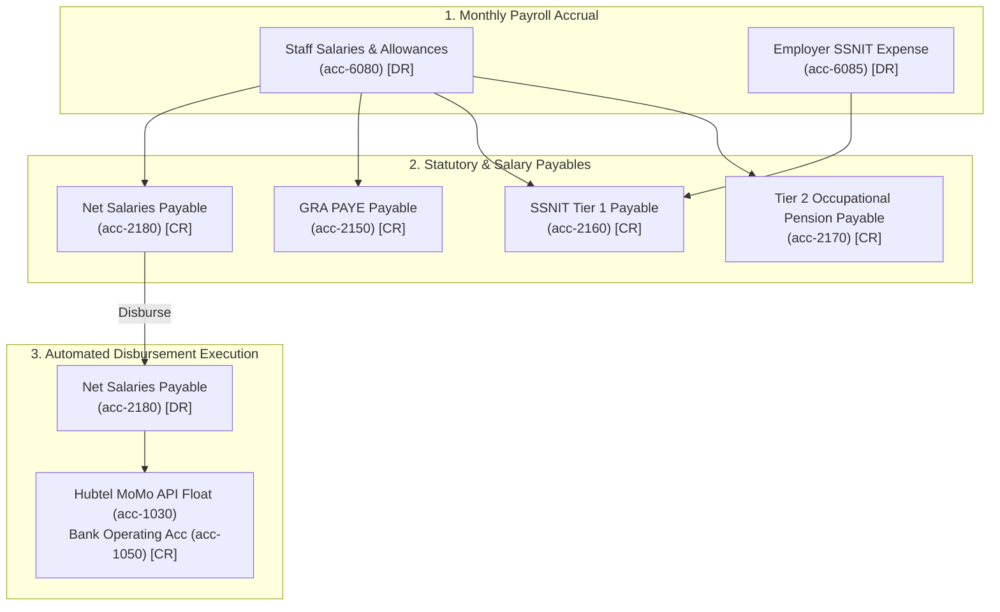

# AmenDesk — HR & Payroll Module Master Implementation Plan
**Salaried Staff Management, Ghanaian Statutory Payroll & Automated Hubtel MoMo Disbursement**

**Prepared by:** Dev Surge Infotech Ltd.  
**Client:** Amen Mart Auctioning Services Ltd.  
**System:** AmenDesk Offline-First ERP  
**Target Environment:** Next.js 16 (App Router), Dexie.js (IndexedDB v5), Tailwind CSS v4, TypeScript Strict  
**Statutory Framework:** Ghana Revenue Authority (GRA) PAYE Act 896, SSNIT National Pensions Act 766, Ghana Labour Act 651  

---

## 1. Executive Summary & Strategic Scope

Amen Mart operates a multi-line asset liquidation and trading business across Ghana:
1. **Auctioning Services** across three distinct legal categories (**Private**, **Government**, and **Judicial**) for Movable assets (Vehicles, Collectibles, Earthmoving equipment, Plant & Machinery) and Immovable assets (Titled Land and Commercial/Residential Properties) — where a **7% statutory auction fee** is applied per unit sold across all auctions.
2. **Car Dealership** — Amen Mart's own direct-sale vehicle business (no 7% auction fee; vehicles are sold directly by Amen Mart).
3. **Land & Property Desks** for direct parcel acquisitions, site plan verifications, indentures, and unit sales.
4. **Cash Office & Accounting** with multi-mode receipting (Cash, MTN MoMo, Telecel Cash, Bank Transfers, Paystack Cards) and 14-day instalment settlement plans.

### Workforce & Remuneration Policy
All operational, administrative, showroom, yard, and auction-day duties at Amen Mart are performed exclusively by **full-time salaried staff**:
- **No Casual Workers**: There are no daily-wage or casual yard handlers.
- **No Staff Sales Commissions**: Staff do not earn sales commissions; all employees are remunerated strictly via fixed monthly salaries and standard allowances.

### Core Objectives of the HR & Payroll Module
1. **Unified Salaried Staff Ledger**: A centralized, offline-first employee directory tracking personal records, Ghana Card verification, SSNIT numbers, GRA TINs, employment contracts, next-of-kin records, and bank/Hubtel MoMo payout endpoints.
2. **Ghanaian Statutory Tax & Pension Compliance**: An automated calculation engine adhering strictly to GRA PAYE graduated tax brackets, SSNIT Tier 1 basic pension contributions (13.5% employer), and generic Tier 2 mandatory occupational pension deductions (5% employee, with trustee left open/unassigned), plus optional Tier 3 voluntary provident funds.
3. **Automated Hubtel API Mobile Money Execution**: Direct programmatic monthly salary disbursement via the **Hubtel Bulk Disbursement API** alongside commercial bank transfer exports (GCB / Stanbic).
4. **Staff Attendance & Leave Management**: Daily attendance tracking, cashier shift linking (`cashShifts`), and statutory annual/sick/maternity leave workflows under the Ghana Labour Act 651.
5. **Seamless Double-Entry Accounting Sync**: Automatic generation of balanced General Journal entries (`journalEntries`) upon payroll approval, debiting salary and employer pension expenses (`acc-6080`, `acc-6085`) and crediting statutory liabilities (`acc-2150`, `acc-2160`, `acc-2170`) and net salary payables (`acc-2180`).
6. **Dual Slip Generation**: 80mm thermal payslips for rapid front-desk issuance alongside official A4 PDF/printable payslips with statutory breakdowns.

---

## 2. Workforce Profile & Salaried Compensation Architecture

Every role at Amen Mart is fulfilled by permanent salaried staff:

| Department | Typical Job Titles | Remuneration Model | Statutory Deductions | Disbursement Channel |
|---|---|---|---|---|
| **Executive & Management** | Managing Director, Lead Auctioneer, Chief Accountant, Operations Manager | Monthly Basic Salary + Fixed Allowances (Transport, Housing, Utility) | GRA PAYE + SSNIT Tier 1 & Tier 2 | Commercial Bank Transfer (GCB / Stanbic) or Hubtel API MoMo |
| **Administrative & Front Desk** | Legal & Indenture Secretary, Front-Desk Cashier, Customer Relations Officer | Monthly Basic Salary + Fixed Allowances | GRA PAYE + SSNIT Tier 1 & Tier 2 | Hubtel API MoMo or Commercial Bank Transfer |
| **Auction, Showroom & Property Operations** | Auction Coordinator, Showroom Officer, Land & Property Officer, Inventory Officer | Monthly Basic Salary + Fixed Allowances | GRA PAYE + SSNIT Tier 1 & Tier 2 | Hubtel API MoMo or Commercial Bank Transfer |
| **Yard, Logistics & Security** | Yard Supervisor, Vehicle Inspector, Logistics Officer, Security Personnel | Monthly Basic Salary + Fixed Allowances | GRA PAYE + SSNIT Tier 1 & Tier 2 | Hubtel API MoMo or Commercial Bank Transfer |

---

## 3. Ghana Statutory Payroll Calculation Engine

### 3.1 GRA PAYE (Pay-As-You-Earn) Graduated Tax Brackets (Monthly Standard)

Under the Ghana Revenue Authority (GRA) Income Tax Act (Act 896 as amended):

| Tax Band | Chargeable Income (GH₵) | Tax Rate | Tax on Band (GH₵) | Cumulative Tax (GH₵) |
|---|---|---|---|---|
| **First Band** | First GH₵ 490.00 | **0%** (Free) | GH₵ 0.00 | GH₵ 0.00 |
| **Second Band** | Next GH₵ 110.00 | **5%** | GH₵ 5.50 | GH₵ 5.50 |
| **Third Band** | Next GH₵ 130.00 | **10%** | GH₵ 13.00 | GH₵ 18.50 |
| **Fourth Band** | Next GH₵ 3,166.67 | **17.5%** | GH₵ 554.17 | GH₵ 572.67 |
| **Fifth Band** | Next GH₵ 16,000.00 | **25%** | GH₵ 4,000.00 | GH₵ 4,572.67 |
| **Sixth Band** | Next GH₵ 30,500.00 | **30%** | GH₵ 9,150.00 | GH₵ 13,722.67 |
| **Exceeding Band** | Over GH₵ 50,396.67 | **35%** | Marginal balance * 35% | — |

*Statutory Personal Reliefs*:
- Disability Relief: 25% of assessable income.
- Marriage / Child Responsibility Relief: Deductible from assessable income before tax band computation.
- Aged Dependent / Old Age Relief: Configurable in employee profile.

### 3.2 SSNIT National Pensions Act (Act 766) Tier Structure

Pensions in Ghana follow a 3-tier structure calculated as a percentage of the employee's **Basic Salary**:
1. **Tier 1 (Mandatory Basic National Social Security)**:
   - **Employer Contribution**: **13.5%** of Basic Salary.
   - Out of this 13.5%, SSNIT retains **11.0%** for the defined-benefit pension scheme and remits **2.5%** to the National Health Insurance Scheme (NHIS).
2. **Tier 2 (Mandatory Occupational Pension — Generic/Unassigned Trustee)**:
   - **Employee Deduction**: **5.0%** of Basic Salary.
   - Tracked in a dedicated Tier 2 liability account (`acc-2170`) with generic export schedules (trustee details left open/optional).
3. **Statutory Contribution Summary**:
   - Total mandatory pension = **18.5%** (5.5% employee deducted, 13% employer contributed).
   - Employee's 5.5% deduction is tax-exempt and deducted from Gross Salary to determine Taxable Income before applying PAYE tax bands.
4. **Tier 3 (Voluntary Provident Fund & Personal Pension)**:
   - Optional contributions up to **16.5%** of Basic Salary (tax-exempt).

### 3.3 End-to-End Net Salary Mathematical Formula
```
Gross Salary = Basic Salary + Fixed Monthly Allowances (Transport, Housing, Lunch, Communication)
Tax-Exempt Pension = SSNIT Employee Deduction (5.5% of Basic Salary) + Tier 3 Voluntary Deduction
Taxable Chargeable Income = Gross Salary - Tax-Exempt Pension - Approved Personal Reliefs
GRA PAYE Tax = CalculateGraduatedPAYE(Taxable Chargeable Income)
Total Employee Deductions = SSNIT Employee (5.5%) + Tier 3 + GRA PAYE + Staff Loan/Salary Advance Repayments
Net Take-Home Salary = Gross Salary - Total Employee Deductions
Total Employer Payroll Cost = Gross Salary + Employer SSNIT Tier 1 (13% of Basic Salary)
```

---

## 4. Double-Entry Accounting Ledger Integration (QuickBooks Pattern)

The HR & Payroll module integrates directly into AmenDesk's double-entry QuickBooks accounting ledger (`accounts` and `journalEntries` tables).



### 4.1 Chart of Accounts Expansion (`accounts`)

| Account Code | Account Name | Account Type | Category | Description |
|---|---|---|---|---|
| **2150** | GRA Statutory PAYE Tax Payable | LIABILITY | CURRENT_LIABILITY | Income tax withheld from employee salaries, payable to GRA by the 15th of following month |
| **2160** | SSNIT Tier 1 Contribution Payable | LIABILITY | CURRENT_LIABILITY | Mandatory Tier 1 pension contribution payable to SSNIT |
| **2170** | Tier 2 Occupational Pension Payable | LIABILITY | CURRENT_LIABILITY | 5% mandatory Tier 2 employee deduction held pending remittance |
| **2180** | Accrued Net Salaries Payable | LIABILITY | CURRENT_LIABILITY | Holding liability for net monthly payroll approved awaiting Hubtel/Bank payout |
| **6080** | Staff Salaries & Allowances | EXPENSE | ADMIN_EXPENSE | Monthly basic salaries and fixed allowances for salaried staff (*Existing in AmenDesk*) |
| **6085** | Employer Pension & SSNIT Contribution Expense | EXPENSE | ADMIN_EXPENSE | Amen Mart statutory 13% employer pension burden |

### 4.2 Automated Journal Entries
1. **Entry 1: Payroll Approval & Accrual (End of Month / Post-Run)**
   - **DR** `acc-6080` (Staff Salaries & Allowances) — Total Basic Salaries + Allowances
   - **DR** `acc-6085` (Employer Pension Contribution) — 13% Employer SSNIT
   - **CR** `acc-2150` (GRA Statutory PAYE Payable) — Total PAYE Tax
   - **CR** `acc-2160` (SSNIT Tier 1 Payable) — Total SSNIT Tier 1 Share
   - **CR** `acc-2170` (Tier 2 Occupational Pension Payable) — Total 5% Employee Tier 2
   - **CR** `acc-2180` (Accrued Net Salaries Payable) — Total Net Take-Home Pay
2. **Entry 2: Automated Hubtel MoMo API & Bank Net Pay Disbursement**
   - **DR** `acc-2180` (Accrued Net Salaries Payable)
   - **CR** `acc-1030` (MTN MoMo / Hubtel Float) for automated Hubtel API mobile money payouts
   - **CR** `acc-1050` (GCB Bank Operating Account) for commercial bank wire transfers

---

## 5. Offline-First Data Architecture & Dexie.js Schema v5

All HR, attendance, leave, and payroll records are stored locally in Dexie IndexedDB first and synchronized via `syncOutbox`.

### 5.1 Dexie Version 5 Table Definitions

```typescript
// Proposed schema evolution in src/lib/db/index.ts (version 5)
this.version(5).stores({
  employees: 'id, employeeCode, fullName, phone, ghanaCardNumber, ssnitNumber, tinNumber, department, employmentType, status, isCashier, locationId',
  payrollRuns: 'id, runNumber, period, status, totalGrossGhs, totalNetGhs, processedAt, journalEntryId',
  payrollSlips: 'id, slipNumber, runId, employeeId, grossSalaryGhs, netPayGhs, paymentMethod, hubtelTransactionId, status, disbursedAt',
  staffAttendance: 'id, employeeId, date, status, shiftType, linkedShiftId',
  leaveRequests: 'id, employeeId, leaveType, startDate, endDate, status, approvedBy',
});
```

### 5.2 TypeScript Interfaces (`src/lib/types/hr.ts`)

```typescript
export type EmploymentType = 'FULL_TIME_SALARIED' | 'PROBATION_SALARIED' | 'EXECUTIVE';
export type Department = 'AUCTION_OPERATIONS' | 'DEALERSHIP_SHOWROOM' | 'LAND_DESK' | 'PROPERTY_DESK' | 'FINANCE_ACCOUNTS' | 'LEGAL_ADMIN' | 'SECURITY_LOGISTICS';
export type PaymentMethod = 'HUBTEL_MOMO_API' | 'BANK_TRANSFER';
export type PayrollStatus = 'DRAFT' | 'CALCULATED' | 'APPROVED' | 'POSTED' | 'DISBURSING' | 'DISBURSED';
export type AttendanceStatus = 'PRESENT' | 'ABSENT' | 'HALF_DAY' | 'ON_LEAVE' | 'FIELD_AUCTION_DUTY';
export type LeaveType = 'ANNUAL' | 'SICK' | 'MATERNITY' | 'PATERNITY' | 'COMPASSIONATE' | 'STUDY';

export interface Employee {
  id: string;
  employeeCode: string; // e.g. AM-EMP-001
  fullName: string;
  phone: string;
  email?: string;
  ghanaCardNumber: string; // GHA-XXXXXXXXX-X
  ssnitNumber?: string; // 13-digit SSNIT number
  tinNumber?: string; // Ghana Revenue Authority TIN
  dateOfBirth?: string;
  gender: 'MALE' | 'FEMALE';
  address: string;
  nextOfKinName: string;
  nextOfKinPhone: string;
  department: Department;
  jobTitle: string;
  employmentType: EmploymentType;
  dateHired: string;
  locationId: string; // references accountingLocations (e.g. loc-gbawe)
  status: 'ACTIVE' | 'ON_LEAVE' | 'TERMINATED' | 'SUSPENDED';
  isCashier: boolean; // whether employee can open/close front-desk cash till shifts
  
  // Salaried Remuneration Structure
  basicSalaryGhs: number;
  transportAllowanceGhs: number;
  housingAllowanceGhs: number;
  lunchAllowanceGhs: number;
  communicationAllowanceGhs: number;
  
  // Statutory & Payout Endpoints
  hasSsnitContribution: boolean;
  tier3VoluntaryPct?: number;
  paymentMethod: PaymentMethod;
  bankName?: string;
  bankBranch?: string;
  bankAccountNumber?: string;
  momoNetwork?: 'MTN' | 'TELECEL' | 'AIRTELTIGO';
  momoPhoneNumber?: string;
  momoAccountName?: string;
  
  createdAt: string;
  updatedAt?: string;
}

export interface PayrollRun {
  id: string;
  runNumber: string; // e.g. PR-2026-10
  period: string; // YYYY-MM
  status: PayrollStatus;
  totalEmployees: number;
  totalBasicGhs: number;
  totalAllowancesGhs: number;
  totalGrossGhs: number;
  totalTaxableGhs: number;
  totalPayeGhs: number;
  totalSsnitTier1EmployerGhs: number;
  totalSsnitTier2EmployeeGhs: number;
  totalTier3Ghs: number;
  totalNetGhs: number;
  journalEntryId?: string; // references journalEntries
  hubtelBatchId?: string; // Hubtel automated API batch reference
  processedBy: string;
  approvedBy?: string;
  createdAt: string;
  approvedAt?: string;
  disbursedAt?: string;
  syncStatus: 'LOCAL' | 'PENDING' | 'SYNCED';
}

export interface PayrollSlip {
  id: string;
  slipNumber: string; // e.g. PS-2026-10-001
  runId: string;
  employeeId: string;
  employeeCode: string;
  fullName: string;
  jobTitle: string;
  department: Department;
  
  // Salaried Earnings
  basicSalaryGhs: number;
  allowancesGhs: number;
  grossSalaryGhs: number;
  
  // Deductions
  ssnitEmployeeGhs: number; // 5.5% mandatory employee deduction (incl. 5% Tier 2)
  tier3VoluntaryGhs: number;
  taxableIncomeGhs: number;
  payeTaxGhs: number;
  loanDeductionGhs: number;
  otherDeductionsGhs: number;
  totalDeductionsGhs: number;
  
  // Net & Employer Cost
  netPayGhs: number;
  ssnitEmployerGhs: number; // 13% employer contribution
  employerTotalCostGhs: number;
  
  paymentMethod: PaymentMethod;
  hubtelTransactionId?: string;
  hubtelResponseMessage?: string;
  paymentReference?: string;
  status: 'PENDING' | 'PROCESSING' | 'DISBURSED' | 'FAILED';
  disbursedAt?: string;
  syncStatus: 'LOCAL' | 'PENDING' | 'SYNCED';
}

export interface StaffAttendance {
  id: string;
  employeeId: string;
  date: string; // YYYY-MM-DD
  timeIn?: string;
  timeOut?: string;
  status: AttendanceStatus;
  shiftType: 'STANDARD_DAY' | 'AUCTION_EVENT_DUTY' | 'WEEKEND_DUTY';
  hoursWorked: number;
  linkedShiftId?: string; // if tied to a front-desk cash till shift
  recordedBy: string;
  notes?: string;
  syncStatus: 'LOCAL' | 'PENDING' | 'SYNCED';
}

export interface LeaveRequest {
  id: string;
  employeeId: string;
  leaveType: LeaveType;
  startDate: string;
  endDate: string;
  workingDaysCount: number;
  reason: string;
  status: 'PENDING' | 'APPROVED' | 'REJECTED' | 'CANCELLED';
  approvedBy?: string;
  actionDate?: string;
  comments?: string;
  createdAt: string;
  syncStatus: 'LOCAL' | 'PENDING' | 'SYNCED';
}
```

---

## 6. User Experience & Route Structure

The HR & Payroll module will be established at `/desk/hr`, with submodules registered in the ERP Sidebar.

### 6.1 Route & View Breakdown

```
/desk/hr
 ├── ?tab=staff          -> Salaried Staff Directory & Personnel Profiles (Default)
 ├── ?tab=payroll        -> Monthly Payroll Wizard & Automated Hubtel API Execution
 ├── ?tab=attendance     -> Staff Attendance Register & Cashier Till Shift Link
 ├── ?tab=leave          -> Staff Leave Calendar, Entitlement Tracking & Approvals
 └── ?tab=reports        -> Statutory Exports (GRA Form DT 0107, SSNIT Tier 1, Generic Tier 2)
```

### 6.2 Key Screen Designs & Features

#### Screen 1: Salaried Staff Directory (`/desk/hr?tab=staff`)
- **4-Card Top Summary**:
  - Total Salaried Headcount (across Departments).
  - Monthly Gross Salary Commitment (GH₵).
  - Monthly Statutory Employer SSNIT & PAYE Obligation (GH₵).
  - Staff on Approved Leave / Active Cashiers on Shift.
- **Filterable Employee Table**:
  - Filters: Department, Payout Channel (Hubtel MoMo API vs Bank Transfer), Ghana Card Verification Status.
  - Fast search by Name, Phone, Employee Code, or Ghana Card.
- **Add / Edit Employee Modal**:
  - Tab 1: Personal & Bio Data (Ghana Card, Photo upload, Next of Kin).
  - Tab 2: Department & Role (Location, Cashier Till permission toggle).
  - Tab 3: Salaried Remuneration (Basic Salary, Transport/Housing/Lunch/Communication Allowances, Tier 3 %).
  - Tab 4: Automated Hubtel MoMo Endpoint & Bank Details (MTN/Telecel/AirtelTigo wallet verification or GCB/Stanbic account).

#### Screen 2: Monthly Payroll Wizard & Hubtel API Disbursement (`/desk/hr?tab=payroll`)
- **Step 1: Select Period & Review Staff Roster**:
  - Pulls all active salaried employees for the selected month (`YYYY-MM`).
  - Checks approved unpaid leave or salary advance deductions.
- **Step 2: Automated Calculation Preview**:
  - Real-time tabular preview showing Basic Salary, Fixed Allowances, Gross Salary, SSNIT 5.5%, Chargeable Income, GRA PAYE, Net Salary, and Employer 13% SSNIT.
- **Step 3: Management Approval & Ledger Posting**:
  - MD / Lead Auctioneer approval button with audit timestamp.
  - Automatically posts balanced General Journal Entry (`JE-YYYY-XXXX`) to the QuickBooks ledger.
- **Step 4: Automated Hubtel API Execution**:
  - Single-click **"Execute Hubtel MoMo Payout"** triggers programmatic API disbursement (`/api/payroll/hubtel-disburse`) to each staff member's registered Mobile Money wallet with real-time transaction status tracking (`PENDING` -> `DISBURSED`) and receipt references.
  - Generates downloadable Bank Transfer CSV for staff paid via GCB/Stanbic bank accounts.

#### Screen 3: Dual-Format Payslip Generation
- **80mm Thermal Slip (Front-Desk Printer)**:
  - Header: Amen Mart Brand Strip.
  - Employee Code, Name, Role, Period.
  - Earnings Summary (Basic Salary, Allowances, Gross Pay).
  - Statutory Deductions (GRA PAYE, SSNIT 5.5%).
  - Net Take-Home Pay & Hubtel Transaction Reference.
- **A4 Executive Payslip**:
  - Formal corporate layout with GAA license credentials, full year-to-date (YTD) cumulative tax and SSNIT contributions, and digital authorization stamp.

---

## 7. Phased Implementation Roadmap & Sprints

### Sprint 1: Foundation & Data Architecture
- [ ] Define TypeScript types in `src/lib/types/hr.ts` (salaried workforce, payroll runs, slips, attendance, leave, Hubtel API metadata).
- [ ] Upgrade Dexie IndexedDB to Version 5 in `src/lib/db/index.ts` with the 5 HR & Payroll tables (`employees`, `payrollRuns`, `payrollSlips`, `staffAttendance`, `leaveRequests`).
- [ ] Add statutory payroll liability and expense accounts (`acc-2150`, `acc-2160`, `acc-2170`, `acc-2180`, `acc-6085`) to Chart of Accounts in `src/lib/db/seed.ts`.
- [ ] Create realistic seed dataset for Amen Mart salaried staff across Auction Operations, Dealership Showroom, Land/Property, and Finance.
- [ ] Add `Staff & Payroll` module and submodules into `src/components/erp/Sidebar.tsx`.

### Sprint 2: Salaried Staff Directory & Profile Management
- [ ] Build `/desk/hr` route with KPI summary cards (`Salaried Staff`, `Gross Payroll`, `Statutory PAYE & SSNIT`, `On Leave`).
- [ ] Implement responsive employee directory table with search, department filters, and status toggles.
- [ ] Build Add/Edit Employee modal with Ghana Card validation, salary & allowance fields, and Hubtel MoMo wallet configuration.

### Sprint 3: Staff Attendance & Leave Management
- [ ] Build Daily Staff Attendance Register with clock-in/out and cashier shift linkage (`cashShifts`).
- [ ] Build Leave Management module with statutory annual leave balances (Ghana Labour Act 651) and approval workflow.

### Sprint 4: Ghanaian Payroll Engine, Hubtel API Execution & Payslips
- [ ] Implement GRA PAYE graduated tax engine (0% to 35% monthly bands) and SSNIT Act 766 calculations (13.5% Tier 1, generic 5.0% Tier 2, optional Tier 3).
- [ ] Build multi-step Monthly Payroll Run wizard (Select -> Preview -> Approve & Post Journal -> Execute Hubtel API).
- [ ] Implement `/api/payroll/hubtel-disburse` endpoint and offline-resilient client service for automated Hubtel Mobile Money payouts.
- [ ] Implement 80mm thermal payslip generator and formal A4 printable payslip components.

### Sprint 5: General Ledger Automation, Statutory Exports & Hardening
- [ ] Implement automated balanced double-entry Journal Entry posting upon payroll approval.
- [ ] Build statutory return exporters (GRA Monthly PAYE Form DT 0107, SSNIT Tier 1 schedule, generic Tier 2 deduction schedule).
- [ ] Execute mandatory quality gates (`npm run check` with 0 TSC errors and 0 ESLint warnings).
- [ ] Update `STATE_HANDOFF.md`, commit, and push live to GitHub repository.

---

## 8. Role-Based Access Control (RBAC) & Data Privacy

| Module Feature / Action | OWNER (MD / Lead Auctioneer) | ACCOUNTANT (Chief Accountant) | SECRETARY (Front Desk) | STAFF (Operations / Showroom) |
|---|---|---|---|---|
| **View Staff Directory** | Full Access | Full Access | View Basic Contact | View Own Profile Only |
| **Add / Edit Salaried Staff** | Full Access | Full Access | Limited (Contact Info) | No Access |
| **View Salary & Compensation** | Full Access | Full Access | No Access (Masked) | View Own Payslip Only |
| **Run & Calculate Payroll** | Approve & Execute Hubtel API | Prepare & Calculate | No Access | No Access |
| **Approve Leave Requests** | Full Access | Full Access | No Access | Submit Request Only |
| **Export Statutory Reports** | Full Access | Full Access | No Access | No Access |

---
*Master Plan Updated & Approved for Implementation by Dev Surge Infotech Ltd. for Amen Mart Auctioning Services.*
