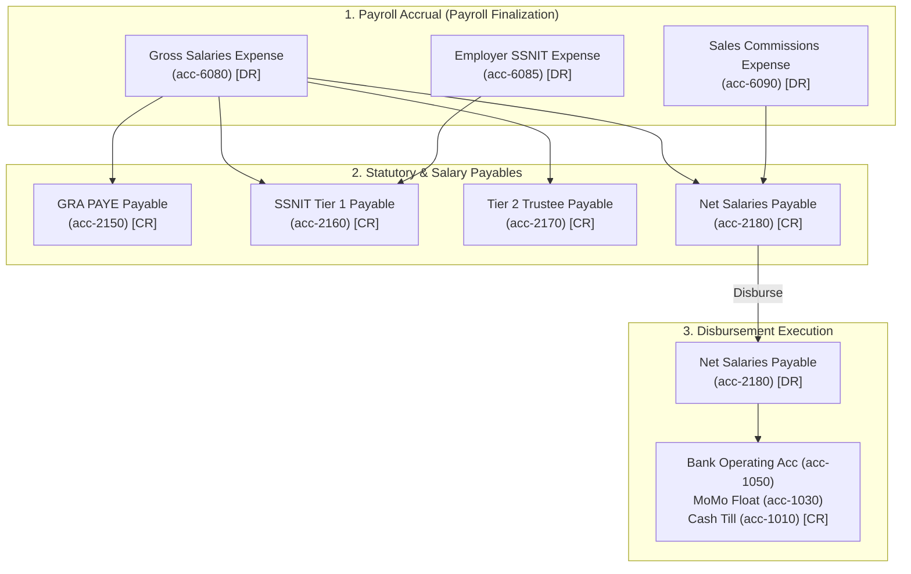
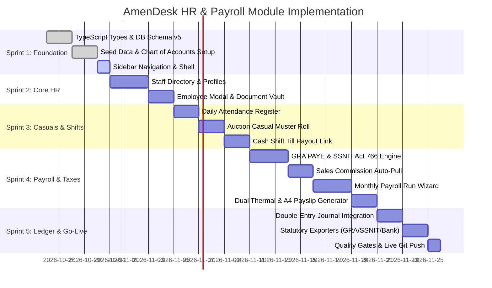

# AmenDesk — HR & Payroll Module Master Implementation Plan
**Staff Management, Ghanaian Statutory Payroll & Yard Casual Operations**

**Prepared by:** Dev Surge Infotech Ltd.  
**Client:** Amen Mart Auctioning Services Ltd.  
**System:** AmenDesk Offline-First ERP  
**Target Environment:** Next.js 16 (App Router), Dexie.js (IndexedDB v5), Tailwind CSS v4, TypeScript Strict  
**Statutory Framework:** Ghana Revenue Authority (GRA) PAYE Act 896, SSNIT National Pensions Act 766, Ghana Labour Act 651  

---

## 1. Executive Summary & Strategic Scope

Amen Mart operates a high-velocity, multi-line asset liquidation and trading business across Ghana:
1. **Auctioning Services** across three distinct legal categories (**Private**, **Government**, and **Judicial**) for Movable assets (Vehicles, Earthmoving equipment, Plant & Machinery) and Immovable assets (Titled Land and Commercial/Residential Properties).
2. **Car Dealership** for direct imported vehicle sales.
3. **Land & Property Desks** for direct parcel acquisitions, site plan verifications, indentures, and unit leases/sales.
4. **Cash Office & Accounting** with multi-mode receipting (Cash, MTN MoMo, Telecel Cash, Bank Transfers, Paystack Cards) and 14-day instalment settlement plans.

To sustain this operation, Amen Mart employs a diverse, hybrid workforce with materially different remuneration structures, operational schedules, and compliance obligations:
- **Full-Time Permanent Staff**: Executive management (Lead Auctioneer Dr. Francis Kwaku Yeboah, Managing Director), Chief Accountant, Front-Desk Legal Secretaries, Cashiers, and Yard Security Chiefs.
- **Commission-Based Commercial Agents**: Dealership vehicle sales agents, land and property acquisition officers, and private consignment sourcing brokers.
- **Yard Casual Handlers & Auction Day Marshals**: Bid spotters, yard drivers, equipment riggers, gate clerks, vehicle detailers, and security marshals mobilized specifically for live auction events or intense delivery periods.
- **Retained Technical Specialists**: Licensed valuation surveyors, master mechanics, and bailiff liaisons.

### Core Objectives of the HR & Payroll Module
1. **Unified Staff Ledger**: A centralized, offline-first employee directory tracking personal records, Ghana Card verification, SSNIT numbers, GRA TINs, employment contracts, guarantor records, and banking/MoMo payout endpoints.
2. **Ghanaian Statutory Tax & Pension Compliance**: An automated calculation engine adhering strictly to GRA PAYE graduated tax brackets, SSNIT Tier 1 basic pension contributions (13.5% employer), Tier 2 mandatory occupational pension deductions (5% employee), and Tier 3 voluntary provident funds.
3. **Auction Day Casuals & Shift Management**: Instant muster-roll check-in for casual yard workers during auction events, with daily wage calculation and direct cash-out reconciliation with front-desk cash shifts (`cashShifts`) or instant MoMo bulk disbursement.
4. **Sales Commission Pipeline**: Cross-module integration that auto-pulls completed vehicle, land, and property transactions, calculates commission entitlements, deducts 7.5% Withholding Tax (WHT) where applicable, and feeds into monthly payroll runs.
5. **Seamless Double-Entry Accounting Sync**: Automatic generation of balanced General Journal entries (`journalEntries`) upon payroll approval, debiting payroll expenses (`acc-6080`, `acc-6085`, `acc-6090`) and crediting statutory liabilities (`acc-2150`, `acc-2160`, `acc-2170`) and net pay liabilities (`acc-2180`).
6. **Dual Slip Generation**: 80mm thermal payslips for rapid field issuance on auction grounds, alongside official A4 PDF/printable payslips with statutory breakdowns.

---

## 2. Workforce Profile & Compensation Architecture

| Staff Cohort | Typical Job Titles | Remuneration Model | Statutory Deductions | Disbursement Channel |
|---|---|---|---|---|
| **Executive & Salaried** | Managing Director, Chief Accountant, Operations Manager, Legal Secretary | Monthly Basic Salary + Allowances (Transport, Housing, Utility) | GRA PAYE + SSNIT Tier 1 & Tier 2 | Commercial Bank Transfer (GCB High St / Stanbic Airport City) |
| **Sales & Commercial** | Showroom Sales Executive, Land Acquisition Broker, Property Agent | Base Retainer + Tiered Sales Commission (% of Gross Margin or Flat Fee) | GRA PAYE (on Base) + 7.5% WHT (on Commissions) | Bank Transfer or MTN MoMo |
| **Auction Day Casuals** | Bid Spotters, Lot Marshals, Yard Drivers, Riggers, Gate Checkers | Daily Wage per Auction Event (GH₵ 150 – GH₵ 350/day) + Lunch Allowance | Casual Labor Tax / WHT (5% flat above statutory threshold) | Cash Till (`acc-1010`) via Cash Shift Payout or Hubtel MoMo |
| **Retained Specialists** | Valuation Surveyors, Bailiff Liaisons, Master Auto Mechanics | Fee per Assignment / Monthly Retainer | 7.5% Professional Services WHT | Bank Transfer or MoMo |

---

## 3. Ghana Statutory Payroll Calculation Engine

### 3.1 GRA PAYE (Pay-As-You-Earn) Graduated Tax Brackets (Monthly Standard)

Under the Ghana Revenue Authority (GRA) Income Tax Act (Act 896 as amended):

| Tax Band | Chargeable Income (GH₵) | Tax Rate | Tax on Band (GH₵) | Cumulative Tax (GH₵) |
|---|---|---|---|---|
| **First Band** | First GH₵ 490.00 | **0%** (Free) | GH₵ 0.00 | GH₵ 0.00 |
| **Second Band** | Next GH₵ 110.00 | **5%** | GH₵ 5.50 | GH₵ 5.50 |
| **Third Band** | Next GH₵ 130.00 | **10%** | GH₵ 13.00 | GH₵ 18.50 |
| **Fourth Band** | Next GH₵ 3,166.67 | **17.5%** | GH₵ 554.17 | GH₵ 572.67 |
| **Fifth Band** | Next GH₵ 16,000.00 | **25%** | GH₵ 4,000.00 | GH₵ 4,572.67 |
| **Sixth Band** | Next GH₵ 30,500.00 | **30%** | GH₵ 9,150.00 | GH₵ 13,722.67 |
| **Exceeding Band** | Over GH₵ 50,396.67 | **35%** | Marginal balance * 35% | — |

*Statutory Personal Reliefs*:
- Disability Relief: 25% of assessable income.
- Marriage / Child Responsibility Relief: Deductible from assessable income before tax band computation.
- Aged Dependent / Old Age Relief: Configurable in employee profile.

### 3.2 SSNIT National Pensions Act (Act 766) Tier Structure

Pensions in Ghana follow a 3-tier structure calculated as a percentage of the employee's **Basic Salary**:
1. **Tier 1 (Mandatory Basic National Social Security)**:
   - **Employer Contribution**: **13.5%** of Basic Salary.
   - Out of this 13.5%, SSNIT retains **11.0%** for the defined-benefit pension scheme and remits **2.5%** to the National Health Insurance Scheme (NHIS).
2. **Tier 2 (Mandatory Private Occupational Pension)**:
   - **Employee Deduction**: **5.0%** of Basic Salary.
   - Remitted monthly to an approved private pension trustee (e.g., Enterprise Trustees, Petra Trust, Axis Pensions).
3. **Statutory Contribution Summary**:
   - Total mandatory pension = **18.5%** (5.5% employee deducted, 13% employer contributed).
   - Employee's 5.5% deduction is tax-exempt and deducted from Gross Salary to determine Taxable Income before applying PAYE tax bands.
4. **Tier 3 (Voluntary Provident Fund & Personal Pension)**:
   - Optional contributions up to **16.5%** of Basic Salary (tax-exempt).

### 3.3 End-to-End Net Pay Mathematical Formula
```latex
Gross Earnings = Basic Salary + Cash Allowances + Overtime + Approved Commissions
Tax-Exempt Pension = SSNIT Employee Deduction (5.5%) + Tier 3 Voluntary Deduction (up to 16.5%)
Taxable Chargeable Income = Gross Earnings - Tax-Exempt Pension - Approved Personal Reliefs
GRA PAYE Tax = CalculateGraduatedPAYE(Taxable Chargeable Income)
Total Employee Deductions = SSNIT Tier 2 + Tier 3 + GRA PAYE + Staff Loan Repayments
Net Take-Home Pay = Gross Earnings - Total Employee Deductions
Employer Burden = Gross Earnings + Employer SSNIT Tier 1 (13%) + Employer Tier 3 Match
```

---

## 4. Double-Entry Accounting Ledger Integration (QuickBooks Pattern)

The HR & Payroll module integrates directly into AmenDesk's double-entry QuickBooks accounting ledger (`accounts` and `journalEntries` tables).



### 4.1 Chart of Accounts Expansion (`accounts`)

| Account Code | Account Name | Account Type | Category | Description |
|---|---|---|---|---|
| **2150** | GRA Statutory PAYE Tax Payable | LIABILITY | CURRENT_LIABILITY | Income tax withheld from employee salaries, payable to GRA by the 15th of following month |
| **2160** | SSNIT Tier 1 Contribution Payable | LIABILITY | CURRENT_LIABILITY | Total mandatory Tier 1 pension (Employee 5.5% + Employer 13%), payable to SSNIT |
| **2170** | Tier 2 Occupational Pension Trustee Payable | LIABILITY | CURRENT_LIABILITY | 5% mandatory private pension trustee deduction |
| **2180** | Accrued Net Salaries & Casual Wages Payable | LIABILITY | CURRENT_LIABILITY | Holding liability for net payroll approved but awaiting physical disbursement |
| **6080** | Staff Payroll & Yard Casual Handlers | EXPENSE | ADMIN_EXPENSE | Basic salaries, yard casual wages, and staff allowances (*Existing in AmenDesk*) |
| **6085** | Employer Pension & SSNIT Contribution Expense | EXPENSE | ADMIN_EXPENSE | Amen Mart statutory 13% employer pension burden |
| **6090** | Sales Agent Commissions Expense | EXPENSE | OPERATING_EXPENSE | Commissions earned on dealership vehicles, land parcels, and property transactions |

### 4.2 Automated Journal Entries
1. **Entry 1: Payroll Approval & Accrual (End of Month / Post-Run)**
   - **DR** `acc-6080` (Staff Payroll & Yard Casual Handlers) — Total Basic + Allowances
   - **DR** `acc-6085` (Employer Pension Contribution) — 13% Employer SSNIT
   - **DR** `acc-6090` (Sales Agent Commissions) — Gross Commissions
   - **CR** `acc-2150` (GRA Statutory PAYE Payable) — Total PAYE Tax
   - **CR** `acc-2160` (SSNIT Tier 1 Payable) — Total 13% Employer + Employee Share
   - **CR** `acc-2170` (Tier 2 Pension Trustee Payable) — Total 5% Employee Tier 2
   - **CR** `acc-2180` (Accrued Net Salaries Payable) — Total Net Take-Home Pay
2. **Entry 2: Net Pay Disbursement**
   - **DR** `acc-2180` (Accrued Net Salaries Payable)
   - **CR** `acc-1050` (GCB Bank Operating Account) for bank wires
   - **CR** `acc-1030` (MTN MoMo via Hubtel) for mobile money batch
   - **CR** `acc-1010` (Cash Till - Gbawe Yard) for cash-in-hand / casual worker payouts
3. **Entry 3: Casual Auction Marshal Same-Day Payout via Till**
   - Directly linked to active `cashShifts` record: Cashier logs a `CASH_OUT` transaction tagged with `HR_CASUAL_PAYOUT`, debiting `acc-6080` and crediting `acc-1010`.

---

## 5. Offline-First Data Architecture & Dexie.js Schema v5

To support field operations where yard marshals work without stable internet, all HR, attendance, and casual wage data is stored locally in Dexie IndexedDB and synced via the existing `syncOutbox` engine.

### 5.1 Dexie Version 5 Table Definitions

```typescript
// Proposed schema evolution in src/lib/db/index.ts (version 5)
this.version(5).stores({
  employees: 'id, employeeCode, fullName, phone, ghanaCardNumber, ssnitNumber, tinNumber, department, employmentType, status, isCashier, locationId',
  payrollRuns: 'id, runNumber, period, runType, status, totalGrossGhs, totalNetGhs, processedAt, journalEntryId',
  payrollSlips: 'id, slipNumber, runId, employeeId, grossEarningsGhs, netPayGhs, paymentMethod, status, disbursedAt',
  staffAttendance: 'id, employeeId, date, status, shiftType, isAuctionDay, linkedShiftId',
  leaveRequests: 'id, employeeId, leaveType, startDate, endDate, status, approvedBy',
  commissionLedger: 'id, agentId, referenceType, referenceId, saleAmountGhs, commissionGhs, status, payrollRunId',
});
```

### 5.2 TypeScript Interfaces

```typescript
export type EmploymentType = 'PERMANENT' | 'PROBATION' | 'COMMISSION_AGENT' | 'CASUAL_HANDLER' | 'CONTRACTOR';
export type Department = 'AUCTION_YARD' | 'DEALERSHIP' | 'LAND_DESK' | 'PROPERTY_DESK' | 'FINANCE_ACCOUNTS' | 'LEGAL_ADMIN' | 'SECURITY_LOGISTICS';
export type PaymentMethod = 'BANK_TRANSFER' | 'MOMO_MTN' | 'MOMO_TELECEL' | 'CASH_TILL';
export type PayrollStatus = 'DRAFT' | 'CALCULATED' | 'APPROVED' | 'POSTED' | 'DISBURSED';
export type AttendanceStatus = 'PRESENT' | 'ABSENT' | 'HALF_DAY' | 'ON_LEAVE' | 'REST_DAY';
export type LeaveType = 'ANNUAL' | 'SICK' | 'MATERNITY' | 'PATERNITY' | 'COMPASSIONATE' | 'STUDY';

export interface Employee {
  id: string;
  employeeCode: string; // e.g. AM-EMP-001
  fullName: string;
  phone: string;
  email?: string;
  ghanaCardNumber: string; // GHA-XXXXXXXXX-X
  ssnitNumber?: string; // 13-digit SSNIT number
  tinNumber?: string; // Ghana Revenue Authority TIN
  dateOfBirth?: string;
  gender: 'MALE' | 'FEMALE';
  address: string;
  nextOfKinName: string;
  nextOfKinPhone: string;
  department: Department;
  jobTitle: string;
  employmentType: EmploymentType;
  dateHired: string;
  contractEndDate?: string;
  locationId: string; // references accountingLocations (e.g. loc-gbawe)
  status: 'ACTIVE' | 'ON_LEAVE' | 'TERMINATED' | 'SUSPENDED';
  isCashier: boolean; // whether employee can operate cash till
  
  // Remuneration Structure
  basicSalaryGhs: number;
  transportAllowanceGhs: number;
  housingAllowanceGhs: number;
  lunchAllowanceGhs: number;
  communicationAllowanceGhs: number;
  dailyRateGhs?: number; // for casual yard handlers
  defaultCommissionRatePct?: number; // for sales agents
  
  // Statutory & Banking
  hasSsnitTier1Tier2: boolean;
  tier3VoluntaryPct?: number;
  paymentMethod: PaymentMethod;
  bankName?: string;
  bankBranch?: string;
  bankAccountNumber?: string;
  momoNetwork?: 'MTN' | 'TELECEL' | 'AIRTELTIGO';
  momoPhoneNumber?: string;
  momoAccountName?: string;
  
  createdAt: string;
  updatedAt?: string;
}

export interface PayrollRun {
  id: string;
  runNumber: string; // e.g. PR-2026-10
  period: string; // YYYY-MM
  runType: 'MONTHLY_REGULAR' | 'AUCTION_CASUAL_EVENT' | 'COMMISSION_OFFCYCLE';
  auctionEventId?: string; // if linked to specific auction event
  status: PayrollStatus;
  totalEmployees: number;
  totalGrossGhs: number;
  totalTaxableGhs: number;
  totalPayeGhs: number;
  totalSsnitTier1EmployerGhs: number;
  totalSsnitTier2EmployeeGhs: number;
  totalTier3Ghs: number;
  totalCommissionsGhs: number;
  totalNetGhs: number;
  journalEntryId?: string; // references journalEntries
  processedBy: string;
  approvedBy?: string;
  createdAt: string;
  approvedAt?: string;
  disbursedAt?: string;
  syncStatus: 'LOCAL' | 'PENDING' | 'SYNCED';
}

export interface PayrollSlip {
  id: string;
  slipNumber: string; // e.g. PS-2026-10-001
  runId: string;
  employeeId: string;
  employeeCode: string;
  fullName: string;
  jobTitle: string;
  department: Department;
  
  // Earnings
  basicSalaryGhs: number;
  allowancesGhs: number;
  overtimeHours: number;
  overtimePayGhs: number;
  commissionsGhs: number;
  grossEarningsGhs: number;
  
  // Deductions
  ssnitTier2Ghs: number; // 5% employee
  tier3VoluntaryGhs: number;
  taxableIncomeGhs: number;
  payeTaxGhs: number;
  loanDeductionGhs: number;
  otherDeductionsGhs: number;
  totalDeductionsGhs: number;
  
  // Net & Employer Cost
  netPayGhs: number;
  ssnitTier1EmployerGhs: number; // 13.5% employer
  employerTotalCostGhs: number;
  
  paymentMethod: PaymentMethod;
  paymentReference?: string;
  status: 'PENDING' | 'DISBURSED' | 'FAILED';
  disbursedAt?: string;
  syncStatus: 'LOCAL' | 'PENDING' | 'SYNCED';
}

export interface StaffAttendance {
  id: string;
  employeeId: string;
  date: string; // YYYY-MM-DD
  timeIn?: string;
  timeOut?: string;
  status: AttendanceStatus;
  shiftType: 'STANDARD_DAY' | 'AUCTION_EVENT' | 'WEEKEND_DUTY' | 'NIGHT_WATCH';
  isAuctionDay: boolean;
  auctionEventId?: string;
  hoursWorked: number;
  overtimeHours: number;
  dailyWageGhs?: number; // for casual workers
  linkedShiftId?: string; // if tied to a cash till shift
  recordedBy: string;
  notes?: string;
  syncStatus: 'LOCAL' | 'PENDING' | 'SYNCED';
}

export interface LeaveRequest {
  id: string;
  employeeId: string;
  leaveType: LeaveType;
  startDate: string;
  endDate: string;
  workingDaysCount: number;
  reason: string;
  status: 'PENDING' | 'APPROVED' | 'REJECTED' | 'CANCELLED';
  approvedBy?: string;
  actionDate?: string;
  comments?: string;
  createdAt: string;
  syncStatus: 'LOCAL' | 'PENDING' | 'SYNCED';
}

export interface CommissionEntry {
  id: string;
  agentId: string;
  referenceType: 'DEALERSHIP_VEHICLE' | 'LAND_PARCEL' | 'PROPERTY_UNIT' | 'AUCTION_CONSIGNMENT';
  referenceId: string;
  referenceLabel: string; // e.g. "2021 Toyota Prado (GW 8941-21)"
  customerId: string;
  saleAmountGhs: number;
  grossMarginGhs: number;
  commissionRatePct: number;
  commissionAmountGhs: number;
  whtRatePct: number; // typically 7.5%
  whtAmountGhs: number;
  netCommissionGhs: number;
  status: 'ACCRUED' | 'APPROVED' | 'PAID' | 'FORFEITED';
  payrollRunId?: string;
  createdAt: string;
  approvedAt?: string;
  syncStatus: 'LOCAL' | 'PENDING' | 'SYNCED';
}
```

---

## 6. User Experience & Route Structure

The HR & Payroll module will be established at `/desk/hr`, with submodules registered in the ERP Sidebar.

### 6.1 Route & View Breakdown

```
/desk/hr
 ├── ?tab=staff          -> Staff Directory & Personnel Profiles (Default)
 ├── ?tab=payroll        -> Monthly & Off-Cycle Payroll Run Processing Wizard
 ├── ?tab=casuals        -> Auction Day Casual Muster Roll & Instant Till Cash-Outs
 ├── ?tab=attendance     -> Daily Attendance Register, Shift Clock-In & Overtime
 ├── ?tab=leave          -> Staff Leave Calendar, Entitlement Tracking & Approvals
 ├── ?tab=commissions    -> Dealership, Land & Property Sales Commission Ledger
 └── ?tab=reports        -> Statutory Exports (GRA Form DT 0107, SSNIT Tier 1, Bank/MoMo Disburse CSVs)
```

### 6.2 Key Screen Designs & Features

#### Screen 1: Staff Directory (`/desk/hr?tab=staff`)
- **4-Card Top Summary**:
  - Total Active Headcount (Permanent vs Casual vs Commission Agents).
  - Monthly Gross Payroll Commitment (GH₵).
  - Pending Leave Requests.
  - Active Cashiers on Duty.
- **Filterable Employee Table**:
  - Filters: Department, Employment Type, Payment Channel, Verification Status (Ghana Card verified).
  - Fast search by Name, Phone, Employee Code, or Ghana Card.
- **Add / Edit Employee Modal**:
  - Tab 1: Personal & Bio Data (Ghana Card, Photo upload, Next of Kin).
  - Tab 2: Employment & Department (Role, Location, Cashier permissions).
  - Tab 3: Remuneration & Deductions (Basic, Allowances, Daily Rate, Tier 3 %).
  - Tab 4: Banking & Mobile Money (GCB/Stanbic details or MTN/Telecel MoMo).

#### Screen 2: Auction Day Casual Muster Roll (`/desk/hr?tab=casuals`)
- Tailored for auction day field logistics at Gbawe Yard.
- Rapid check-in checklist: Supervisor selects 15–30 yard marshals, spotters, and forklift drivers.
- Auto-applies standard auction daily rate (e.g. GH₵ 200/day + GH₵ 30 lunch).
- **One-Click Instant Till Payout**: Generates a bulk cash voucher directly credited from `acc-1010` (Cash Till) with thermal signature slips printed immediately.

#### Screen 3: Monthly Payroll Wizard (`/desk/hr?tab=payroll`)
- **Step 1: Select Period & Inclusions**:
  - Pulls active employees.
  - Checks approved leave and attendance deductions.
  - Auto-imports approved sales commissions from `commissionLedger`.
- **Step 2: Automated Calculation Preview**:
  - Real-time tabular preview showing Gross, SSNIT 5.5%, Chargeable Income, GRA PAYE, Loans, Net Pay, Employer 13%.
  - Highlighted alerts for tax anomalies or missing MoMo/bank accounts.
- **Step 3: Management Approval**:
  - MD / Lead Auctioneer approval button with audit timestamp.
- **Step 4: Ledger Posting & Disbursement**:
  - Automated generation of balanced General Journal Entry (`JE-YYYY-XXXX`).
  - Generates downloadable Bank Transfer CSV (GCB/Stanbic format) and Hubtel MoMo bulk payout file.

#### Screen 4: Dual-Format Payslip Generation
- **80mm Thermal Slip (Front-Desk / Yard Printer)**:
  - Header: Amen Mart Gold/Navy Brand Strip.
  - Employee Code, Name, Role, Period.
  - Earnings Summary (Basic, Overtime, Commissions, Gross).
  - Statutory Deductions (PAYE, SSNIT Tier 2).
  - Net Pay (Large, bold, high-contrast).
  - Signature lines for Employee and Cashier.
- **A4 Executive Payslip**:
  - Formal corporate format with GAA license credentials, full year-to-date (YTD) cumulative tax and pension contributions, company stamp area, and statutory relief breakdown.

---

## 7. Phased Implementation Roadmap & Sprints



### Sprint 1: Foundation & Data Architecture (Week 1)
- [ ] Define comprehensive TypeScript types in `src/lib/types/hr.ts`.
- [ ] Upgrade Dexie IndexedDB to Version 5 in `src/lib/db/index.ts` with 6 new tables.
- [ ] Add statutory payroll liability and expense accounts (`acc-2150`, `acc-2160`, `acc-2170`, `acc-2180`, `acc-6085`, `acc-6090`) to Chart of Accounts in `src/lib/db/seed.ts`.
- [ ] Create realistic seed dataset for Amen Mart staff (Executives, Auction Marshals, Sales Agents, Technicians).
- [ ] Add `Staff & Payroll` module and submodules into `src/components/erp/Sidebar.tsx`.

### Sprint 2: Staff Directory & Profile Management (Week 1–2)
- [ ] Build `/desk/hr` route with KPI summary cards (`Total Staff`, `Gross Payroll`, `Casuals Active`, `Pending Leave`).
- [ ] Implement responsive employee directory table with search, role filters, and status toggles.
- [ ] Build comprehensive Add/Edit Employee modal with photo compression and Ghana Card validation.
- [ ] Implement secure document vault for contracts, guarantor forms, and driver's licenses.

### Sprint 3: Attendance, Shifts & Auction Casuals (Week 2)
- [ ] Build Daily Attendance Register with clock-in/out timestamps and offline sync outbox support.
- [ ] Build **Auction Day Casual Muster Roll** for fast bulk-selection of auction spotters and handlers.
- [ ] Link cashier employees to active `cashShifts` records.
- [ ] Build one-click cash-out voucher integration for instant till payout on auction grounds.

### Sprint 4: Ghanaian Payroll Engine & Payslips (Week 3)
- [ ] Implement GRA PAYE graduated tax engine with exact 2026 monthly tax brackets and personal reliefs.
- [ ] Implement SSNIT Act 766 Tier 1 (13.5% employer) and Tier 2 (5.0% employee) pension algorithms.
- [ ] Implement Tier 3 voluntary provident fund deductions and tax exemptions.
- [ ] Build cross-module sales commission listener pulling closed deals from Dealership, Land, and Property.
- [ ] Build multi-step Monthly Payroll Run wizard (Select -> Preview -> Approve -> Disburse).
- [ ] Implement 80mm thermal payslip generator and formal A4 printable payslip components.

### Sprint 5: General Ledger Automation, Statutory Exports & Hardening (Week 3–4)
- [ ] Implement automated balanced double-entry Journal Entry posting upon payroll approval.
- [ ] Build statutory return exporters:
  - GRA Monthly PAYE Tax Return (Form DT 0107 / CSV).
  - SSNIT Tier 1 Electronic Contribution Return.
  - Tier 2 Private Pension Trustee Monthly Schedule.
- [ ] Build commercial bank transfer batch file generator (GCB / Stanbic CSV format) and Hubtel MoMo bulk payout exporter.
- [ ] Conduct end-to-end sandbox verification in `AmenDeskDB_sandbox`.
- [ ] Execute mandatory quality gates (`npm run check` with 0 TSC errors and 0 ESLint warnings).
- [ ] Commit with conventional commit messages and push live to GitHub repository.

---

## 8. Role-Based Access Control (RBAC) & Data Privacy

Payroll and compensation data contains sensitive personal identifiers (PII) and remuneration details. Strict access control rules will be enforced across AmenDesk roles:

| Module Feature / Action | OWNER (MD / Lead Auctioneer) | ACCOUNTANT (Chief Accountant) | SECRETARY (Front Desk) | STAFF (Yard Marshals / Cashiers) |
|---|---|---|---|---|
| **View Staff Directory** | Full Access | Full Access | View Basic Contact | View Own Profile Only |
| **Add / Edit Employee** | Full Access | Full Access | Limited (Contact Info) | No Access |
| **View Salary & Compensation** | Full Access | Full Access | No Access (Hidden) | View Own Payslip Only |
| **Run Monthly Payroll** | Approve & Disburse | Prepare & Calculate | No Access | No Access |
| **Log Auction Casuals** | Full Access | Full Access | Check-In Marshals | Check-In Marshals |
| **Disburse Casual Till Cash** | Full Access | Full Access | Authorized Cashiers | No Access |
| **Approve Leave Requests** | Full Access | Full Access | No Access | Submit Request Only |
| **Export Statutory Reports** | Full Access | Full Access | No Access | No Access |

*Data Privacy Safeguard*: On shared front-desk or yard tablets, salary fields are masked (`••••••`) unless unlocked with an Accountant or Owner PIN/session credential.

---

## 9. Success Verification Metrics

| KPI | Target Benchmark | Verification Method |
|---|---|---|
| **Calculation Accuracy** | **100.00%** compliance with GRA PAYE and SSNIT Act 766 formulas | Unit test suite verifying against GRA official tax tables and manual accountant reconciliation |
| **Double-Entry Balance** | Total Debits = Total Credits (Net Variance = GH₵ 0.00) | Automated journal balance assertion prior to posting in Dexie DB |
| **Offline Capability** | 100% attendance logging and casual slip printing without internet | Air-gapped tablet test at Gbawe auction grounds |
| **Thermal Printing Speed** | `< 2 seconds` per casual wage slip | 80mm POS thermal printer hardware benchmark |
| **Payroll Processing Time** | Reduced from 2 days (manual spreadsheets) to `< 15 minutes` | End-to-end sandbox payroll run simulation |
| **Zero Code Debt** | 0 TypeScript errors (`tsc --noEmit`), 0 ESLint warnings (`--max-warnings 0`) | Mandatory `npm run check` quality gate |

---
*Master Plan Approved for Implementation by Dev Surge Infotech Ltd. for Amen Mart Auctioning Services.*
